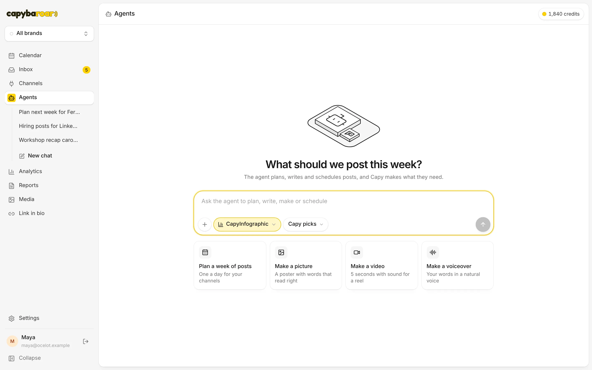
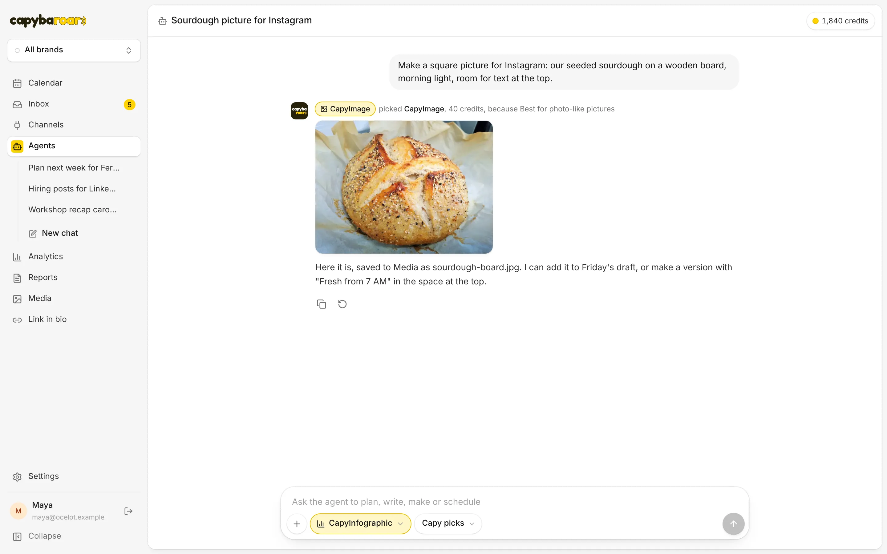

import { Aside, CardGrid, LinkCard, LinkButton, Steps } from '@astrojs/starlight/components';

The agent is Claude with every Capybaroar action. Tell it what you need and it plans and writes posts, makes pictures and videos, and reads your results.

<LinkButton href="https://app.capybaroar.com/agents" variant="secondary" icon="external">Open in Capybaroar</LinkButton>

## What the agent can do

- Look at your channels and recent posts, then plan and write new ones.
- Save posts as drafts at your queue times, or schedule them when you ask.
- Make pictures and videos for posts and attach them when they're ready.
- Read your analytics and tell you which posts did best.
- Edit or delete posts. It asks before deleting.

It uses the same actions and checks you do, so it can't go past your plan's limits or post to a channel you can't use.

## Start a chat

<Steps>

1. **Open Agents.** Click **Agents** in the sidebar, then **New chat**.

   

1. **Say what you want.** For example: "Plan next week for our bakery launch: one LinkedIn post a day, Monday to Friday at 10 AM. Save them as drafts."

1. **Check the drafts.** The agent tells you what it saved. Open them in the calendar to edit, then schedule.

</Steps>

A new chat offers starting points like **Plan a week of posts** or **Posts from a link**. Click one to fill in the message, then change it to fit. Your chats stay under **Agents** in the sidebar.

## Drafts first

The agent saves drafts unless you ask it to schedule. Nothing goes out until you, or the agent on your request, schedule it.

## Pictures, videos and sound

On plans with AI, the **Make** menu in the message box says what the agent makes for that message:

| Make | What you get |
| - | - |
| **CapyInfographic** | Graphics, charts and banners in your brand |
| **CapyMotion** | Animated videos with your words and numbers |
| **Auto** | The agent decides what each post needs |
| **CapyImage** | Pictures and edits |
| **CapyVideo** | Short videos with sound |
| **CapyAudio** | Voiceovers, music and sound effects |

Each one shows what it costs from, in credits. Pick a **Model** if you want a certain one, or leave it empty and Capy picks. To work from your own files, press **+** and add them from Media. Audio goes to your media library, since a post can't hold sound on its own.

## The Agents screen

| Part | What it does |
| - | - |
| **New chat** | Starts a chat. It's under **Agents** in the sidebar, with your 6 newest chats and **All chats**. |
| The message box | Says **Ask the agent to plan, write, make or schedule**. Press Enter to send, and Shift+Enter for a new line. |
| **+** | Adds files from Media for the agent to use |
| **Make** | What the agent makes for this message (below) |
| **Model** | **Capy picks**, or a model you choose for pictures, videos and audio |
| **Copy** | Copies an answer |
| **Ask again** | Sends your last message again, when an answer failed |
| **More for `<chat>`** | In the sidebar: **Delete** a chat after **Delete "`<title>`"?** |

A new chat offers six starting points: **Plan a week of posts**, **Posts from a link**, **What worked**, **Make a picture**, **Make a video** and **Make a voiceover**.

When the agent changes something, the chat shows a short line for it, like **Saved 5 posts**, **Changed a post**, **Deleted a post everywhere**, **Added a file** or **Will attach when done**. Reading your channels or results shows no line.

## What it can use

The agent has every action of the [MCP server](/api-reference/mcp-tools/): list brands, channels, groups, campaigns, posts and media; create, change and delete posts; find the next queue time; upload files from a link; make AI files; read credits and analytics; and manage webhooks for owners and admins. It also has **attach when done**, which adds a video to a draft as soon as it's made.

Its rules:

- It lists your channels before writing, and only uses channels that exist.
- It keeps each post within its network's limit and fills required settings.
- It saves drafts unless you clearly ask to schedule or post.
- Before anything that can't be undone, or that people outside will see, it asks you first: deleting, posting now, webhooks, and uploading from a link.
- It never makes up facts, numbers, quotes or customer names.
- For a graphic with words or numbers, it uses CapyInfographic, and asks for the brand's website the first time.

One message can take up to 20 steps, like reading channels, writing posts and saving them.

## Who can use it

Owners, admins and editors on a paid plan. Clients can't. Chats are your own: others in the workspace don't see them. A chat is kept for 365 days after its last message.

## What it costs

The agent is on paid plans and uses [AI credits](/ai/ai-credits/). Each message costs what it really used, at least 2 credits. While it works, it holds 200 credits at a time and gives back what it didn't use. Pictures and videos it makes are charged on their own, at the prices in [Make pictures, videos and audio](/ai/ai-media/#what-each-model-costs).

<Aside type="tip">
The agent knows your brand's voice, words to avoid and hashtags when you fill in the brand kit. See [Brands](/workspace/brands/#the-brand-kit).
</Aside>

## Related

<CardGrid>
  <LinkCard title="Plan a week of posts with the agent" href="/ai/plan-a-week/" />
  <LinkCard title="AI credits" href="/ai/ai-credits/" />
  <LinkCard title="Use Capybaroar from Claude, ChatGPT or Cursor" href="/ai/mcp/" />
</CardGrid>
