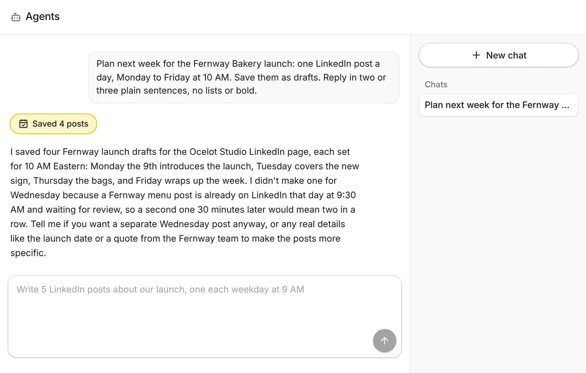

import { Aside, CardGrid, LinkCard, LinkButton, Steps } from '@astrojs/starlight/components';

The agent is Claude with every Capybaroar action. Tell it what you need and it plans and writes posts, makes pictures and videos, and reads your results.

<LinkButton href="https://app.capybaroar.com/agents" variant="secondary" icon="external">Open in Capybaroar</LinkButton>

## What the agent can do

- Look at your channels and recent posts, then plan and write new ones.
- Save posts as drafts at your queue times, or schedule them when you ask.
- Make pictures and videos for posts and attach them when they're ready.
- Read your analytics and tell you which posts did best.
- Edit or delete posts. It asks before deleting.

It uses the same actions and checks you do, so it can't go past your plan's limits or post to a channel you can't use.

## Start a chat

<Steps>

1. **Open Agents.** Click **Agents** in the sidebar, then **New chat**.

1. **Say what you want.** For example: "Plan next week for our bakery launch: one LinkedIn post a day, Monday to Friday at 10 AM. Save them as drafts."

1. **Check the drafts.** The agent tells you what it saved. Open them in the calendar to edit, then schedule.

</Steps>

A new chat offers starting points like **Plan a week of posts** or **Posts from a link**. Click one to fill in the message, then change it to fit. Your chats stay under **Agents** in the sidebar.

## Drafts first

The agent saves drafts unless you ask it to schedule. Nothing goes out until you, or the agent on your request, schedule it.

## Pictures, videos and sound

On plans with AI, the **Make** menu in the message box says what the agent makes for that message:

| Make | What you get |
| - | - |
| **CapyInfographic** | Graphics, charts and banners in your brand |
| **CapyMotion** | Animated videos with your words and numbers |
| **Auto** | The agent decides what each post needs |
| **CapyImage** | Pictures and edits |
| **CapyVideo** | Short videos with sound |
| **CapyAudio** | Voiceovers, music and sound effects |

Each one shows what it costs from, in credits. Pick a **Model** if you want a certain one, or leave it empty and Capy picks. To work from your own files, press **+** and add them from Media. Audio goes to your media library, since a post can't hold sound on its own.

## What it costs

The agent is on paid plans and uses [AI credits](/ai/ai-credits/). Each message costs what it really used, with a small minimum. Pictures and videos it makes are charged on their own.

<Aside type="tip">
The agent knows your brand's voice, words to avoid and hashtags when you fill in the brand kit. See [Team and roles](/workspace/team-and-roles/#brand-kit).
</Aside>

## Related

<CardGrid>
  <LinkCard title="Plan a week of posts with the agent" href="/ai/plan-a-week/" />
  <LinkCard title="AI credits" href="/ai/ai-credits/" />
  <LinkCard title="Use Capybaroar from Claude, ChatGPT or Cursor" href="/ai/mcp/" />
</CardGrid>
