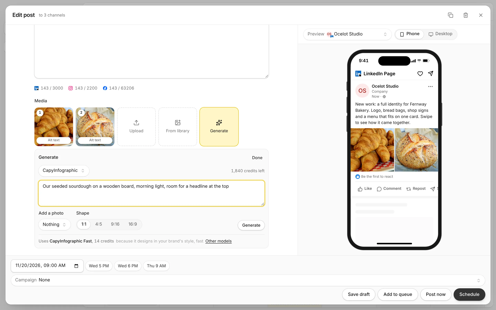

import { Aside, CardGrid, LinkCard, LinkButton, Steps } from '@astrojs/starlight/components';

**Generate** makes a file with AI and puts it in your media library, ready for any post. It needs a paid plan, and uses [AI credits](/ai/ai-credits/).

<LinkButton href="https://app.capybaroar.com/media" variant="secondary" icon="external">Open in Capybaroar</LinkButton>

## Where to find it

- **Media**: press **Generate** at the top right.
- **The post editor**: press **Generate** in the **Media** area. The file is added to the post when it's ready.
- **Agents**: ask the agent for a picture or video while it writes posts. See [The AI agent](/ai/agent/).
- **The API and MCP**: [`POST /generations`](/api-reference/generations/) and the `generate_media` tool.

## What you can make

| Kind | What it makes | Example prompt |
| - | - | - |
| **CapyInfographic** | Graphics, charts and banners in your brand's look. Claude designs it and Capybaroar draws it, so the words are spelled right. | "3 tips to sleep better: dark room, no screens after 10, same wake-up time every day" |
| **CapyMotion** | An animated video of 6 to 30 seconds: stats that count up, bars, lists, quotes and a call to action | "73% of owners check cash flow weekly (our 2026 survey). 3 steps to do it in 10 minutes." |
| **CapyImage** | Pictures, and edits of a picture | "A poster that says "Grand opening Saturday" on a sunny coffee shop window" |
| **CapyVideo** | Short videos with sound | "A capybara surfing at sunset, slow push-in" |
| **CapyAudio** | Voiceovers, music and sound effects | "Upbeat background music for a 15-second product reel" |

## Make a file

<Steps>

1. **Pick what to make** in the menu at the top. It starts on **CapyInfographic**. The credits you have left show on the right.

1. **Write the prompt.** For infographics and animations, write the content: a headline, the points, the numbers and their source. For pictures and videos, describe the scene: subject, setting, light and style, and for a video what moves. For audio, write the exact words of a voiceover, or describe the music or sound. For a song, write the style, then `Lyrics:` and the words.

1. **Set the options** that show for that kind:
   - **Edit a picture** (CapyImage), **Start from** (CapyVideo) or **Add a photo** (CapyInfographic and CapyMotion): pick a picture from your library, or **Nothing**.
   - **Shape**: **1:1**, **9:16** or **16:9**. Infographics and animations also take **4:5**. Pictures start at 1:1, and animations at 9:16.
   - **Length**: **5s** or **10s**, for videos and sound effects.

1. **Check the line under the form.** It says which model will make it and what it costs, like **Uses FLUX.2 Pro, 6 credits because it's fast and sharp for everyday posts**. Press **Other models** to pick one yourself, or **Let Capy pick**.

1. **Press Generate.** A waiting tile shows while it's made. Pictures take seconds, videos and animations a few minutes. When it's done, it lands in Media.

</Steps>

## How Capy picks a model

Capy reads your prompt and uses the first rule that fits.

| Kind | When your prompt has | Capy picks | Why it says |
| - | - | - | - |
| CapyInfographic | Premium, detailed, a lot of data, a report | CapyInfographic Best | it's a detailed design |
| CapyInfographic | Anything else | CapyInfographic Fast | it designs in your brand's style, fast |
| CapyMotion | Anything | CapyMotion | it animates your words and numbers |
| CapyImage | A picture to edit | Nano Banana 2 Edit | you added a picture, so Capy edits it |
| CapyImage | Words to print: quotes, a headline, a sign, a logo, a poster, a banner | Ideogram V3 | it spells words right |
| CapyImage | Premium, hero, 4K, detailed, magazine, cover, luxury | Nano Banana Pro | you asked for top quality |
| CapyImage | Anything else | FLUX.2 Pro | it's fast and sharp for everyday posts |
| CapyVideo | Someone talks: says, speaks, interview, voice | Seedance 2.0 Fast | it matches lips to speech |
| CapyVideo | An ad, cinematic, premium, trailer, film | Veo 3.1 | you asked for a cinematic look |
| CapyVideo | Anything else | Kling 3 Pro | good motion with sound at a fair price |
| CapyAudio | A song with `Lyrics:` | MiniMax Music v2 | you wrote lyrics |
| CapyAudio | Music, a beat, a jingle, a track | Lyria 2 | you asked for music |
| CapyAudio | A sound effect, a whoosh, a ding | ElevenLabs Sound Effects | you asked for a sound effect |
| CapyAudio | Anything else | ElevenLabs Turbo v2.5 | it reads your words in a natural voice |

## What each model costs

| Model | Kind | Credits |
| - | - | - |
| CapyInfographic Fast | Infographic | 14 |
| CapyInfographic Best | Infographic | 24 |
| CapyMotion | Animation | 20 |
| FLUX.2 Pro | Picture | 6 |
| Ideogram V3 | Picture | 6 |
| Nano Banana 2 | Picture | 16 |
| Nano Banana 2 Edit | Picture edit | 16 |
| Nano Banana Pro | Picture | 30 |
| Kling 3 Pro | Video | 168 for 5s, 336 for 10s |
| Seedance 2.0 Fast | Video | 242 for 5s, 484 for 10s |
| Veo 3.1 | Video | 480 for 5s (made as 6s), 640 for 10s (made as 8s) |
| ElevenLabs Turbo v2.5 | Voiceover | 1 for every 100 characters |
| ElevenLabs v3 | Voiceover | 2 for every 100 characters |
| Lyria 2 | Music | 20 |
| Stable Audio 2.5 | Music, 30 seconds | 40 |
| MiniMax Music v2 | Song | 6 |
| ElevenLabs Sound Effects | Sound effect | 2 for 5s, 4 for 10s |

Every price is 2 times what the model costs Capybaroar, rounded up, and at least 1 credit. No single file can cost more than 1,000. If a file fails, its credits come back.

## Your brand's look

CapyInfographic and CapyMotion use the brand's colors, fonts and logo. The first time, they read them from the brand's website. Set the site in **Settings**, **Brands**, or the agent asks for it. See [Brands](/workspace/brands/).

## Where the file goes

- It lands in **Media**, in the brand you're working in.
- From the post editor, it's added to the post too.
- Audio can't go on a post on its own. Use it in a video you edit elsewhere.

<Aside type="note">
Claude's directory app doesn't offer AI pictures and videos. Make them in Capybaroar, or connect Claude with an MCP link from **Settings**, **API and MCP**.
</Aside>

## Related

<CardGrid>
  <LinkCard title="AI credits" href="/ai/ai-credits/" />
  <LinkCard title="The media library" href="/publishing/media-library/" />
  <LinkCard title="Errors with media and AI files" href="/errors/media/#ai-pictures-videos-infographics-and-audio" />
</CardGrid>
