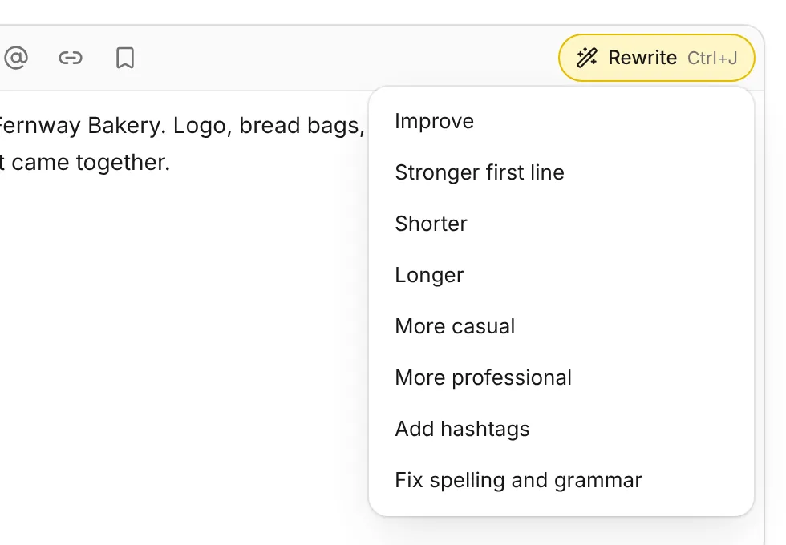
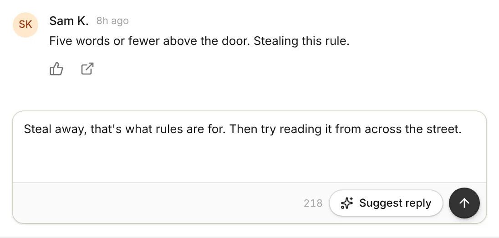

import { CardGrid, LinkCard, LinkButton, Steps } from '@astrojs/starlight/components';

In the post editor, AI can rewrite your text, fit it to each network and suggest replies in the Inbox.

<LinkButton href="https://app.capybaroar.com/calendar" variant="secondary" icon="external">Open in Capybaroar</LinkButton>

## Rewrite a post

<Steps>

1. **Open a post** in the calendar, or click **New post**.

1. **Write a first version**, even a rough one.

1. **Press Rewrite** in the text toolbar, or Ctrl+J (⌘J on a Mac), and keep the version you like.

</Steps>

The **Rewrite** menu has **Improve**, **Stronger first line**, **Shorter**, **Longer**, **More casual**, **More professional**, **Add hashtags** and **Fix spelling and grammar**. To ask for something else, type it in the box at the bottom of the menu and Claude changes the text that way. Your browser's undo (Ctrl+Z) takes a rewrite back.

## Fit to each network

One post rarely fits every network as is. X has 280 characters and LinkedIn has 3,000. Open a channel's tab and change the text for that network only, or ask AI to fit it with **Fit to this network** in the **Rewrite** menu. Each network's preview updates as you go.

## Threads, polls, carousels and slideshows

When the post goes to a network that takes them, the **Rewrite** menu can also **Write a thread**, **Write an X poll**, **Make a LinkedIn carousel** or **Make a TikTok slideshow** from your text.

## Suggested replies in the Inbox

In the **Inbox**, open a comment and press **Suggest reply**. Edit the draft and send it.

## What it costs

Each rewrite, fit, caption or suggested reply costs 4 [AI credits](/ai/ai-credits/). A thread, poll, carousel or slideshow costs 10. AI writing is on paid plans.

## Related

<CardGrid>
  <LinkCard title="AI credits" href="/ai/ai-credits/" />
  <LinkCard title="Schedule your first post" href="/get-started/schedule-your-first-post/" />
  <LinkCard title="The AI agent" href="/ai/agent/" />
</CardGrid>
