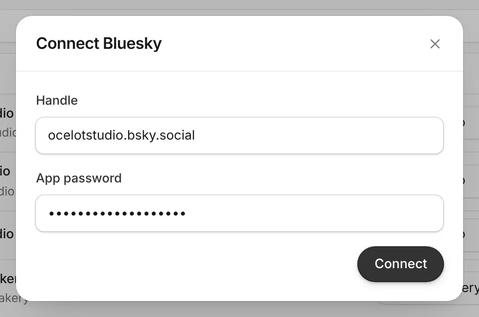
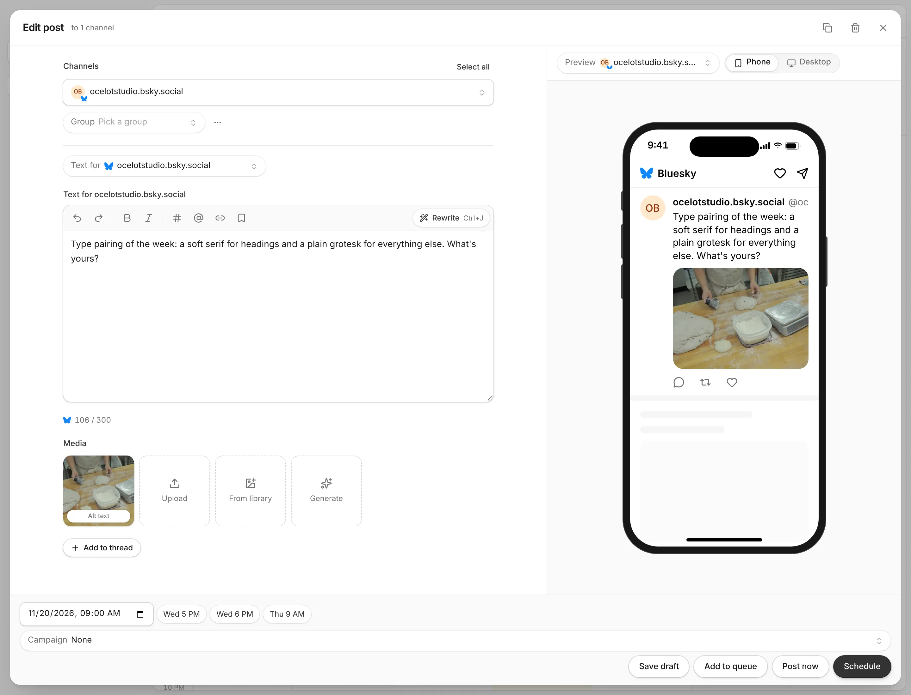

import { Aside, CardGrid, LinkCard, LinkButton, Steps } from '@astrojs/starlight/components';

How to connect Bluesky, what you can post there and how to fix a post it turns down.

<LinkButton href="https://app.capybaroar.com/channels" variant="secondary" icon="external">Open in Capybaroar</LinkButton>

## At a glance

| | |
| - | - |
| **Characters** | 300 a post |
| **Needs a picture or video** | No |
| **Threads** | Yes, up to 25 posts |
| **Connects with** | A short form: handle and app password |
| **Inbox** | Replies and mentions: answer and like |
| **Analytics** | Likes, replies, reposts and quotes |
| **Change after it goes out** | No |
| **Delete everywhere** | Yes |

## Connect Bluesky

Bluesky connects with an app password, so your real password stays private.

<Steps>

1. **Make an app password.** In Bluesky, open **Settings**, then **Privacy and security**, then **App passwords**, and add one.

1. **Connect in Capybaroar.** Click Bluesky in **Channels** and enter your handle and the app password.

   

</Steps>

### What Capybaroar asks for

Bluesky has no sign-in page for apps, so it connects with an app password. An app password can post, reply and like as you. It can't change your real password, and you can delete it in Bluesky at any time.

## Post to Bluesky

<Steps>

1. **Open the calendar** and click **New post**.

1. **Pick your Bluesky channel** and write the post.

1. **Open the Bluesky tab** to set the options below.

1. **Check the preview**, then schedule, queue or post now.

</Steps>

- Press Add to thread under the text to post a thread: each post goes out as a reply to the one before, with its own text and files, up to 25 posts.
- Posts can be up to 300 characters.
- A post takes up to 4 pictures, each under 1 MB. Videos aren't supported yet.
- In the Inbox you can answer and like replies and mentions.

## Limits

| | |
| - | - |
| **Text** | 300 characters a post |
| **Pictures** | Up to 4, each under 1 MB |
| **Video** | Not yet |
| **Thread** | The first post and up to 24 replies |
| **Alt text** | Sent with each picture |

Capybaroar checks these before a post is scheduled, so a post that breaks one is stopped before it's scheduled, with the reason under the text.

## Results and Inbox

Bluesky's counts are public, so Capybaroar reads **likes**, **replies** (as comments) and **reposts and quotes** (as shares). Follower counts are saved once a day. Capybaroar reads each post's numbers 1 hour, 1 day, 7 days and 30 days after it goes out, so a post's numbers fill in over its first month. They show in **Analytics**, on the post itself and in [reports](/results/reports/).

The Inbox shows replies to your posts and mentions of you. You can answer and like them. Capybaroar checks for new items every 10 minutes and looks back up to 7 days. Items you answer move to **Done**. See [Inbox](/results/inbox/).

## After it goes out

Bluesky doesn't let apps change a post. **Delete everywhere** deletes it on Bluesky. See [Edit and delete posts that went out](/publishing/edit-and-delete/).

## Disconnect or reconnect

Open **Channels**, find the channel and press **Remove** (the bin icon), then **Remove** again. Owners, admins and editors (for their brands) can do this.

- Scheduled posts stop going to this channel.
- The channel's Inbox items and results go with it, and posts that went out to it lose this channel's numbers in Analytics.
- The plan's channel count goes down by one, so you can add another.
- Delete the app password in Bluesky too, so it can't be used again.

When Bluesky stops taking posts from Capybaroar, the channel shows **Reconnect** in red on **Channels**. Owners and admins get an email, at most once a day, and webhooks get a `channel.reconnect` event. Press **Reconnect** (the arrows icon) and sign in again, or fill in the connect form again for networks that use one. Posts due while it was signed out fail with `Reconnect <channel name>`. Open each one and schedule it again.

## If a post is turned down

Capybaroar checks each post before it's scheduled and shows the reason under the text. Some messages come from Bluesky when the post goes out. These are the Bluesky ones:

| Message | What to do |
| - | - |
| `Wrong handle or app password` | Check the handle (like name.bsky.social) and make a new app password if needed. |
| `Bluesky posts are up to 300 characters` | Shorten the text in the Bluesky tab. |
| `Bluesky pictures must be under 1 MB` | Use smaller pictures. |
| `Wrong handle or app password` | Check the handle (like `you.bsky.social`) and make a new app password. |
| `Bluesky videos aren't supported yet` | Use pictures. |
| `Bluesky takes up to 4 pictures` | Remove pictures until there are 4 or fewer. |
| `Bluesky pictures must be under 1 MB` | Use smaller pictures. |

Read more about scheduling Bluesky on the [Bluesky scheduler](https://capybaroar.com/bluesky-scheduler) page.

## Related

<CardGrid>
  <LinkCard title="Compare every network" href="/channels/" />
  <LinkCard title="Connect your first channel" href="/get-started/connect-a-channel/" />
  <LinkCard title="Schedule your first post" href="/get-started/schedule-your-first-post/" />
</CardGrid>
