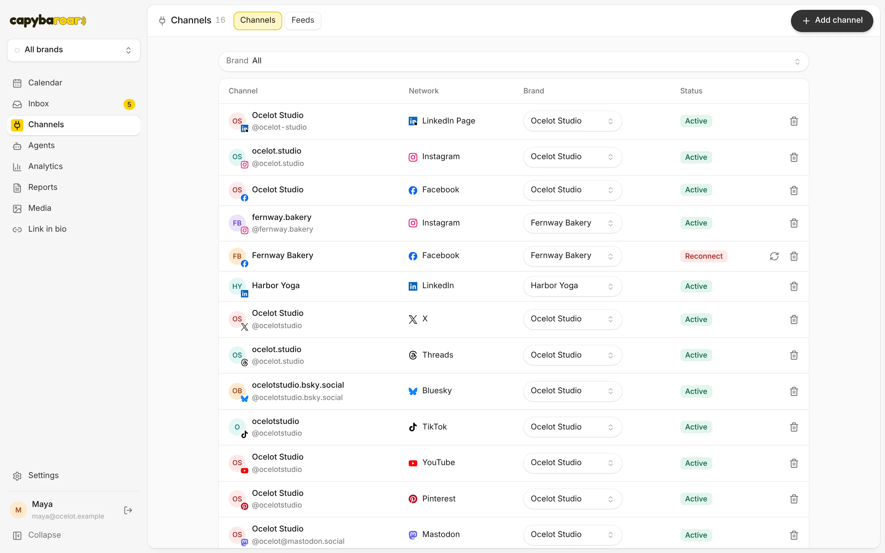
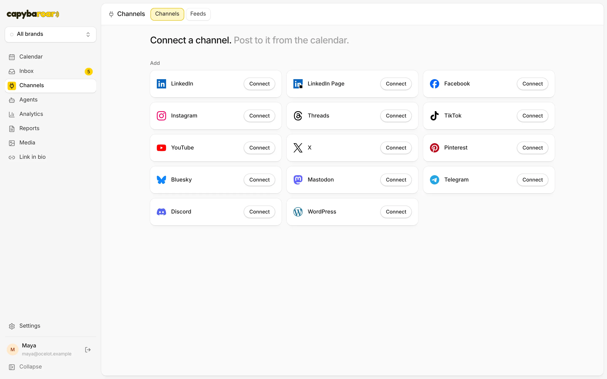
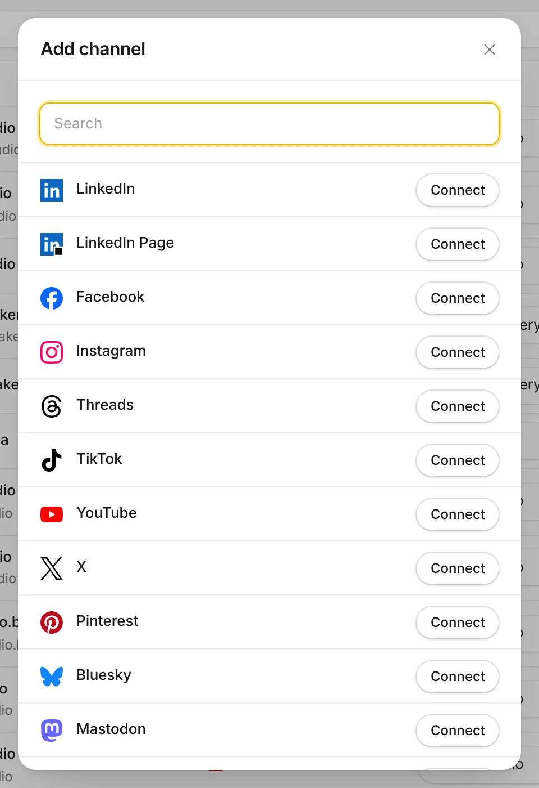

import { Aside, CardGrid, LinkCard, LinkButton, Steps } from '@astrojs/starlight/components';

**Channels** lists every social account connected to the workspace. It's where you add a new one, sign in again when one is signed out, move one to another brand and remove one you no longer use.

<LinkButton href="https://app.capybaroar.com/channels" variant="secondary" icon="external">Open in Capybaroar</LinkButton>

## Who can use it

| Role | What they can do here |
| - | - |
| **Owner**, **Admin** | Everything: add, reconnect, remove, and move channels between brands |
| **Editor** | Add, reconnect and remove channels in their brands. They see only their brands' channels. |
| **Client** | Can't open Channels. Clients go to the calendar. |

## The two tabs

The header has two tabs, each with its own address:

- **Channels** (`/channels`): the list on this page.
- **Feeds** (`/channels/feeds`): RSS feeds that turn new articles into posts. See [RSS feeds](/publishing/rss-feeds/).

The count beside the title is how many channels you see.

## The first time

With no channels yet, the screen shows **Connect a channel. Post to it from the calendar.** and a card for each network with a **Connect** button.

A network shows **Soon** in place of **Connect** while its sign-in isn't set up on Capybaroar's side.

## Add a channel

<Steps>

1. **Press Add channel** at the top right.

1. **Find the network.** Type in **Search** to narrow the list, then press **Connect** beside it.

   

1. **Sign in, or fill in the form.** Most networks send you to their own sign-in page. Bluesky, Discord, Telegram and WordPress ask for a few details in a **Connect** form. Mastodon asks for your server first, then sends you there to sign in.

1. **Come back to Channels.** The new channel shows in the list with the status **Active**.

</Steps>

New channels go into the brand picked in the sidebar's brand menu. With **All brands** picked, they have no brand until you give them one. Reconnecting an account that's already here updates it in place and keeps its brand.

If the sign-in fails, Channels shows the reason in red at the top, like `No Facebook Pages were shared with Capybaroar`. Each [network's page](/channels/) lists its messages.

## The list

| Column | What it shows |
| - | - |
| **Channel** | The account's picture and name, and its @handle when the network has one |
| **Network** | The network's logo and name |
| **Brand** | A menu with the channel's brand. Shown to owners and admins in workspaces with more than one brand. |
| **Status** | **Active** in green, or **Reconnect** in red |
| (actions) | **Reconnect** (shown only when needed) and **Remove** |

With more than one brand, the **Brand** menu above the list filters it: **All**, one brand, or **No brand**. When nothing matches, the list says **No matches**.

## Move a channel to another brand

Owners and admins pick a brand in the channel's **Brand** menu. The move saves at once. Its scheduled posts keep going out. A channel can't be left with no brand once it has one.

Brands keep each client's channels, posts and files apart. See [Brands](/workspace/brands/).

## Reconnect a channel

A channel shows **Reconnect** when its network stops taking posts from Capybaroar, for example after a password change, a removed permission or an expired sign-in. Press **Reconnect** (the arrows icon) and sign in again, or fill in the form again.

While a channel needs reconnecting:

- New posts to it are refused with `Reconnect <channel name> first`.
- Posts that come due fail with `Reconnect <channel name>`. Open each one from the calendar and schedule it again after you reconnect.
- Owners and admins get an email about it, at most once a day.
- Webhooks that asked for it get a [`channel.reconnect`](/api-reference/webhook-events/#channelreconnect) event, once.

## Remove a channel

<Steps>

1. **Press Remove** (the bin icon) on the channel's row.

1. **Confirm.** The box asks **Remove `<name>`?** and says **Scheduled posts stop going to this channel.** Press **Remove**.

</Steps>

When a channel is removed:

- Scheduled posts stop going to it. Posts to other channels still go out.
- Its Inbox items and results are deleted, so Analytics no longer counts its posts.
- Capybaroar ends its access on TikTok, X and YouTube, as those networks ask. For other networks, also remove the app, app password, bot or webhook on the network's side.
- The removal shows in the [audit log](/workspace/audit-log/).

<Aside type="caution">
Removing a channel can't be undone. To post to it again, connect it again. Past results don't come back.
</Aside>

## How many channels you can have

| Plan | Channels |
| - | - |
| Free | 3 |
| Creator | 8 |
| Pro | 30 |
| Agency | 100 |

A connect that would go over the limit is refused with `Your plan allows <n> channels. Upgrade to add more.` Facebook and LinkedIn Pages count one each, so connecting five Pages at once uses five. During the 14-day trial you get Pro's 30.

## Related

<CardGrid>
  <LinkCard title="Compare every network" href="/channels/" />
  <LinkCard title="Connect your first channel" href="/get-started/connect-a-channel/" />
  <LinkCard title="Brands" href="/workspace/brands/" />
</CardGrid>
