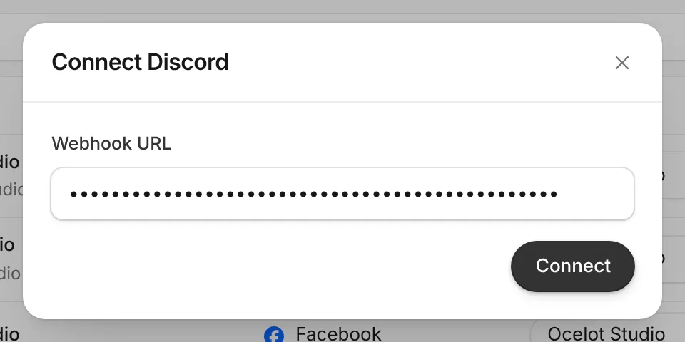
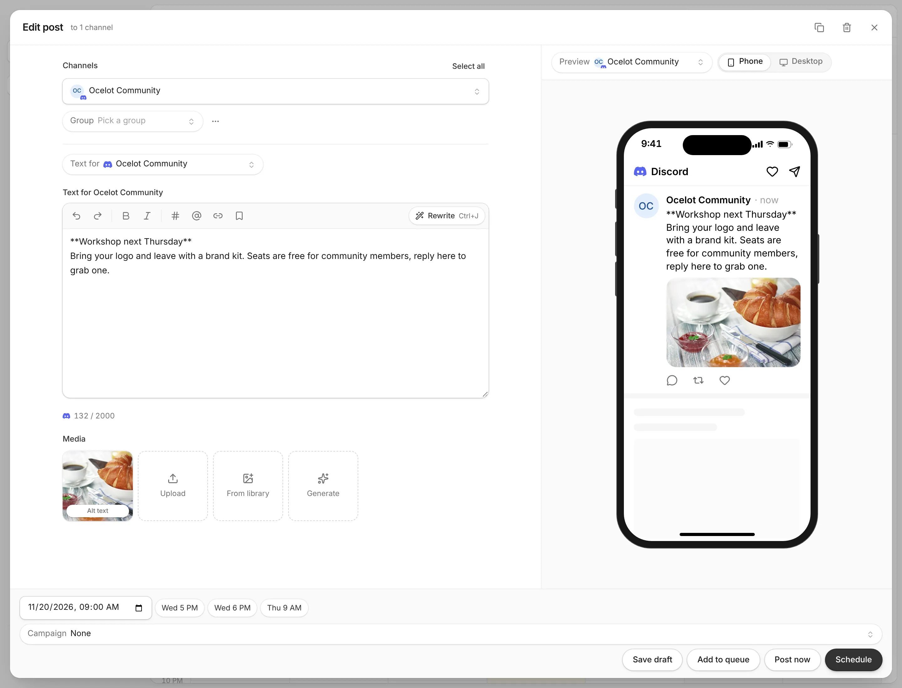

import { Aside, CardGrid, LinkCard, LinkButton, Steps } from '@astrojs/starlight/components';

How to connect Discord, what you can post there and how to fix a post it turns down.

<LinkButton href="https://app.capybaroar.com/channels" variant="secondary" icon="external">Open in Capybaroar</LinkButton>

## At a glance

| | |
| - | - |
| **Characters** | 2,000 |
| **Needs a picture or video** | No |
| **Connects with** | A short form: a webhook URL |
| **Inbox** | No |
| **Analytics** | No |
| **Change after it goes out** | Yes, the text |
| **Delete everywhere** | Yes |

## Connect Discord

Discord connects with a webhook, a private link that posts into one channel.

<Steps>

1. **Make a webhook.** In Discord, open the channel's settings, then **Integrations**, then **Webhooks**, create one and copy its URL.

1. **Connect in Capybaroar.** Click Discord in **Channels** and paste the webhook URL.

   

</Steps>

### What Capybaroar asks for

A webhook can only post messages into its one channel. It can't read the server, its members or other channels.

## Post to Discord

<Steps>

1. **Open the calendar** and click **New post**.

1. **Pick your Discord channel** and write the post.

1. **Open the Discord tab** to set the options below.

1. **Check the preview**, then schedule, queue or post now.

</Steps>

- Messages can be up to 2,000 characters.
- A message takes up to 10 files, each under 10 MB.
- Each webhook posts to one channel. Add another webhook for another channel.

## Limits

| | |
| - | - |
| **Text** | 2,000 characters |
| **Files** | Up to 10, each under 10 MB |
| **Alt text** | Sent as each file's description |

Capybaroar checks these before a post is scheduled, so a post that breaks one is stopped before it's scheduled, with the reason under the text.

## Results and Inbox

Discord webhooks can't read reactions or views, so Discord posts show in Analytics without numbers.

Discord doesn't come into the Inbox.

## After it goes out

Open the post, press **Edit**, change the text and press **Save changes**. **Delete everywhere** deletes the message. If someone already deleted it, you see `This message is no longer on Discord`. See [Edit and delete posts that went out](/publishing/edit-and-delete/).

## Disconnect or reconnect

Open **Channels**, find the channel and press **Remove** (the bin icon), then **Remove** again. Owners, admins and editors (for their brands) can do this.

- Scheduled posts stop going to this channel.
- The channel's Inbox items and results go with it, and posts that went out to it lose this channel's numbers in Analytics.
- The plan's channel count goes down by one, so you can add another.
- Delete the webhook in Discord too, under the channel's **Integrations**, so the URL can't post again.

When Discord stops taking posts from Capybaroar, the channel shows **Reconnect** in red on **Channels**. Owners and admins get an email, at most once a day, and webhooks get a `channel.reconnect` event. Press **Reconnect** (the arrows icon) and sign in again, or fill in the connect form again for networks that use one. Posts due while it was signed out fail with `Reconnect <channel name>`. Open each one and schedule it again.

## If a post is turned down

Capybaroar checks each post before it's scheduled and shows the reason under the text. Some messages come from Discord when the post goes out. These are the Discord ones:

| Message | What to do |
| - | - |
| `This Discord webhook doesn't exist or was deleted` | Make a new webhook in Discord and connect it again. |
| `Discord takes up to 10 files` | Remove files until there are 10 or fewer. |
| `Discord files must be under 10 MB` | Use smaller files. |
| `Enter a Discord webhook URL, like https://discord.com/api/webhooks/...` | Paste the whole URL you copied from Discord. |
| `This Discord webhook doesn't exist or was deleted` | Make a new webhook and connect again. |
| `Discord files must be under 10 MB (…)` | Use a smaller file. |

Read more about scheduling Discord on the [Discord scheduler](https://capybaroar.com/discord-message-scheduler) page.

## Related

<CardGrid>
  <LinkCard title="Compare every network" href="/channels/" />
  <LinkCard title="Connect your first channel" href="/get-started/connect-a-channel/" />
  <LinkCard title="Schedule your first post" href="/get-started/schedule-your-first-post/" />
</CardGrid>
