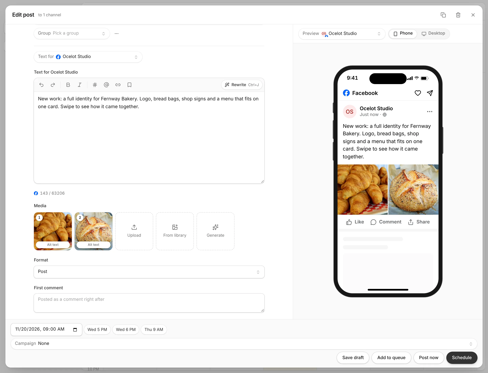

import { Aside, CardGrid, LinkCard, LinkButton, Steps } from '@astrojs/starlight/components';

How to connect Facebook, what you can post there and how to fix a post it turns down.

<LinkButton href="https://app.capybaroar.com/channels" variant="secondary" icon="external">Open in Capybaroar</LinkButton>

## At a glance

| | |
| - | - |
| **Characters** | 63,206 |
| **Needs a picture or video** | No |
| **Formats** | Post, Reel, Story |
| **Connects with** | Sign-in with Meta (Pages) |
| **Inbox** | Comments and replies: answer, like and hide |
| **Analytics** | Reach, views, reactions, comments, shares and clicks |
| **Change after it goes out** | Yes, the text of a post |
| **Delete everywhere** | Yes |

## Connect Facebook

Click Facebook in Channels, sign in with Meta and pick the Facebook Pages you want to add. Capybaroar posts to Pages.

### What Capybaroar asks for

Capybaroar asks Meta to list your Pages, publish to them, read and manage engagement on them, read insights, and see the business that owns them. You pick which Pages to share during sign-in. Each Page you share becomes its own channel. If you share none, you see `No Facebook Pages were shared with Capybaroar`.

## Post to Facebook

<Steps>

1. **Open the calendar** and click **New post**.

1. **Pick your Facebook channel** and write the post.

1. **Open the Facebook tab** to set the options below.

1. **Check the preview**, then schedule, queue or post now.

</Steps>

- Choose Post, Reel or Story in the Facebook tab.
- A post takes one video, or pictures only. A Reel is one video, and a Story is one picture or video.
- Add a first comment for links or extra details.

## Facebook settings

| Setting | Choices |
| - | - |
| **Format** | Post, Reel, Story (starts as Post) |
| **First comment** | Posted as a comment right after the post |

## Limits

| | |
| - | - |
| **Text** | 63,206 characters |
| **Post** | Text, pictures, or one video |
| **Reel** | One video |
| **Story** | One picture or one video, no text |
| **First comment** | Posted right after the post. Stories have none. |

Capybaroar checks these before a post is scheduled, so a post that breaks one is stopped before it's scheduled, with the reason under the text.

## Results and Inbox

Facebook sends back **reactions** (counted as likes), **comments**, **shares**, **reach** and **clicks** for a post. Videos and Reels send **views** and **reach**. Stories send no numbers. Follower counts are saved once a day. Capybaroar reads each post's numbers 1 hour, 1 day, 7 days and 30 days after it goes out, so a post's numbers fill in over its first month. They show in **Analytics**, on the post itself and in [reports](/results/reports/).

The Inbox shows comments and replies on your Page's 15 newest posts. You can answer, like and hide them. Messenger conversations are coming soon. Capybaroar checks for new items every 10 minutes and looks back up to 7 days. Items you answer move to **Done**. See [Inbox](/results/inbox/).

## After it goes out

You can change the text of a post after it goes out: open it, press **Edit**, then **Save changes**. Facebook doesn't let apps change a video's or Reel's text (`Facebook doesn't let apps change a video's or Reel's text. Edit it on Facebook.`), and a Story has no text to change. **Delete everywhere** deletes the post on Facebook. See [Edit and delete posts that went out](/publishing/edit-and-delete/).

## Disconnect or reconnect

Open **Channels**, find the channel and press **Remove** (the bin icon), then **Remove** again. Owners, admins and editors (for their brands) can do this.

- Scheduled posts stop going to this channel.
- The channel's Inbox items and results go with it, and posts that went out to it lose this channel's numbers in Analytics.
- The plan's channel count goes down by one, so you can add another.

When Facebook stops taking posts from Capybaroar, the channel shows **Reconnect** in red on **Channels**. Owners and admins get an email, at most once a day, and webhooks get a `channel.reconnect` event. Press **Reconnect** (the arrows icon) and sign in again, or fill in the connect form again for networks that use one. Posts due while it was signed out fail with `Reconnect <channel name>`. Open each one and schedule it again.

## If a post is turned down

Capybaroar checks each post before it's scheduled and shows the reason under the text. Some messages come from Facebook when the post goes out. These are the Facebook ones:

| Message | What to do |
| - | - |
| `Facebook takes one video, or pictures only` | Use one video on its own, or only pictures. |
| `A Facebook Reel is one video` | Keep one video for a Reel. |
| `A Facebook Story is one picture or video` | Keep one file for a Story. |
| `No Facebook Pages were shared with Capybaroar` | Connect again and tick the Pages you want during the Meta sign-in. |
| `Facebook didn't publish the Story` | Try again with one picture or one short video. |
| `A Facebook Reel is one video` | Use one video for a Reel. |
| `A Facebook Story is one picture or video` | Keep one file for a Story. |
| `Facebook takes one video, or pictures only` | Use one video on its own, or only pictures. |

Read more about scheduling Facebook on the [Facebook scheduler](https://capybaroar.com/facebook-post-scheduler) page.

## Related

<CardGrid>
  <LinkCard title="Compare every network" href="/channels/" />
  <LinkCard title="Connect your first channel" href="/get-started/connect-a-channel/" />
  <LinkCard title="Schedule your first post" href="/get-started/schedule-your-first-post/" />
</CardGrid>
