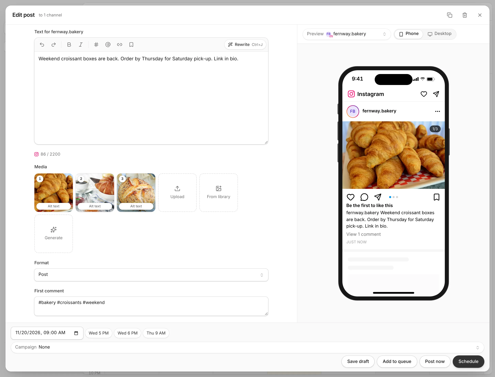

import { Aside, CardGrid, LinkCard, LinkButton, Steps } from '@astrojs/starlight/components';

How to connect Instagram, what you can post there and how to fix a post it turns down.

<LinkButton href="https://app.capybaroar.com/channels" variant="secondary" icon="external">Open in Capybaroar</LinkButton>

## At a glance

| | |
| - | - |
| **Characters** | 2,200 |
| **Needs a picture or video** | Yes |
| **Formats** | Post, carousel of up to 10, Reel, Story |
| **Connects with** | Sign-in with Meta |
| **Inbox** | Comments and replies: answer and hide |
| **Analytics** | Reach, views, likes, comments, shares and saves |
| **Change after it goes out** | No |
| **Delete everywhere** | No, delete it in the Instagram app |

## Connect Instagram

Click Instagram in Channels and sign in with Meta. Pick the Instagram account you post from and approve Capybaroar.

### What Capybaroar asks for

Capybaroar asks Meta to read your Instagram professional accounts and the Pages they're linked to, publish posts, read and manage comments, and read insights. Your Instagram account must be a business or creator account linked to a Facebook Page. If none is linked, you see `No Instagram professional account is linked to your Facebook Pages`.

## Post to Instagram

<Steps>

1. **Open the calendar** and click **New post**.

1. **Pick your Instagram channel** and write the post.

1. **Open the Instagram tab** to set the options below.

1. **Check the preview**, then schedule, queue or post now.

</Steps>

- Make a Reel a Trial Reel to show it to non-followers first. Share it with your followers yourself in the Instagram app, or let Instagram share it when it does well.
- A post needs at least one picture or video. A Reel is one video, and a Story is one picture or video.
- A post takes up to 10 files, which Instagram shows as a carousel.
- Add a cover for a Reel from its tab, and a first comment for hashtags or links.

<Aside type="caution">
Instagram only lets apps post to professional accounts (business or creator). You can switch for free in the Instagram app under account settings.
</Aside>

## Instagram settings

| Setting | Choices |
| - | - |
| **Format** | Post, Reel, Story (starts as Post) |
| **Trial Reel** | Off; On, share with followers yourself; On, share when it does well (starts as Off, for Reels only) |
| **Reel cover** | A picture (for Reels only) |
| **First comment** | Posted as a comment right after the post |

## Limits

| | |
| - | - |
| **Text** | 2,200 characters |
| **Files on a post** | 1 to 10, shown as a carousel |
| **Reel** | One video |
| **Story** | One picture or one video |
| **Alt text** | Sent with each picture |

Capybaroar checks these before a post is scheduled, so a post that breaks one is stopped before it's scheduled, with the reason under the text.

## Results and Inbox

Instagram sends back **reach**, **views**, **likes**, **comments**, **shares** and **saves** for each post. Stories give fewer numbers, so a Story may show only likes and comments. Follower counts are saved once a day. Capybaroar reads each post's numbers 1 hour, 1 day, 7 days and 30 days after it goes out, so a post's numbers fill in over its first month. They show in **Analytics**, on the post itself and in [reports](/results/reports/).

The Inbox shows comments and replies on your 15 newest posts. You can answer them, and hide or show a comment again. Direct messages are coming soon. Capybaroar checks for new items every 10 minutes and looks back up to 7 days. Items you answer move to **Done**. See [Inbox](/results/inbox/).

## After it goes out

Instagram doesn't let apps change or delete a post. To fix one, edit or delete it in the Instagram app. **Delete everywhere** lists Instagram as one to delete by hand, with a link to the post. See [Edit and delete posts that went out](/publishing/edit-and-delete/).

## Disconnect or reconnect

Open **Channels**, find the channel and press **Remove** (the bin icon), then **Remove** again. Owners, admins and editors (for their brands) can do this.

- Scheduled posts stop going to this channel.
- The channel's Inbox items and results go with it, and posts that went out to it lose this channel's numbers in Analytics.
- The plan's channel count goes down by one, so you can add another.

When Instagram stops taking posts from Capybaroar, the channel shows **Reconnect** in red on **Channels**. Owners and admins get an email, at most once a day, and webhooks get a `channel.reconnect` event. Press **Reconnect** (the arrows icon) and sign in again, or fill in the connect form again for networks that use one. Posts due while it was signed out fail with `Reconnect <channel name>`. Open each one and schedule it again.

## If a post is turned down

Capybaroar checks each post before it's scheduled and shows the reason under the text. Some messages come from Instagram when the post goes out. These are the Instagram ones:

| Message | What to do |
| - | - |
| `Instagram needs a picture or video` | Add a picture or video. Instagram doesn't take text-only posts. |
| `An Instagram Reel is one video` | Remove extra files, or set the format back to Post. |
| `An Instagram Story is one picture or video` | Keep one file for a Story. |
| `Instagram takes up to 10 files` | Remove files until there are 10 or fewer. |
| `No Instagram professional account is linked to your Facebook Pages` | Switch the account to business or creator in the Instagram app, link it to a Facebook Page, then connect again. |
| `Media processing failed: …` | Instagram couldn't read the file. Try another picture or video, or a smaller one. |

Read more about scheduling Instagram on the [Instagram scheduler](https://capybaroar.com/instagram-post-scheduler) page.

## Related

<CardGrid>
  <LinkCard title="Compare every network" href="/channels/" />
  <LinkCard title="Connect your first channel" href="/get-started/connect-a-channel/" />
  <LinkCard title="Schedule your first post" href="/get-started/schedule-your-first-post/" />
</CardGrid>
