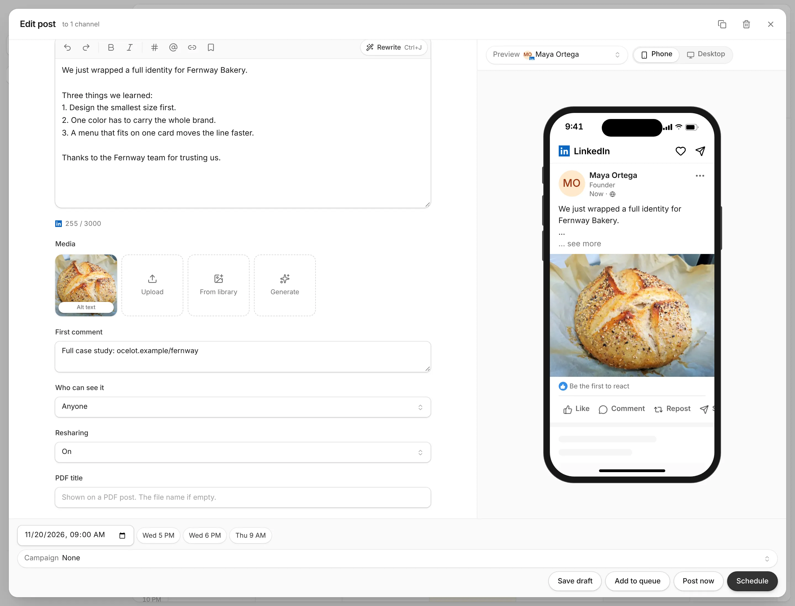

import { Aside, CardGrid, LinkCard, LinkButton, Steps } from '@astrojs/starlight/components';

How to connect LinkedIn, what you can post there and how to fix a post it turns down.

<LinkButton href="https://app.capybaroar.com/channels" variant="secondary" icon="external">Open in Capybaroar</LinkButton>

## At a glance

| | |
| - | - |
| **Characters** | 3,000 |
| **Needs a picture or video** | No |
| **Connects with** | Sign-in |
| **Inbox** | Not in the Inbox (profiles); Comments and mentions: answer and like (Pages) |
| **Analytics** | Reach and engagement for each post in Analytics |
| **Change after it goes out** | Yes, the text |

## Connect LinkedIn

Click LinkedIn in Channels and sign in. Add your own profile, or a company Page where you are an admin.

## Post to LinkedIn

<Steps>

1. **Open the calendar** and click **New post**.

1. **Pick your LinkedIn channel** and write the post.

1. **Open the LinkedIn tab** to set the options below.

1. **Check the preview**, then schedule, queue or post now.

</Steps>

- Posts can be up to 3,000 characters.
- A post takes one video, up to 20 pictures, or one PDF.
- A PDF goes out as a document post that people swipe through like a carousel. PDFs are up to 100 MB and 300 pages. Set its title in PDF title, or the file name is used.
- Pick who can see a post on your profile (anyone, connections only or LinkedIn members), and turn resharing off if you want.
- Add a first comment for links, so the post itself keeps people on LinkedIn.
- The Inbox shows comments on LinkedIn Pages, and you can like them there.

## LinkedIn settings

| Setting | Choices |
| - | - |
| **First comment** | Posted as a comment right after the post |
| **Who can see it** | Anyone, Connections only, LinkedIn members (starts as Anyone) |
| **Resharing** | On, Off (starts as On) |
| **PDF title** | Text |

## If a post is turned down

Capybaroar checks each post before it's scheduled and shows the reason next to the channel. These are the LinkedIn ones:

| Message | What to do |
| - | - |
| `LinkedIn takes one video, or pictures only` | Use one video on its own, or only pictures. |
| `LinkedIn takes one PDF on its own` | Remove the other files, or post the PDF on its own. |
| `PDFs can only go to LinkedIn` | Pick only LinkedIn channels for a PDF, or use pictures for the other networks. |
| `LinkedIn couldn't read this PDF` | Check that the file opens, is under 100 MB and has 300 pages or fewer. |

Read more about scheduling LinkedIn on the [LinkedIn scheduler](https://capybaroar.com/linkedin-post-scheduler) page.

## Related

<CardGrid>
  <LinkCard title="Connect your first channel" href="/get-started/connect-a-channel/" />
  <LinkCard title="Schedule your first post" href="/get-started/schedule-your-first-post/" />
</CardGrid>
