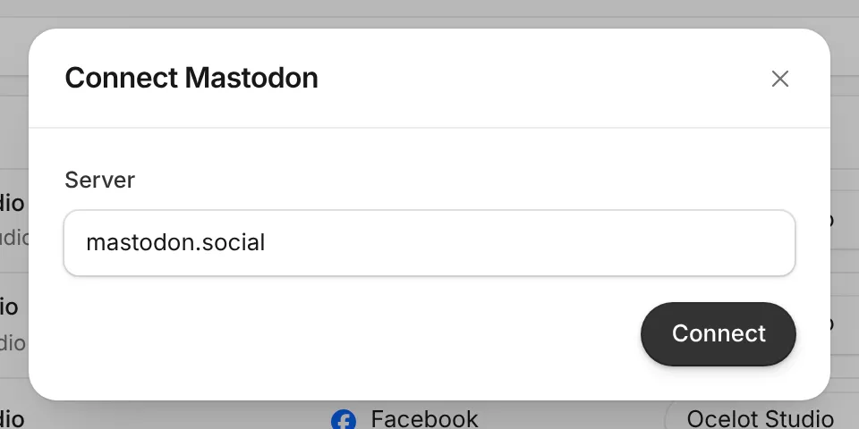

import { Aside, CardGrid, LinkCard, LinkButton, Steps } from '@astrojs/starlight/components';

How to connect Mastodon, what you can post there and how to fix a post it turns down.

<LinkButton href="https://app.capybaroar.com/channels" variant="secondary" icon="external">Open in Capybaroar</LinkButton>

## At a glance

| | |
| - | - |
| **Characters** | 500 a post |
| **Needs a picture or video** | No |
| **Threads** | Yes, up to 25 posts |
| **Connects with** | Sign-in on your server |
| **Inbox** | Replies, mentions and direct messages: answer and like |
| **Analytics** | Favourites, replies and boosts |
| **Change after it goes out** | Yes: the text and content warning |
| **Delete everywhere** | Yes |

## Connect Mastodon

Click Mastodon in Channels and type your server, like mastodon.social. Capybaroar sends you to that server to sign in and approve.

### What Capybaroar asks for

Capybaroar registers itself on your server and asks to read your account, write posts, upload media and favourite posts.

## Post to Mastodon

<Steps>

1. **Open the calendar** and click **New post**.

1. **Pick your Mastodon channel** and write the post.

1. **Open the Mastodon tab** to set the options below.

1. **Check the preview**, then schedule, queue or post now.

</Steps>

- Press Add to thread under the text to post a thread: each post goes out as a reply to the one before, with its own text and files, up to 25 posts.
- Posts can be up to 500 characters.
- Pick Visibility (Public, Quiet public or Followers) and add a content warning if you need one.
- In the Inbox you can answer and like replies.

## Mastodon settings

| Setting | Choices |
| - | - |
| **Visibility** | Public, Quiet public, Followers (starts as Public) |
| **Content warning** | Text |

## Limits

| | |
| - | - |
| **Text** | 500 characters a post. Some servers allow more, but Capybaroar keeps to 500. |
| **Files** | Up to 4 |
| **Thread** | The first post and up to 24 replies |
| **Alt text** | Sent with each file |

Capybaroar checks these before a post is scheduled, so a post that breaks one is stopped before it's scheduled, with the reason under the text.

## Results and Inbox

Your server sends back **favourites** (as likes), **replies** (as comments) and **boosts** (as shares). Follower counts are saved once a day. Capybaroar reads each post's numbers 1 hour, 1 day, 7 days and 30 days after it goes out, so a post's numbers fill in over its first month. They show in **Analytics**, on the post itself and in [reports](/results/reports/).

The Inbox shows replies and mentions, and direct messages sent to you. You can answer and like them. Capybaroar checks for new items every 10 minutes and looks back up to 7 days. Items you answer move to **Done**. See [Inbox](/results/inbox/).

## After it goes out

Open the post, press **Edit**, change the text or content warning, and press **Save changes**. A post with a poll can't change from here (`This Mastodon post has a poll. Edit it on Mastodon.`). **Delete everywhere** deletes it on your server. See [Edit and delete posts that went out](/publishing/edit-and-delete/).

## Disconnect or reconnect

Open **Channels**, find the channel and press **Remove** (the bin icon), then **Remove** again. Owners, admins and editors (for their brands) can do this.

- Scheduled posts stop going to this channel.
- The channel's Inbox items and results go with it, and posts that went out to it lose this channel's numbers in Analytics.
- The plan's channel count goes down by one, so you can add another.

When Mastodon stops taking posts from Capybaroar, the channel shows **Reconnect** in red on **Channels**. Owners and admins get an email, at most once a day, and webhooks get a `channel.reconnect` event. Press **Reconnect** (the arrows icon) and sign in again, or fill in the connect form again for networks that use one. Posts due while it was signed out fail with `Reconnect <channel name>`. Open each one and schedule it again.

## If a post is turned down

Capybaroar checks each post before it's scheduled and shows the reason under the text. Some messages come from Mastodon when the post goes out. These are the Mastodon ones:

| Message | What to do |
| - | - |
| `Enter a Mastodon server, like mastodon.social` | Type the server your account is on. |
| `Mastodon posts are up to 500 characters` | Shorten the text in the Mastodon tab. |
| `Enter a Mastodon server, like mastodon.social` | Type only the server's name, without your handle. |
| `Mastodon takes up to 4 files` | Remove files until there are 4 or fewer. |
| `Mastodon sign-in expired; try again` | Connect again from Channels. |

Read more about scheduling Mastodon on the [Mastodon scheduler](https://capybaroar.com/mastodon-scheduler) page.

## Related

<CardGrid>
  <LinkCard title="Compare every network" href="/channels/" />
  <LinkCard title="Connect your first channel" href="/get-started/connect-a-channel/" />
  <LinkCard title="Schedule your first post" href="/get-started/schedule-your-first-post/" />
</CardGrid>
