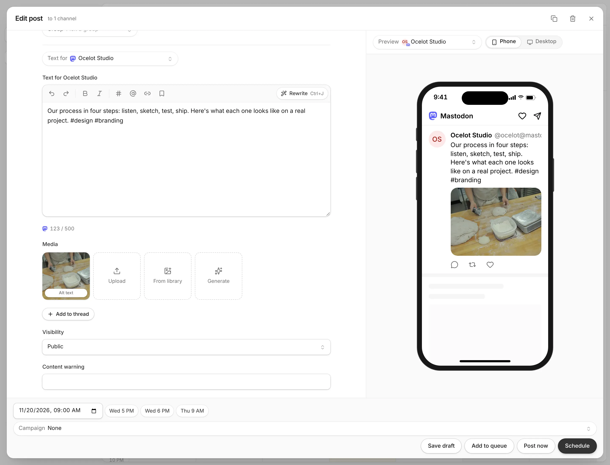

import { Aside, CardGrid, LinkCard, LinkButton, Steps } from '@astrojs/starlight/components';

How to connect Mastodon, what you can post there and how to fix a post it turns down.

<LinkButton href="https://app.capybaroar.com/channels" variant="secondary" icon="external">Open in Capybaroar</LinkButton>

## At a glance

| | |
| - | - |
| **Characters** | 500 |
| **Needs a picture or video** | No |
| **Connects with** | Sign-in (Server) |
| **Inbox** | Comments and mentions: answer and like |
| **Analytics** | Reach and engagement for each post in Analytics |
| **Change after it goes out** | Yes: the text and content warning |

## Connect Mastodon

Click Mastodon in Channels and type your server, like mastodon.social. Capybaroar sends you to that server to sign in and approve.

## Post to Mastodon

<Steps>

1. **Open the calendar** and click **New post**.

1. **Pick your Mastodon channel** and write the post.

1. **Open the Mastodon tab** to set the options below.

1. **Check the preview**, then schedule, queue or post now.

</Steps>

- Press Add to thread under the text to post a thread: each post goes out as a reply to the one before, with its own text and files, up to 25 posts.
- Posts can be up to 500 characters.
- Pick Visibility (Public, Quiet public or Followers) and add a content warning if you need one.
- In the Inbox you can answer and like replies.

## Mastodon settings

| Setting | Choices |
| - | - |
| **Visibility** | Public, Quiet public, Followers (starts as Public) |
| **Content warning** | Text |

## If a post is turned down

Capybaroar checks each post before it's scheduled and shows the reason next to the channel. These are the Mastodon ones:

| Message | What to do |
| - | - |
| `Enter a Mastodon server, like mastodon.social` | Type the server your account is on. |
| `Mastodon posts are up to 500 characters` | Shorten the text in the Mastodon tab. |

Read more about scheduling Mastodon on the [Mastodon scheduler](https://capybaroar.com/mastodon-scheduler) page.

## Related

<CardGrid>
  <LinkCard title="Connect your first channel" href="/get-started/connect-a-channel/" />
  <LinkCard title="Schedule your first post" href="/get-started/schedule-your-first-post/" />
</CardGrid>
