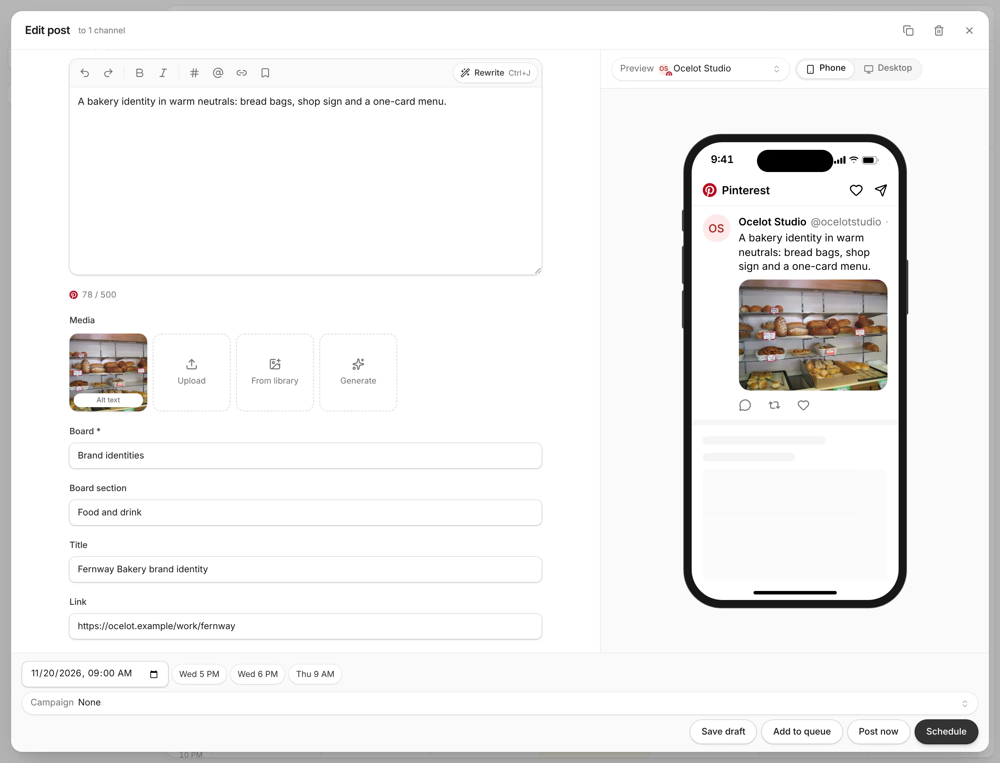

import { Aside, CardGrid, LinkCard, LinkButton, Steps } from '@astrojs/starlight/components';

How to connect Pinterest, what you can post there and how to fix a post it turns down.

<LinkButton href="https://app.capybaroar.com/channels" variant="secondary" icon="external">Open in Capybaroar</LinkButton>

## At a glance

| | |
| - | - |
| **Characters** | 500 in the editor (Pinterest allows 800) |
| **Needs a picture or video** | Yes, one |
| **Connects with** | Sign-in with Pinterest |
| **Inbox** | No |
| **Analytics** | Impressions, saves, clicks and video views |
| **Change after it goes out** | Yes: the text, title and link |
| **Delete everywhere** | Yes |

## Connect Pinterest

Click Pinterest in Channels, sign in and approve Capybaroar.

### What Capybaroar asks for

Capybaroar asks Pinterest to read and write your boards and Pins, and read your account.

## Post to Pinterest

<Steps>

1. **Open the calendar** and click **New post**.

1. **Pick your Pinterest channel** and write the post.

1. **Open the Pinterest tab** to set the options below.

1. **Check the preview**, then schedule, queue or post now.

</Steps>

- Every Pin is one picture or one video, and goes to a board you pick. Add a board section by its name if you use sections.
- Add a title and the link people visit when they click the Pin.
- Descriptions can be up to 500 characters.
- Alt text from your media library goes out with the Pin.

## Pinterest settings

| Setting | Choices |
| - | - |
| **Board** | Text (required) |
| **Board section** | Text |
| **Title** | Text |
| **Link** | Text |

## Limits

| | |
| - | - |
| **Description** | 500 characters in the editor |
| **Files** | Exactly one picture or one video |
| **Title** | 100 characters |
| **Link** | 2,048 characters |
| **Board** | Required, by its name |
| **Alt text** | Sent with the picture |

Capybaroar checks these before a post is scheduled, so a post that breaks one is stopped before it's scheduled, with the reason under the text.

## Results and Inbox

Pinterest sends back **impressions**, **saves**, **clicks** (Pin clicks and outbound clicks added up) and **video views** for each Pin, over the last 90 days. Follower counts are saved once a day. Capybaroar reads each post's numbers 1 hour, 1 day, 7 days and 30 days after it goes out, so a post's numbers fill in over its first month. They show in **Analytics**, on the post itself and in [reports](/results/reports/).

Pinterest doesn't come into the Inbox.

## After it goes out

Open the Pin's post, press **Edit**, change the description, title or link, and press **Save changes**. **Delete everywhere** deletes the Pin. See [Edit and delete posts that went out](/publishing/edit-and-delete/).

## Disconnect or reconnect

Open **Channels**, find the channel and press **Remove** (the bin icon), then **Remove** again. Owners, admins and editors (for their brands) can do this.

- Scheduled posts stop going to this channel.
- The channel's Inbox items and results go with it, and posts that went out to it lose this channel's numbers in Analytics.
- The plan's channel count goes down by one, so you can add another.

When Pinterest stops taking posts from Capybaroar, the channel shows **Reconnect** in red on **Channels**. Owners and admins get an email, at most once a day, and webhooks get a `channel.reconnect` event. Press **Reconnect** (the arrows icon) and sign in again, or fill in the connect form again for networks that use one. Posts due while it was signed out fail with `Reconnect <channel name>`. Open each one and schedule it again.

## If a post is turned down

Capybaroar checks each post before it's scheduled and shows the reason under the text. Some messages come from Pinterest when the post goes out. These are the Pinterest ones:

| Message | What to do |
| - | - |
| `Pinterest needs a board` | Pick a board in the Pinterest tab. |
| `Pinterest needs one picture or one video` | Keep one file. |
| `Pinterest board "…" wasn't found` | Type the board's name exactly as it shows on Pinterest. |
| `Pinterest board section "…" wasn't found` | Check the section's name, or leave Board section empty. |
| `Pinterest couldn't process this video` | Try another video file. |
| `Pinterest titles are up to 100 characters` | Shorten the title. |
| `Pinterest links are up to 2,048 characters` | Use a shorter link. |

Read more about scheduling Pinterest on the [Pinterest scheduler](https://capybaroar.com/pinterest-pin-scheduler) page.

## Related

<CardGrid>
  <LinkCard title="Compare every network" href="/channels/" />
  <LinkCard title="Connect your first channel" href="/get-started/connect-a-channel/" />
  <LinkCard title="Schedule your first post" href="/get-started/schedule-your-first-post/" />
</CardGrid>
