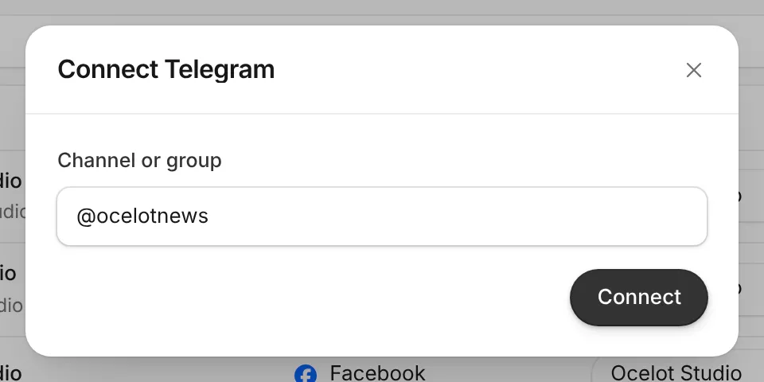
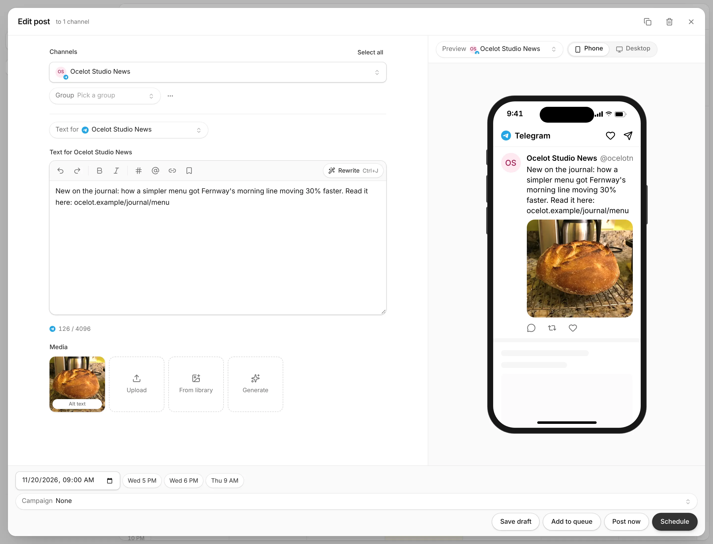

import { Aside, CardGrid, LinkCard, LinkButton, Steps } from '@astrojs/starlight/components';

How to connect Telegram, what you can post there and how to fix a post it turns down.

<LinkButton href="https://app.capybaroar.com/channels" variant="secondary" icon="external">Open in Capybaroar</LinkButton>

## At a glance

| | |
| - | - |
| **Characters** | 4,096, or 1,024 under files |
| **Needs a picture or video** | No |
| **Connects with** | A short form: your channel or group |
| **Inbox** | No |
| **Analytics** | No post numbers. Member counts are saved daily. |
| **Change after it goes out** | Yes, the text |
| **Delete everywhere** | Yes, with Telegram's time limits |

## Connect Telegram

<Steps>

1. **Add the bot.** In Telegram, open your channel or group and add the Capybaroar bot as an admin. In a channel, give it the right to post messages.

1. **Open Channels.** In Capybaroar, click **Channels**, then **Add channel**, and press **Connect** next to Telegram.

1. **Enter the channel.** Type the channel or group, like `@yourchannel`. A `t.me` link or a numeric chat id works too.

   

</Steps>

If the bot isn't an admin yet, Capybaroar's message names the bot to add.

### What Capybaroar asks for

One Capybaroar bot posts for everyone. You add it as an admin of your channel or group. In a channel, it needs the right to post messages. It doesn't read your members or messages.

## Post to Telegram

<Steps>

1. **Open the calendar** and click **New post**.

1. **Pick your Telegram channel** and write the post.

1. **Open the Telegram tab** to set the options below.

1. **Check the preview**, then schedule, queue or post now.

</Steps>

- Messages can be up to 4,096 characters.
- A post takes up to 10 files. Several files go out as one album, and an album can't hold GIFs.
- Pictures must be under 5 MB, and videos and GIFs under 20 MB.
- With pictures or a video, text longer than 1,024 characters goes out as a reply right after the files.
- You can change a post's text after it goes out.
- Telegram lets the bot delete its messages in a basic group for 48 hours. After that, delete them in Telegram. In a channel or supergroup the bot can delete them later too.

## Limits

| | |
| - | - |
| **Text** | 4,096 characters |
| **Caption under files** | 1,024 characters. Longer text goes out as its own message after the files. |
| **Files** | Up to 10. Several files go out as one album. |
| **Pictures** | Under 5 MB |
| **Videos and GIFs** | Under 20 MB. An album can't hold GIFs. |

Capybaroar checks these before a post is scheduled, so a post that breaks one is stopped before it's scheduled, with the reason under the text.

## Results and Inbox

Telegram doesn't send post numbers to bots, so Telegram posts show in Analytics without numbers. The channel's member count is saved once a day.

Telegram doesn't come into the Inbox.

## After it goes out

Open the post, press **Edit**, change the text and press **Save changes**. If the text went out as its own message after an album, edit it in Telegram (`Telegram sent this text as its own message. Edit it in Telegram.`). In a basic group the bot can delete its messages for 48 hours. After that, Telegram answers `Telegram won't let the bot delete this message. Delete it in Telegram.` See [Edit and delete posts that went out](/publishing/edit-and-delete/).

## Disconnect or reconnect

Open **Channels**, find the channel and press **Remove** (the bin icon), then **Remove** again. Owners, admins and editors (for their brands) can do this.

- Scheduled posts stop going to this channel.
- The channel's Inbox items and results go with it, and posts that went out to it lose this channel's numbers in Analytics.
- The plan's channel count goes down by one, so you can add another.
- Remove the bot from the channel's admins in Telegram too, if you no longer use it anywhere.

When Telegram stops taking posts from Capybaroar, the channel shows **Reconnect** in red on **Channels**. Owners and admins get an email, at most once a day, and webhooks get a `channel.reconnect` event. Press **Reconnect** (the arrows icon) and sign in again, or fill in the connect form again for networks that use one. Posts due while it was signed out fail with `Reconnect <channel name>`. Open each one and schedule it again.

## If a post is turned down

Capybaroar checks each post before it's scheduled and shows the reason under the text. Some messages come from Telegram when the post goes out. These are the Telegram ones:

| Message | What to do |
| - | - |
| `Enter a channel like @yourchannel` | Type the channel's @name, its t.me link or its chat id. |
| `Add @… as an admin of the channel first` | Add the bot the message names as an admin of the channel or group, then connect again. |
| `Let @… post messages in the channel's admin rights` | In the channel's admin settings, turn on Post messages for the bot. |
| `Telegram posts are up to 4096 characters` | Shorten the text in the Telegram tab. |
| `Telegram takes up to 10 files` | Remove files until there are 10 or fewer. |
| `Telegram albums can't hold GIFs` | Post the GIF on its own. |
| `Telegram pictures must be under 5 MB` | Use smaller pictures. |
| `Telegram videos must be under 20 MB` | Use a shorter or smaller video. |
| `Telegram posts need text or media` | Add text or a file. |
| `Telegram captions are up to 1024 characters` | Shorten the text under the files, or remove the files. |
| `Telegram won't let the bot delete this message. Delete it in Telegram.` | Delete it in Telegram. |

## Related

<CardGrid>
  <LinkCard title="Compare every network" href="/channels/" />
  <LinkCard title="Connect your first channel" href="/get-started/connect-a-channel/" />
  <LinkCard title="Schedule your first post" href="/get-started/schedule-your-first-post/" />
</CardGrid>
