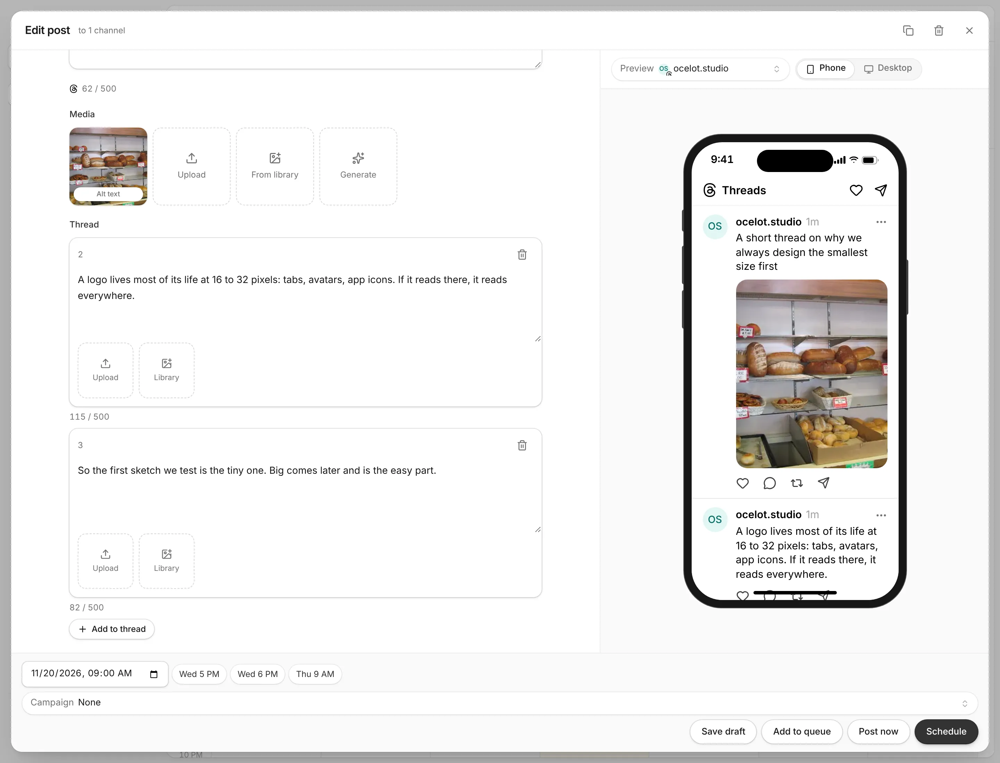

import { Aside, CardGrid, LinkCard, LinkButton, Steps } from '@astrojs/starlight/components';

How to connect Threads, what you can post there and how to fix a post it turns down.

<LinkButton href="https://app.capybaroar.com/channels" variant="secondary" icon="external">Open in Capybaroar</LinkButton>

## At a glance

| | |
| - | - |
| **Characters** | 500 a post |
| **Needs a picture or video** | No |
| **Threads** | Yes, up to 25 posts |
| **Connects with** | Sign-in with Meta |
| **Inbox** | Replies: answer and hide |
| **Analytics** | Views, likes, replies, reposts, quotes and shares |
| **Change after it goes out** | No |
| **Delete everywhere** | Coming soon. For now, delete the post in the Threads app |

## Connect Threads

Click Threads in Channels, sign in with Meta and approve Capybaroar.

### What Capybaroar asks for

Capybaroar asks Threads for your basic profile, to publish posts, manage replies and read insights. It also asks to read replies and delete posts when its Meta app has those permissions.

## Post to Threads

<Steps>

1. **Open the calendar** and click **New post**.

1. **Pick your Threads channel** and write the post.

1. **Open the Threads tab** to set the options below.

1. **Check the preview**, then schedule, queue or post now.

</Steps>

- Press Add to thread under the text to post a thread: each post goes out as a reply to the one before, with its own text and files, up to 25 posts.
- Posts can be up to 500 characters.
- A post takes up to 20 files.
- In the Inbox you can answer replies and hide them.

## Limits

| | |
| - | - |
| **Text** | 500 characters a post |
| **Files** | Up to 20 a post, shown as a carousel |
| **Thread** | The first post and up to 24 replies |

Capybaroar checks these before a post is scheduled, so a post that breaks one is stopped before it's scheduled, with the reason under the text.

## Results and Inbox

Threads sends back **views**, **likes**, **replies** (as comments), and **reposts**, **quotes** and **shares** added up as shares. Follower counts are saved once a day. Capybaroar reads each post's numbers 1 hour, 1 day, 7 days and 30 days after it goes out, so a post's numbers fill in over its first month. They show in **Analytics**, on the post itself and in [reports](/results/reports/).

The Inbox shows replies to your 10 newest posts from the last 14 days. You can answer and hide them. Capybaroar checks for new items every 10 minutes and looks back up to 7 days. Items you answer move to **Done**. See [Inbox](/results/inbox/).

## After it goes out

Threads doesn't let apps change a post. **Delete everywhere** deletes it on Threads once Capybaroar's Meta app has delete access. Until then, or for a channel connected before it, you see `Delete it in the Threads app` or `Reconnect Threads to delete from here`. See [Edit and delete posts that went out](/publishing/edit-and-delete/).

## Disconnect or reconnect

Open **Channels**, find the channel and press **Remove** (the bin icon), then **Remove** again. Owners, admins and editors (for their brands) can do this.

- Scheduled posts stop going to this channel.
- The channel's Inbox items and results go with it, and posts that went out to it lose this channel's numbers in Analytics.
- The plan's channel count goes down by one, so you can add another.

When Threads stops taking posts from Capybaroar, the channel shows **Reconnect** in red on **Channels**. Owners and admins get an email, at most once a day, and webhooks get a `channel.reconnect` event. Press **Reconnect** (the arrows icon) and sign in again, or fill in the connect form again for networks that use one. Posts due while it was signed out fail with `Reconnect <channel name>`. Open each one and schedule it again.

## If a post is turned down

Capybaroar checks each post before it's scheduled and shows the reason under the text. Some messages come from Threads when the post goes out. These are the Threads ones:

| Message | What to do |
| - | - |
| `Threads posts are up to 500 characters` | Shorten the text in the Threads tab. |
| `Threads takes up to 20 files` | Remove files until there are 20 or fewer. |
| `Threads takes up to 20 files` | Remove files until there are 20 or fewer. |

Read more about scheduling Threads on the [Threads scheduler](https://capybaroar.com/threads-scheduler) page.

## Related

<CardGrid>
  <LinkCard title="Compare every network" href="/channels/" />
  <LinkCard title="Connect your first channel" href="/get-started/connect-a-channel/" />
  <LinkCard title="Schedule your first post" href="/get-started/schedule-your-first-post/" />
</CardGrid>
