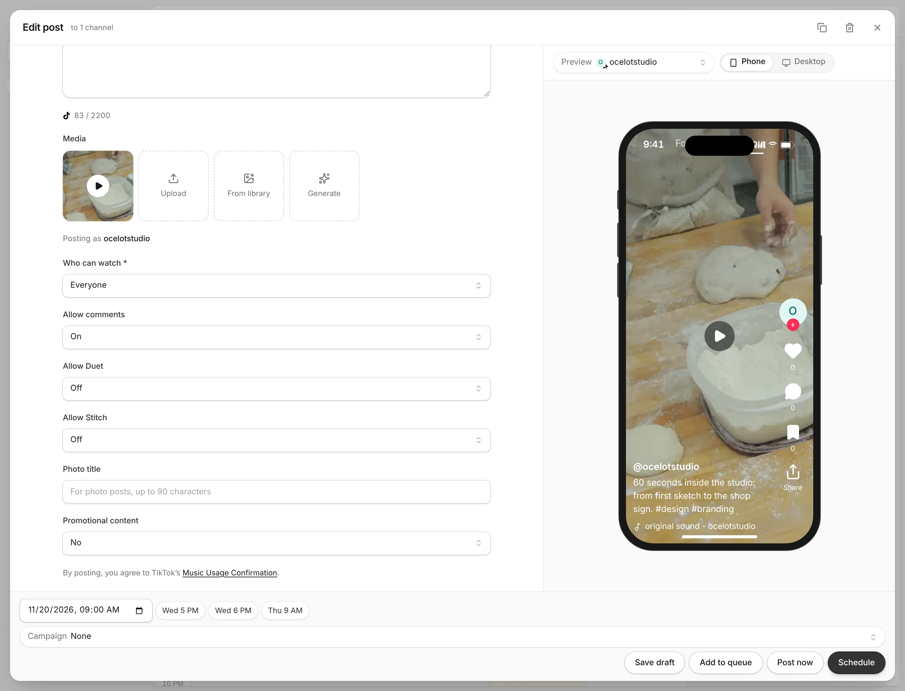

import { Aside, CardGrid, LinkCard, LinkButton, Steps } from '@astrojs/starlight/components';

How to connect TikTok, what you can post there and how to fix a post it turns down.

<LinkButton href="https://app.capybaroar.com/channels" variant="secondary" icon="external">Open in Capybaroar</LinkButton>

## At a glance

| | |
| - | - |
| **Characters** | 2,200 |
| **Needs a picture or video** | Yes |
| **Formats** | One video, or a photo post of 1 to 35 pictures |
| **Connects with** | Sign-in with TikTok |
| **Inbox** | No |
| **Analytics** | No post numbers yet |
| **Change after it goes out** | No |
| **Delete everywhere** | No, delete it in the TikTok app |

## Connect TikTok

Click TikTok in Channels, sign in with TikTok and approve Capybaroar. TikTok always shows its approval page, with Switch account if you want a different account.

### What Capybaroar asks for

Capybaroar asks TikTok for your basic profile and profile info, and to publish videos. When you write a TikTok post, Capybaroar asks TikTok which **Who can watch** choices your account allows, and the TikTok tab shows only those.

## Post to TikTok

<Steps>

1. **Open the calendar** and click **New post**.

1. **Pick your TikTok channel** and write the post.

1. **Open the TikTok tab** to set the options below.

1. **Check the preview**, then schedule, queue or post now.

</Steps>

- A TikTok post is one video, or a photo post of 1 to 35 JPG or WebP pictures. Captions are up to 2,200 characters.
- A photo post can have a title of up to 90 characters in Photo title. TikTok adds music to it.
- The TikTok tab shows the account you post as, and the Who can watch choices TikTok allows for it. Pick one: there is no default.
- Allow comments, Duet and Stitch start off. Turn on the ones you want. If your TikTok settings turn one off, it stays off here too.
- Mark promotional posts as Your brand or Branded content. TikTok labels them, and branded content can't be set to Only me.
- After it posts, TikTok may take a few minutes to process the video before it shows on your profile.
- Disconnecting TikTok in Capybaroar also removes Capybaroar's access on TikTok.

## TikTok settings

| Setting | Choices |
| - | - |
| **Who can watch** | Everyone, Friends, Followers, Only me (required) |
| **Allow comments** | On, Off (starts as Off) |
| **Allow Duet** | On, Off (starts as Off) |
| **Allow Stitch** | On, Off (starts as Off) |
| **Photo title** | Text |
| **Promotional content** | No, Your brand, Branded content (starts as No) |

## Limits

| | |
| - | - |
| **Caption** | 2,200 characters |
| **Video** | One video |
| **Photo post** | 1 to 35 JPG or WebP pictures, each under 20 MB |
| **Photo title** | 90 characters |

Capybaroar checks these before a post is scheduled, so a post that breaks one is stopped before it's scheduled, with the reason under the text.

## Results and Inbox

TikTok doesn't send post numbers back to Capybaroar yet, so TikTok posts show in Analytics without numbers.

TikTok doesn't come into the Inbox.

## After it goes out

TikTok doesn't let apps change or delete a post. Edit or delete it in the TikTok app. **Delete everywhere** gives you the link. See [Edit and delete posts that went out](/publishing/edit-and-delete/).

## Disconnect or reconnect

Open **Channels**, find the channel and press **Remove** (the bin icon), then **Remove** again. Owners, admins and editors (for their brands) can do this.

- Scheduled posts stop going to this channel.
- The channel's Inbox items and results go with it, and posts that went out to it lose this channel's numbers in Analytics.
- The plan's channel count goes down by one, so you can add another.
- Capybaroar also ends its access on TikTok, as TikTok asks.

When TikTok stops taking posts from Capybaroar, the channel shows **Reconnect** in red on **Channels**. Owners and admins get an email, at most once a day, and webhooks get a `channel.reconnect` event. Press **Reconnect** (the arrows icon) and sign in again, or fill in the connect form again for networks that use one. Posts due while it was signed out fail with `Reconnect <channel name>`. Open each one and schedule it again.

## If a post is turned down

Capybaroar checks each post before it's scheduled and shows the reason under the text. Some messages come from TikTok when the post goes out. These are the TikTok ones:

| Message | What to do |
| - | - |
| `TikTok takes one video, or pictures only` | Use one video on its own, or only pictures. |
| `TikTok photo posts take JPG or WebP pictures` | Save the picture as JPG or WebP and add it again. |
| `TikTok photo posts take up to 35 pictures` | Remove some pictures, or make two posts. |
| `Choose who can watch this TikTok` | Pick an option in Who can watch. |
| `Branded content can't be set to Only me on TikTok` | Pick a wider audience, or set Promotional content to Your brand or No. |
| `This TikTok account can't post with that Who can watch choice. Pick another` | Pick one of the options the TikTok tab shows. |
| `TikTok has blocked this account from posting for now` | Check the account in the TikTok app. |
| `TikTok needs one video, or 1 to 35 pictures` | Add a video or pictures. |
| `TikTok pictures must be under 20 MB` | Use smaller pictures. |
| `TikTok photo titles are up to 90 characters` | Shorten the Photo title. |
| `TikTok captions are up to 2,200 characters` | Shorten the text. |

Read more about scheduling TikTok on the [TikTok scheduler](https://capybaroar.com/tiktok-scheduler) page.

## Related

<CardGrid>
  <LinkCard title="Compare every network" href="/channels/" />
  <LinkCard title="Connect your first channel" href="/get-started/connect-a-channel/" />
  <LinkCard title="Schedule your first post" href="/get-started/schedule-your-first-post/" />
</CardGrid>
