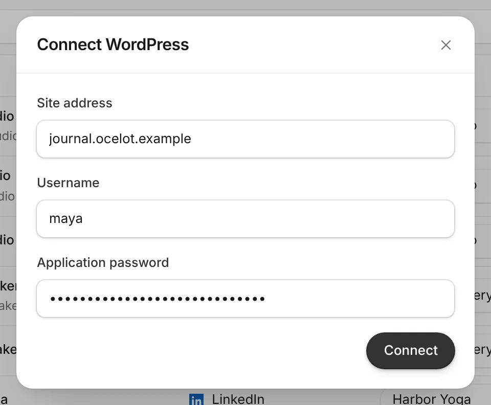

import { Aside, CardGrid, LinkCard, LinkButton, Steps } from '@astrojs/starlight/components';

How to connect a WordPress site, what you can publish there and how to fix a post it turns down.

<LinkButton href="https://app.capybaroar.com/channels" variant="secondary" icon="external">Open in Capybaroar</LinkButton>

## At a glance

| | |
| - | - |
| **Characters** | 100,000 |
| **Needs a picture or video** | No |
| **Connects with** | A short form: site address, username and application password |
| **Inbox** | No |
| **Analytics** | No |
| **Change after it goes out** | Yes: the text, title, status, categories, tags and excerpt |
| **Delete everywhere** | Yes |

## Connect WordPress

<Steps>

1. **Make an application password.** In WordPress, open **Users**, then **Profile**, and find **Application Passwords**. Add one and copy it. Your site must use an `https://` address.

1. **Open Channels.** In Capybaroar, click **Channels**, then **Add channel**, and press **Connect** next to WordPress.

1. **Fill in the form.** Enter your site address, like `example.com`, your WordPress username and the application password.

   

</Steps>

Use an author, editor or administrator account. Capybaroar checks that it can publish posts.

### What Capybaroar asks for

An application password lets Capybaroar use your site's REST API as that user. It can do what the user can do, so use an author or editor account if you want less. You can revoke it in WordPress under **Users**, **Profile**.

## Post to WordPress

<Steps>

1. **Open the calendar** and click **New post**.

1. **Pick your WordPress channel** and write the post.

1. **Open the WordPress tab** to set the options below.

1. **Check the preview**, then schedule, queue or post now.

</Steps>

- Every WordPress post needs a title. Set it in the WordPress tab.
- The post text becomes the body. A blank line starts a new paragraph, and links become clickable.
- Add one picture to use it as the featured image. Its alt text from your media library goes with it.
- Pick a status: **Publish**, **Draft** or **Pending review**.
- Type category and tag names. Capybaroar uses the ones your site has and adds any that are missing.
- After it goes out you can still change the text, title, status, categories, tags and excerpt.

## WordPress settings

| Setting | Choices |
| - | - |
| **Title** | Text (required) |
| **Status** | Publish, Draft, Pending review (starts as Publish) |
| **Categories** | Names, separated by commas |
| **Tags** | Names, separated by commas |
| **Excerpt** | Text |

## Limits

| | |
| - | - |
| **Body** | 100,000 characters |
| **Title** | Required |
| **Featured image** | One picture. Videos and PDFs aren't taken. |
| **Address** | Your site's `https://` address |

Capybaroar checks these before a post is scheduled, so a post that breaks one is stopped before it's scheduled, with the reason under the text.

## Results and Inbox

WordPress doesn't report views to Capybaroar, so WordPress posts show in Analytics without numbers.

WordPress doesn't come into the Inbox.

## After it goes out

Open the post, press **Edit**, change the body or settings and press **Save changes**. **Delete everywhere** deletes the post on your site. See [Edit and delete posts that went out](/publishing/edit-and-delete/).

## Disconnect or reconnect

Open **Channels**, find the channel and press **Remove** (the bin icon), then **Remove** again. Owners, admins and editors (for their brands) can do this.

- Scheduled posts stop going to this channel.
- The channel's Inbox items and results go with it, and posts that went out to it lose this channel's numbers in Analytics.
- The plan's channel count goes down by one, so you can add another.
- Revoke the application password in WordPress too.

When WordPress stops taking posts from Capybaroar, the channel shows **Reconnect** in red on **Channels**. Owners and admins get an email, at most once a day, and webhooks get a `channel.reconnect` event. Press **Reconnect** (the arrows icon) and sign in again, or fill in the connect form again for networks that use one. Posts due while it was signed out fail with `Reconnect <channel name>`. Open each one and schedule it again.

## If a post is turned down

Capybaroar checks each post before it's scheduled and shows the reason under the text. Some messages come from WordPress when the post goes out. These are the WordPress ones:

| Message | What to do |
| - | - |
| `Enter your site's address, like example.com` | Type the address of your WordPress site. |
| `Use your site's https:// address` | Application passwords need https. Use the https:// address. |
| `WordPress didn't accept that username and application password` | Check the username and make a new application password. |
| `This site's REST API isn't reachable. Check the address, and that the REST API is on.` | Check the address. Some security plugins turn the REST API off. |
| `This WordPress user can't publish posts. Use an author, editor or administrator.` | Connect with an account that has one of those roles. |
| `WordPress posts need a title` | Add a title in the WordPress tab. |
| `WordPress takes pictures as the featured image only` | Remove videos and other files. |
| `WordPress takes one picture, as the featured image` | Keep one picture. |
| `Use your site's https:// address` | Use the `https://` address of your site. |
| `WordPress didn't accept that username and application password` | Check the username and make a new application password. |
| `This site's REST API isn't reachable. Check the address, and that the REST API is on.` | Check the address, and that no plugin turns off the REST API. |
| `This WordPress user can't publish posts. Use an author, editor or administrator.` | Connect with a user who can publish. |
| `WordPress takes pictures as the featured image only` | Remove videos and PDFs. |
| `WordPress takes one picture, as the featured image` | Keep one picture. |

## Related

<CardGrid>
  <LinkCard title="Compare every network" href="/channels/" />
  <LinkCard title="Connect your first channel" href="/get-started/connect-a-channel/" />
  <LinkCard title="Schedule your first post" href="/get-started/schedule-your-first-post/" />
</CardGrid>
