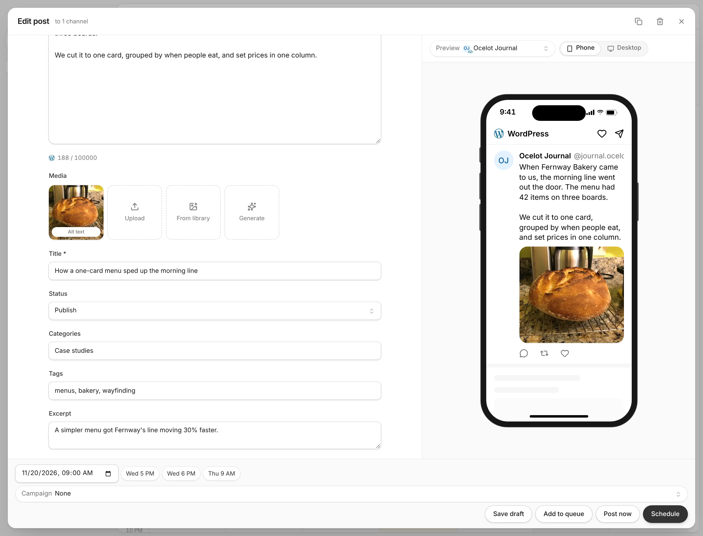

import { Aside, CardGrid, LinkCard, LinkButton, Steps } from '@astrojs/starlight/components';

How to connect a WordPress site, what you can publish there and how to fix a post it turns down.

<LinkButton href="https://app.capybaroar.com/channels" variant="secondary" icon="external">Open in Capybaroar</LinkButton>

## At a glance

| | |
| - | - |
| **Characters** | 100,000 |
| **Needs a picture or video** | No |
| **Connects with** | A short form (Site address, Username, Application password) |
| **Inbox** | Not in the Inbox |
| **Analytics** | Not in Analytics yet |
| **Change after it goes out** | Yes: the text, title, status, categories, tags and excerpt |

## Connect WordPress

<Steps>

1. **Make an application password.** In WordPress, open **Users**, then **Profile**, and find **Application Passwords**. Add one and copy it. Your site must use an `https://` address.

1. **Open Channels.** In Capybaroar, click **Channels**, then **Add channel**, and press **Connect** next to WordPress.

1. **Fill in the form.** Enter your site address, like `example.com`, your WordPress username and the application password.

   

</Steps>

Use an author, editor or administrator account. Capybaroar checks that it can publish posts.

## Post to WordPress

<Steps>

1. **Open the calendar** and click **New post**.

1. **Pick your WordPress channel** and write the post.

1. **Open the WordPress tab** to set the options below.

1. **Check the preview**, then schedule, queue or post now.

</Steps>

- Every WordPress post needs a title. Set it in the WordPress tab.
- The post text becomes the body. A blank line starts a new paragraph, and links become clickable.
- Add one picture to use it as the featured image. Its alt text from your media library goes with it.
- Pick a status: **Publish**, **Draft** or **Pending review**.
- Type category and tag names. Capybaroar uses the ones your site has and adds any that are missing.
- After it goes out you can still change the text, title, status, categories, tags and excerpt.

## WordPress settings

| Setting | Choices |
| - | - |
| **Title** | Text (required) |
| **Status** | Publish, Draft, Pending review (starts as Publish) |
| **Categories** | Names, separated by commas |
| **Tags** | Names, separated by commas |
| **Excerpt** | Text |

## If a post is turned down

Capybaroar checks each post before it's scheduled and shows the reason next to the channel. These are the WordPress ones:

| Message | What to do |
| - | - |
| `Enter your site's address, like example.com` | Type the address of your WordPress site. |
| `Use your site's https:// address` | Application passwords need https. Use the https:// address. |
| `WordPress didn't accept that username and application password` | Check the username and make a new application password. |
| `This site's REST API isn't reachable. Check the address, and that the REST API is on.` | Check the address. Some security plugins turn the REST API off. |
| `This WordPress user can't publish posts. Use an author, editor or administrator.` | Connect with an account that has one of those roles. |
| `WordPress posts need a title` | Add a title in the WordPress tab. |
| `WordPress takes pictures as the featured image only` | Remove videos and other files. |
| `WordPress takes one picture, as the featured image` | Keep one picture. |

## Related

<CardGrid>
  <LinkCard title="Connect your first channel" href="/get-started/connect-a-channel/" />
  <LinkCard title="Schedule your first post" href="/get-started/schedule-your-first-post/" />
</CardGrid>
