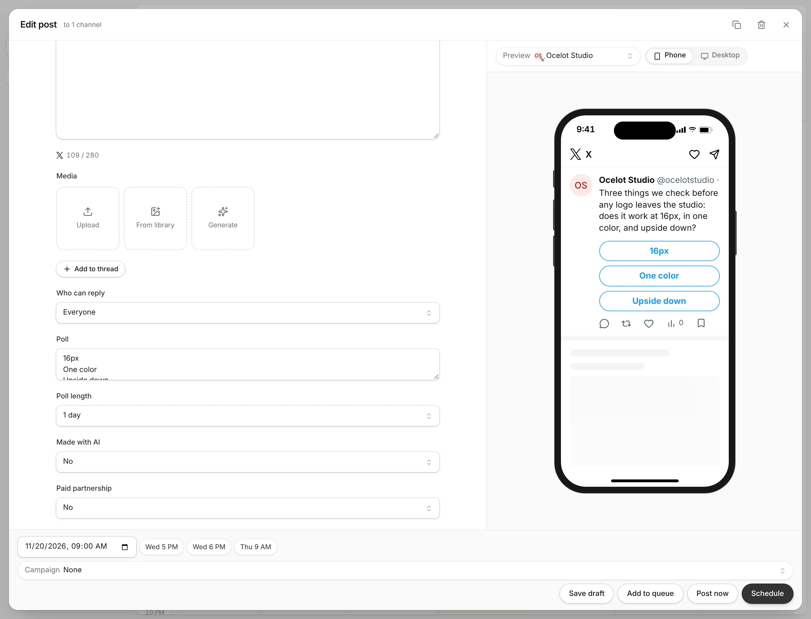

import { Aside, CardGrid, LinkCard, LinkButton, Steps } from '@astrojs/starlight/components';

How to connect X (Twitter), what you can post there and how to fix a post it turns down.

<LinkButton href="https://app.capybaroar.com/channels" variant="secondary" icon="external">Open in Capybaroar</LinkButton>

## At a glance

| | |
| - | - |
| **Characters** | 280 a post |
| **Needs a picture or video** | No |
| **Threads** | Yes, up to 25 posts |
| **Polls** | Yes, 2 to 4 options |
| **Connects with** | Sign-in with X |
| **Inbox** | Replies and mentions: answer, like and hide, when turned on (check) |
| **Analytics** | Impressions, likes, replies, reposts, quotes, bookmarks and clicks |
| **Change after it goes out** | No |
| **Delete everywhere** | Yes |

## Connect X (Twitter)

Click X in Channels, sign in to X and approve Capybaroar.

### What Capybaroar asks for

Capybaroar asks X to read and write posts, read your profile, upload media, stay signed in, like posts and hide replies.

## Post to X (Twitter)

<Steps>

1. **Open the calendar** and click **New post**.

1. **Pick your X (Twitter) channel** and write the post.

1. **Open the X (Twitter) tab** to set the options below.

1. **Check the preview**, then schedule, queue or post now.

</Steps>

- Press Add to thread under the text to post a thread: each post goes out as a reply to the one before, with its own text and files, up to 25 posts.
- Posts can be up to 280 characters.
- A post takes up to 4 pictures, or one video or GIF.
- Pictures must be under 5 MB, GIFs under 15 MB and videos under 512 MB.
- Add a poll: write 2 to 4 options in Poll, one per line, each up to 25 characters, and pick how long it stays open. A poll can't have pictures or video.
- Pick who can reply (everyone, people you follow, only people you mention, or verified accounts), and mark a post as made with AI or as a paid partnership.

## X (Twitter) settings

| Setting | Choices |
| - | - |
| **Who can reply** | Everyone, People you follow, Only people you mention, Verified accounts (starts as Everyone) |
| **Poll** | Text |
| **Poll length** | 1 hour, 6 hours, 1 day, 3 days, 7 days (starts as 1 day) |
| **Made with AI** | No, Yes (starts as No) |
| **Paid partnership** | No, Yes (starts as No) |

## Limits

| | |
| - | - |
| **Text** | 280 characters a post. X counts some links and scripts differently, so stay a little under near the limit. |
| **Pictures** | Up to 4, each under 5 MB |
| **GIF** | One, under 15 MB |
| **Video** | One, under 512 MB |
| **Poll** | 2 to 4 options of up to 25 characters, no files |
| **Thread** | The first post and up to 24 replies |
| **Alt text** | Sent with each picture |

Capybaroar checks these before a post is scheduled, so a post that breaks one is stopped before it's scheduled, with the reason under the text.

## Results and Inbox

X sends back **impressions**, **likes**, **replies** (as comments), **reposts and quotes** (as shares), **bookmarks** (as saves) and, for your own recent posts, **link and profile clicks**. Follower counts are saved once a day. Capybaroar reads each post's numbers 1 hour, 1 day, 7 days and 30 days after it goes out, so a post's numbers fill in over its first month. They show in **Analytics**, on the post itself and in [reports](/results/reports/).

X charges for reading replies, so the X Inbox is on only where Capybaroar has turned it on (check). When it's on, the Inbox shows replies and mentions, and you can answer, like and hide them. Capybaroar checks for new items every 30 minutes and looks back up to 7 days. Items you answer move to **Done**. See [Inbox](/results/inbox/).

## After it goes out

X doesn't let apps change a post. **Delete everywhere** deletes it on X. See [Edit and delete posts that went out](/publishing/edit-and-delete/).

## Disconnect or reconnect

Open **Channels**, find the channel and press **Remove** (the bin icon), then **Remove** again. Owners, admins and editors (for their brands) can do this.

- Scheduled posts stop going to this channel.
- The channel's Inbox items and results go with it, and posts that went out to it lose this channel's numbers in Analytics.
- The plan's channel count goes down by one, so you can add another.
- Capybaroar also ends its access on X.

When X (Twitter) stops taking posts from Capybaroar, the channel shows **Reconnect** in red on **Channels**. Owners and admins get an email, at most once a day, and webhooks get a `channel.reconnect` event. Press **Reconnect** (the arrows icon) and sign in again, or fill in the connect form again for networks that use one. Posts due while it was signed out fail with `Reconnect <channel name>`. Open each one and schedule it again.

## If a post is turned down

Capybaroar checks each post before it's scheduled and shows the reason under the text. Some messages come from X (Twitter) when the post goes out. These are the X (Twitter) ones:

| Message | What to do |
| - | - |
| `An X poll has 2 to 4 options` | Write 2, 3 or 4 options in Poll, one per line. |
| `An X poll can't have pictures or video` | Remove the files, or clear the poll. |
| `X posts are up to 280 characters` | Shorten the text in the X tab. |
| `X takes up to 4 pictures, or one video or GIF` | Remove files until you have up to 4 pictures, or one video or GIF. |
| `X posts need text or media` | Add text or a file. |
| `Poll options are up to 25 characters: …` | Shorten the option the message names. |
| `X pictures must be under 5 MB` | Use smaller pictures. |
| `X GIFs must be under 15 MB` | Use a smaller GIF. |
| `X videos must be under 512 MB` | Use a shorter or smaller video. |
| `X video processing failed: …` | X couldn't read the video. Try another file. |

Read more about scheduling X (Twitter) on the [X (Twitter) scheduler](https://capybaroar.com/x-post-scheduler) page.

## Related

<CardGrid>
  <LinkCard title="Compare every network" href="/channels/" />
  <LinkCard title="Connect your first channel" href="/get-started/connect-a-channel/" />
  <LinkCard title="Schedule your first post" href="/get-started/schedule-your-first-post/" />
</CardGrid>
