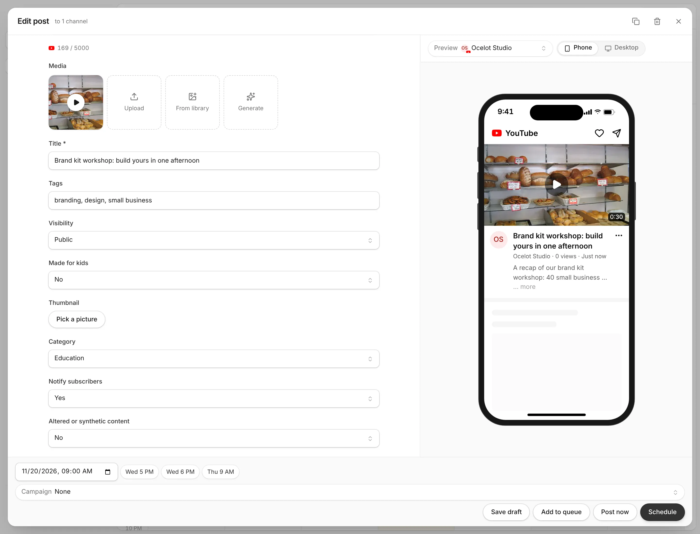

import { Aside, CardGrid, LinkCard, LinkButton, Steps } from '@astrojs/starlight/components';

How to connect YouTube, what you can post there and how to fix a post it turns down.

<LinkButton href="https://app.capybaroar.com/channels" variant="secondary" icon="external">Open in Capybaroar</LinkButton>

## At a glance

| | |
| - | - |
| **Characters** | 5,000 (the description) |
| **Needs a picture or video** | Yes, exactly one video |
| **Connects with** | Sign-in with Google |
| **Inbox** | Comments and replies: answer and hide |
| **Analytics** | Views, likes and comments |
| **Change after it goes out** | Yes: the text, title, tags, category, visibility, Made for kids and altered content |
| **Delete everywhere** | Yes |

## Connect YouTube

Click YouTube in Channels and sign in with the Google account that owns the channel.

### What Capybaroar asks for

Capybaroar asks Google to upload videos, read your YouTube account, manage comments (to answer and hide them from the Inbox) and see your basic profile. If the Google account has no channel, you see `This Google account has no YouTube channel`.

## Post to YouTube

<Steps>

1. **Open the calendar** and click **New post**.

1. **Pick your YouTube channel** and write the post.

1. **Open the YouTube tab** to set the options below.

1. **Check the preview**, then schedule, queue or post now.

</Steps>

- Every YouTube post is one video with a title. The post text becomes the description, up to 5,000 characters.
- Pick a category, choose whether subscribers get a notification, and mark videos with realistic altered or AI-made content as altered or synthetic.
- Set Visibility (Public, Unlisted or Private), Made for kids, tags and a thumbnail in the YouTube tab.
- In the Inbox you can answer comments and hide them. YouTube doesn't let a hidden comment be shown again.

## YouTube settings

| Setting | Choices |
| - | - |
| **Title** | Text (required) |
| **Tags** | Names, separated by commas |
| **Visibility** | Public, Unlisted, Private (starts as Public) |
| **Made for kids** | No, Yes (starts as No) |
| **Thumbnail** | A picture |
| **Category** | Film and animation, Cars and vehicles, Music, Pets and animals, Sports, Travel and events, Gaming, People and blogs, Comedy, Entertainment, News and politics, How-to and style, Education, Science and technology, Nonprofits and activism (starts as People and blogs) |
| **Notify subscribers** | Yes, No (starts as Yes) |
| **Altered or synthetic content** | No, Yes (starts as No) |

## Limits

| | |
| - | - |
| **Video** | Exactly one |
| **Title** | Required, up to 100 characters |
| **Description** | 5,000 bytes. Most letters are one byte, but emoji and some scripts take more. |
| **Characters not allowed** | `<` and `>` in the title or description |
| **Thumbnail** | A picture from your library |

Capybaroar checks these before a post is scheduled, so a post that breaks one is stopped before it's scheduled, with the reason under the text.

## Results and Inbox

YouTube sends back **views**, **likes** and **comments** for each video. Subscriber counts are saved once a day. Capybaroar reads each post's numbers 1 hour, 1 day, 7 days and 30 days after it goes out, so a post's numbers fill in over its first month. They show in **Analytics**, on the post itself and in [reports](/results/reports/).

The Inbox shows comments and replies on your videos. You can answer and hide them. YouTube doesn't let a hidden comment be shown again. Capybaroar checks for new items every 30 minutes and looks back up to 7 days. Items you answer move to **Done**. See [Inbox](/results/inbox/).

## After it goes out

Open the video's post, press **Edit**, change the text or settings, and press **Save changes**. You can change the description, title, tags, category, visibility, Made for kids and altered content. **Delete everywhere** deletes the video on YouTube. See [Edit and delete posts that went out](/publishing/edit-and-delete/).

## Disconnect or reconnect

Open **Channels**, find the channel and press **Remove** (the bin icon), then **Remove** again. Owners, admins and editors (for their brands) can do this.

- Scheduled posts stop going to this channel.
- The channel's Inbox items and results go with it, and posts that went out to it lose this channel's numbers in Analytics.
- The plan's channel count goes down by one, so you can add another.
- Capybaroar also ends its access on your Google account.

When YouTube stops taking posts from Capybaroar, the channel shows **Reconnect** in red on **Channels**. Owners and admins get an email, at most once a day, and webhooks get a `channel.reconnect` event. Press **Reconnect** (the arrows icon) and sign in again, or fill in the connect form again for networks that use one. Posts due while it was signed out fail with `Reconnect <channel name>`. Open each one and schedule it again.

## If a post is turned down

Capybaroar checks each post before it's scheduled and shows the reason under the text. Some messages come from YouTube when the post goes out. These are the YouTube ones:

| Message | What to do |
| - | - |
| `YouTube needs exactly one video` | Use one video and no pictures. |
| `YouTube needs a title` | Add a title in the YouTube tab. |
| `This Google account has no YouTube channel` | Sign in with the Google account that owns the channel, or create a channel first. |
| `YouTube needs exactly one video` | Keep one video and remove other files. |
| `YouTube titles and descriptions can't contain < or >` | Take out the angle brackets. |
| `This Google account has no YouTube channel` | Make a channel on YouTube, or sign in with the account that has one. |
| `Reconnect YouTube to delete from here` | Reconnect the channel so Capybaroar gets the newer access it needs. |

Read more about scheduling YouTube on the [YouTube scheduler](https://capybaroar.com/youtube-video-scheduler) page.

## Related

<CardGrid>
  <LinkCard title="Compare every network" href="/channels/" />
  <LinkCard title="Connect your first channel" href="/get-started/connect-a-channel/" />
  <LinkCard title="Schedule your first post" href="/get-started/schedule-your-first-post/" />
</CardGrid>
