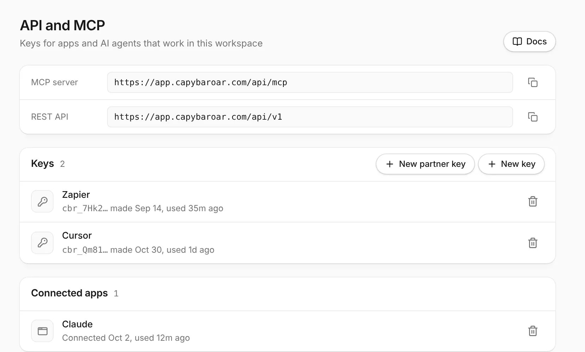
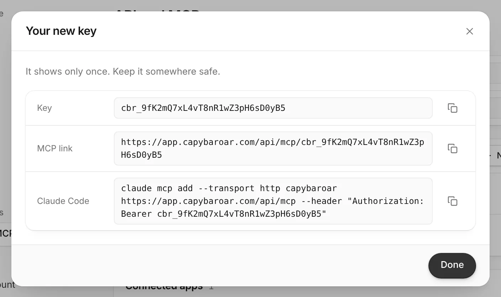

import { Aside, CardGrid, LinkCard, LinkButton, Steps } from '@astrojs/starlight/components';

The REST API lets your own code schedule posts and read results. It runs the same actions as the [MCP server](/ai/mcp/), and every plan includes it, Free too.

This page is the quick start. The [API reference](/api-reference/) has every endpoint in detail, with parameters, sample replies and errors.

<LinkButton href="https://app.capybaroar.com/settings?tab=api" variant="secondary" icon="external">Open in Capybaroar</LinkButton>

## Make a key

<Steps>

1. **Open API and MCP.** In the app, click **Settings**, then **API and MCP**.

   

1. **Press New key.** Name it after the app that uses it, then press **Make key**.

1. **Copy the key.** It starts with `cbr_` and shows only once. Keep it somewhere safe.

   

</Steps>

A key acts as the person who made it, with their role and brands, and it's checked on every request. The **Keys** list shows when each key was made and last used. Press **Delete key** at any time, and apps using it stop working.

## Send a request

The base address is `https://app.capybaroar.com/api/v1`. Send the key as `Authorization: Bearer cbr_...` and JSON bodies. Times are ISO 8601 with an offset, like `2026-11-05T09:00:00-05:00`.

```sh
curl https://app.capybaroar.com/api/v1/channels \
  -H "Authorization: Bearer cbr_..."
```

## Requests

| Request | What it does |
| - | - |
| `GET /brands` | Brands |
| `GET /channels?brand_id=` | Channels, with limits and settings |
| `GET /channel-groups` | Channel groups and their channels |
| `GET /campaigns` | Campaigns |
| `GET /posts?from=&to=&brand_id=` | Posts in a range (the next 30 days without `from` and `to`) |
| `POST /posts` | Make a post |
| `GET /posts/{id}` | One post |
| `PATCH /posts/{id}` | Change the fields you send |
| `DELETE /posts/{id}` | Delete a post from Capybaroar |
| `DELETE /posts/{id}?everywhere=true&channels=` | Delete a post on the networks it went out on (all, or the channel ids in `channels`, comma-separated) |
| `GET /media` | Media library |
| `POST /media` | Add a file from a link |
| `POST /generations` | Start an AI file: an infographic, animation, picture, video or audio |
| `GET /generations/{id}` | Check an AI file: queued, running, done or failed |
| `GET /credits` | AI credits left and when plan credits refill |
| `GET /queue` | Next free queue time |
| `GET /analytics?days=30&channel_id=` | Results for 7, 30 or 90 days |
| `GET /webhooks` | Webhooks |
| `POST /webhooks` | Add a webhook |
| `PATCH /webhooks/{id}` | Turn it on or off: `{"enabled": false}` |
| `POST /webhooks/{id}/test` | Send a `ping` event now |
| `DELETE /webhooks/{id}` | Delete a webhook |

## Make a post

```sh
curl https://app.capybaroar.com/api/v1/posts \
  -H "Authorization: Bearer cbr_..." \
  -H "Content-Type: application/json" \
  -d '{
    "channel_ids": ["CHANNEL_ID"],
    "text": "We just shipped the new calendar.",
    "publish_at": "2026-11-05T09:00:00-05:00",
    "mode": "schedule",
    "settings": { "CHANNEL_ID": { "first_comment": "Try it: capybaroar.com" } }
  }'
```

| Field | What it is |
| - | - |
| `channel_ids` | Channels from one brand. Required. |
| `text` | The text every channel shares |
| `mode` | `draft` (the default), `schedule`, `now` or `queue` |
| `publish_at` | Required for `draft` and `schedule` |
| `media_ids` | Files from the media library, in order |
| `thread` | A thread's posts after the first, each `{ "text", "media_ids" }`, up to 24. They go out as replies on X, Bluesky, Threads and Mastodon. Other channels post the first only. |
| `channel_text` | Own text for some channels, by channel id |
| `settings` | Network settings by channel id, like a first comment, a YouTube title or a Pinterest board |
| `campaign_id` | The campaign the post belongs to, or `null` to take it out of one |

Posts get the same checks as in the app: character limits, required settings, media, plan limits, brands and approvals. In a brand that needs approval, an editor's post waits in review. `GET /channels` lists each channel's settings and which are required.

## Delete a post

A plain delete removes the post from Capybaroar only. What already went out stays on the networks. With `everywhere`, each channel is deleted on its network and the answer lists what happened on each one.

```sh
curl -X DELETE "https://app.capybaroar.com/api/v1/posts/POST_ID?everywhere=true" \
  -H "Authorization: Bearer cbr_..."
```

Each channel's `result` is one of these:

| Result | What it means |
| - | - |
| `deleted` | It's gone from the network |
| `failed` | It didn't work. The `error` says why. Try again. |
| `manual` | The network can't delete from here. Open `url` and delete it there. Instagram and TikTok always answer this. |
| `skipped` | Nothing went out on that channel |

`deleted` at the top is true once every channel is deleted. The post then stays in Capybaroar with the status `deleted`, so analytics keep its results. Delete it again without `everywhere` to remove the record.

## Upload a file by link

Send a public link and Capybaroar downloads the file into the media library. It takes JPG, PNG, GIF, WebP, MP4 and MOV up to 250 MB, judged by the file itself. Links to private networks are refused.

```sh
curl https://app.capybaroar.com/api/v1/media \
  -H "Authorization: Bearer cbr_..." \
  -H "Content-Type: application/json" \
  -d '{ "url": "https://example.com/launch.png", "alt": "The new calendar" }'
```

The answer has the file's `id`. Put it in `media_ids` when you make a post.

## Make an AI file

`POST /generations` takes a `kind` (`infographic`, `motion`, `image`, `video` or `audio`) and a `prompt`. It answers right away with status 202 and an id. Check `GET /generations/{id}` until it's done, then attach the media it made. It needs a plan with AI and uses [AI credits](/ai/ai-credits/).

## Errors and limits

Errors come back as `{"error": {"code": "...", "message": "..."}}` with a status:

| Status | What it means |
| - | - |
| 400 | A request to fix. The message says what. |
| 401 | A missing or deleted key |
| 404 | Something isn't there |
| 409 | The post already went out |
| 429 | Over 120 requests a minute for this key. Wait for the seconds in `Retry-After`. |

<Aside type="caution">
A key can post as you. Keep it out of code you share, and delete it if it leaks.
</Aside>

## Related

<CardGrid>
  <LinkCard title="Webhooks" href="/developers/webhooks/" />
  <LinkCard title="Use Capybaroar from Claude, ChatGPT or Cursor" href="/ai/mcp/" />
</CardGrid>
