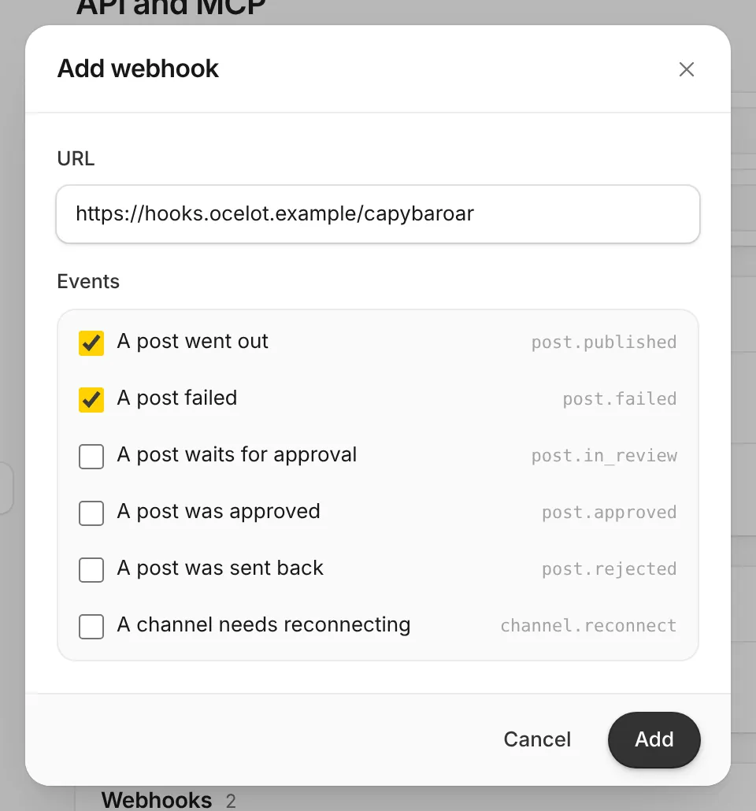
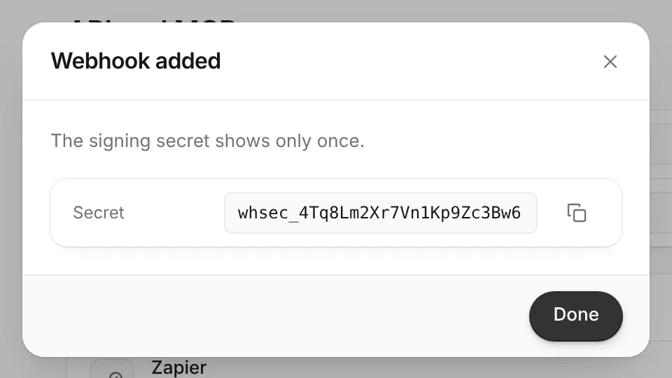
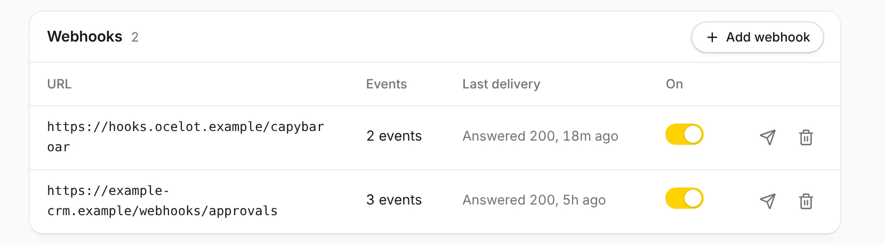

import { Aside, CardGrid, LinkCard, LinkButton, Steps } from '@astrojs/starlight/components';

A webhook tells your own tools when something happens in Capybaroar. Capybaroar sends a POST to your URL with the event, signed so you can check it came from us. Webhooks are on every plan.

<LinkButton href="https://app.capybaroar.com/settings?tab=api" variant="secondary" icon="external">Open in Capybaroar</LinkButton>

## Add a webhook

<Steps>

1. **Open API and MCP.** Click **Settings**, then **API and MCP**. Only owners and admins can manage webhooks.

1. **Press Add webhook.** Enter an `https://` URL and tick the events you want. **A post went out** and **A post failed** start ticked.

   

1. **Copy the signing secret.** It shows only once, under **Webhook added**. Keep it with your code.

   

1. **Send a test.** Press **Send a test** to send a `ping` event and check your URL answers.

   

</Steps>

You can also add one with `POST /webhooks` in the [REST API](/developers/rest-api/). A workspace can have up to 10 webhooks.

## Events

| Event | In Settings | When |
| - | - | - |
| `post.published` | A post went out | A post went out on a channel, with its link |
| `post.failed` | A post failed | A post failed on a channel after its retries, with the reason |
| `post.in_review` | A post waits for approval | A post waits for approval |
| `post.approved` | A post was approved | A post was approved |
| `post.rejected` | A post was sent back | A post was sent back, with the comment |
| `channel.reconnect` | A channel needs reconnecting | A channel needs reconnecting |

## What a delivery looks like

```http
POST https://your-site.com/hooks/capybaroar
Capybaroar-Event: post.published
Capybaroar-Delivery: evt_6f1c...
Capybaroar-Signature: t=1793700000,v1=5257a8...

{
  "id": "evt_6f1c...",
  "type": "post.published",
  "created_at": "2026-11-05T14:00:03.120Z",
  "workspace_id": "...",
  "data": { "post_id": "...", "brand_id": "...", "channel_id": "...", "channel_name": "Acme", "network": "linkedin", "url": "https://www.linkedin.com/feed/update/..." }
}
```

## Check the signature

The `Capybaroar-Signature` header holds a time `t` and `v1`, the HMAC-SHA256 of `t`, a dot and the raw body, keyed with your signing secret. Check each request before you trust it:

```js
import { createHmac, timingSafeEqual } from "node:crypto";

function verify(secret, header, rawBody) {
  const { t, v1 } = Object.fromEntries(header.split(",").map((p) => p.split("=")));
  const want = createHmac("sha256", secret).update(`${t}.${rawBody}`).digest("hex");
  const fresh = Math.abs(Date.now() / 1000 - Number(t)) < 300;
  return fresh && timingSafeEqual(Buffer.from(want), Buffer.from(v1));
}
```

## Answering and retries

Answer with a 2xx within 10 seconds. Anything else is tried again after 1, 5, 15 and 60 minutes, then 3, 6 and 12 hours. Every try of an event has the same `id`, so you can skip ones you already handled.

A webhook whose deliveries fail 5 times in a row turns itself off, and Settings shows why. Fix your URL, then switch it back on in the **Webhooks** list. The **Last delivery** column shows how the newest one went.

<Aside type="note">
Capybaroar only sends webhooks to addresses on the public internet. It checks the address it connects to, so a URL that points inside a private network is refused.
</Aside>

## Related

<CardGrid>
  <LinkCard title="REST API" href="/developers/rest-api/" />
  <LinkCard title="Approvals" href="/workspace/approvals/" />
</CardGrid>
