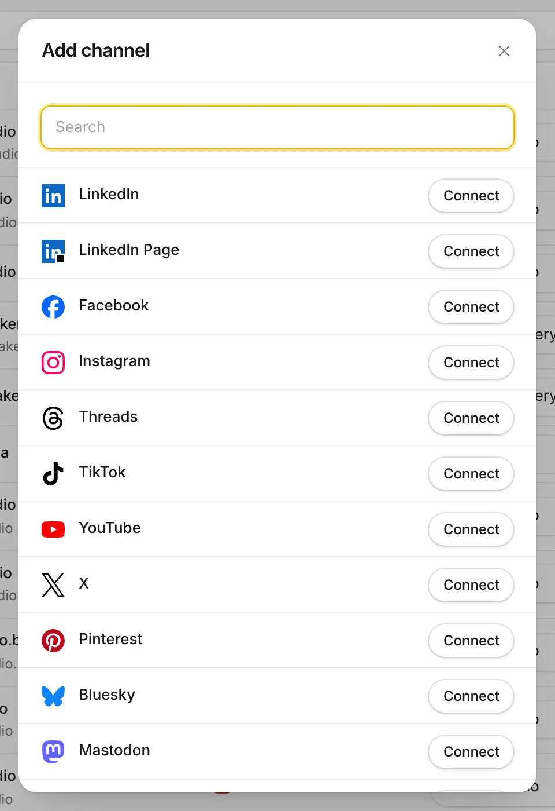
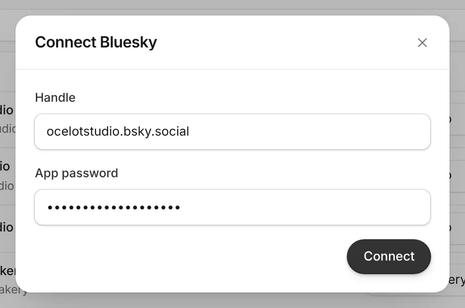
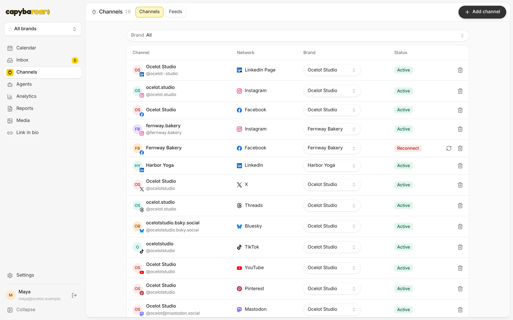

import { Aside, CardGrid, LinkCard, LinkButton, Steps } from '@astrojs/starlight/components';

A channel is one social account Capybaroar can post to, like your Instagram account or your LinkedIn Page.

<LinkButton href="https://app.capybaroar.com/channels" variant="secondary" icon="external">Open in Capybaroar</LinkButton>

## Steps

<Steps>

1. **Open Channels.** Click **Channels** in the sidebar.

1. **Pick a network.** Click **Add channel**, find the network you want to add and press **Connect**. Your first time on Channels, the networks are listed on the page itself.

   

1. **Sign in and approve.** Most networks open their own sign-in page. Sign in with the account you post from and approve Capybaroar. Bluesky, Discord, Telegram and WordPress ask for details in a short form instead.

   

1. **Check it's connected.** You land back on Channels, and the new channel shows as **Active**. Post to it from the calendar.

   

</Steps>

<Aside type="note">
A network marked **Soon** can't be connected in your workspace yet.
</Aside>

## How each network connects

| Network | How you connect |
| - | - |
| [Instagram](/channels/instagram/), [Facebook](/channels/facebook/), [Threads](/channels/threads/) | Sign in with Meta |
| [TikTok](/channels/tiktok/) | Sign in with TikTok |
| [LinkedIn](/channels/linkedin/) | Sign in with LinkedIn, for your profile or a Page you manage |
| [YouTube](/channels/youtube/) | Sign in with the Google account that owns the channel |
| [X](/channels/x/), [Pinterest](/channels/pinterest/) | Sign in with that network |
| [Mastodon](/channels/mastodon/) | Type your server, then sign in there |
| [Bluesky](/channels/bluesky/) | Your handle and an app password |
| [Discord](/channels/discord/) | A webhook link for the channel |
| [Telegram](/channels/telegram/) | Add the Capybaroar bot as an admin, then type your channel or group |
| [WordPress](/channels/wordpress/) | Your site address, username and an application password |

## When a channel says Reconnect

Networks sign apps out from time to time, for example after a password change. Click **Reconnect** on the channel and sign in again. Scheduled posts stay in place.

## How many channels you can add

Free covers 3 channels, Creator 8, Pro 30 and Agency 100. Reconnecting a channel you already have doesn't count as a new one.

## Brands

Each channel belongs to one brand. On plans with more than one brand, Channels shows a **Brand** column. Pick a brand there to move a channel to it. See [Team and roles](/workspace/brands/).

## Related

<CardGrid>
  <LinkCard title="Schedule your first post" href="/get-started/schedule-your-first-post/" />
  <LinkCard title="Instagram" href="/channels/instagram/" />
  <LinkCard title="LinkedIn" href="/channels/linkedin/" />
</CardGrid>
