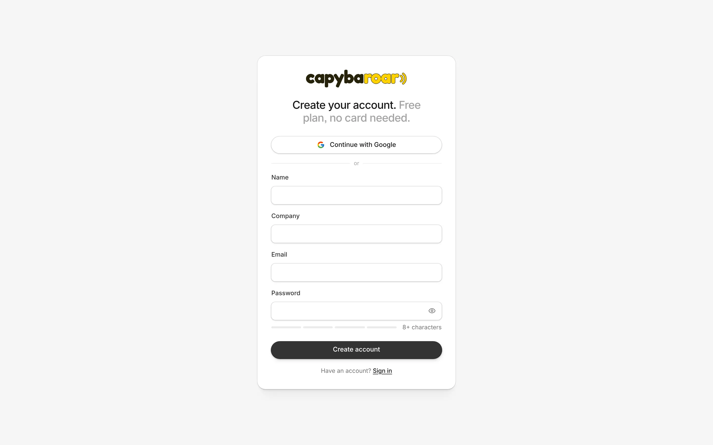
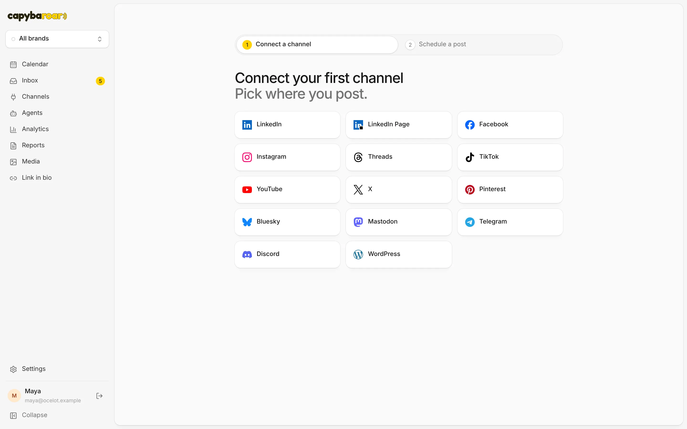
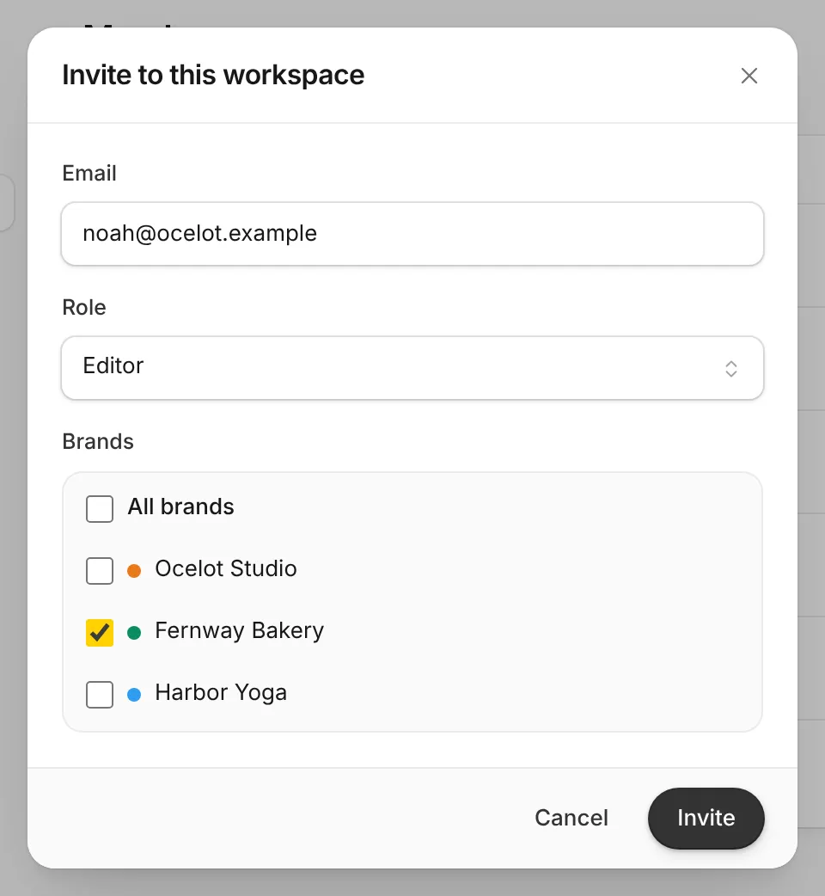

import { CardGrid, LinkCard, LinkButton, Steps } from '@astrojs/starlight/components';

Sign up with your email in under a minute. You start on 14 days of Pro, free, with no card.

<LinkButton href="https://app.capybaroar.com/signup" variant="secondary" icon="external">Open in Capybaroar</LinkButton>

## Steps

<Steps>

1. **Open the sign-up page.** Go to [app.capybaroar.com/signup](https://app.capybaroar.com/signup).

1. **Fill in the form.** Enter your name, company, email and a password, then press **Create account**.

   

1. **Follow the welcome steps.** The welcome screen walks you through two things: **Connect a channel** and **Schedule a post**.

   

</Steps>

## Your free trial

New workspaces get 14 days of Pro with 200 AI credits. You don't need a card. When the trial ends you move to the Free plan unless you pick a paid plan, and your posts and channels stay where they are.

## Inviting your team

Pro includes 5 members and Agency includes 15. Clients who only approve posts don't take a seat. Invite people from **Settings**, then **Members**. See [Team and roles](/workspace/team-and-roles/).

## Related

<CardGrid>
  <LinkCard title="Connect your first channel" href="/get-started/connect-a-channel/" />
  <LinkCard title="What is Capybaroar?" href="/get-started/welcome/" />
</CardGrid>
