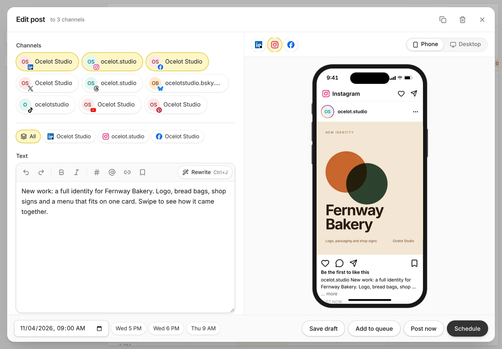
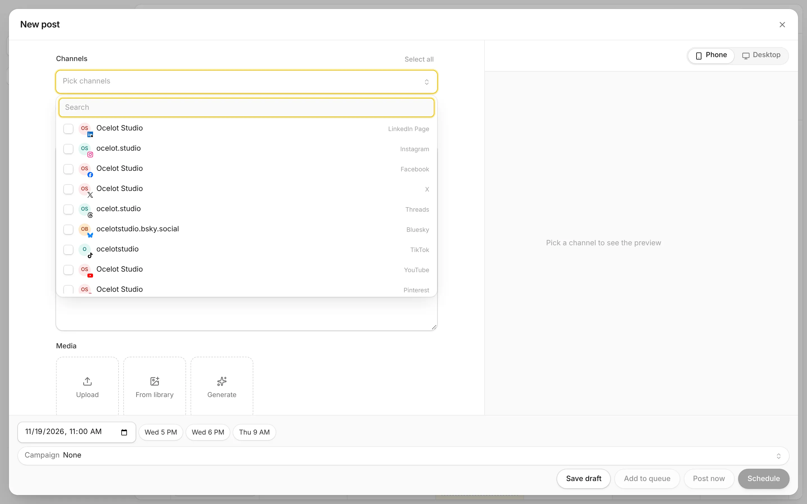
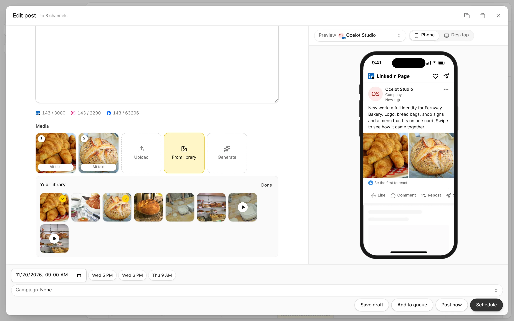
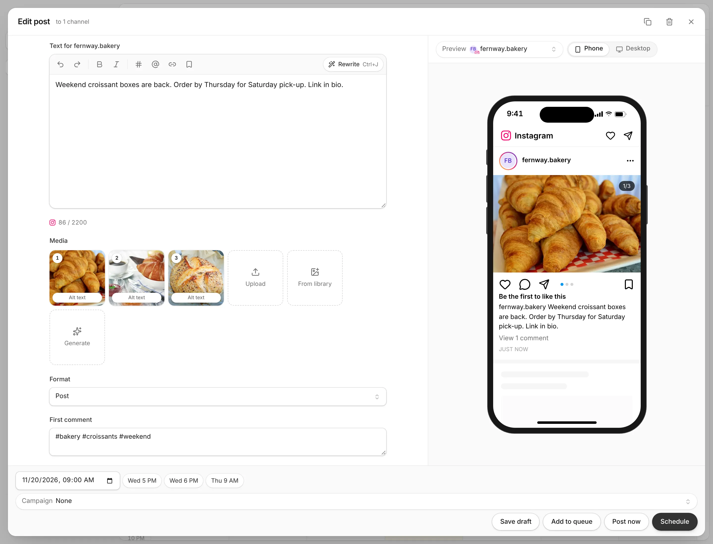
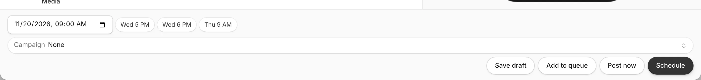
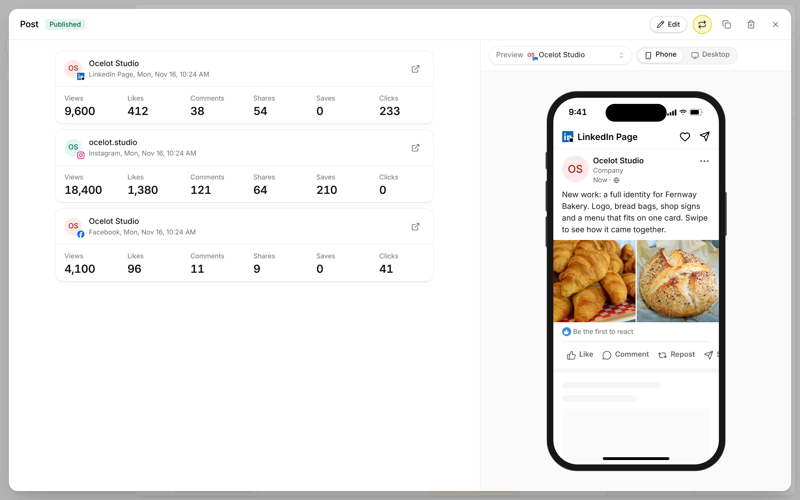

import { CardGrid, LinkCard, LinkButton, Steps } from '@astrojs/starlight/components';

Write a post once, check how it looks on each network, then schedule it, queue it or post it now.

<LinkButton href="https://app.capybaroar.com/calendar" variant="secondary" icon="external">Open in Capybaroar</LinkButton>

<video class="walkthrough" src="/videos/write-a-post.mp4" autoplay muted loop playsinline preload="metadata" width="1280" height="800" aria-label="Writing a post: picking channels, typing the text and checking the preview for each channel" title="Writing a post: picking channels, typing the text and checking the preview for each channel"></video>

## Steps

<Steps>

1. **Open the calendar.** Click **Calendar**, then **New post**.

1. **Pick channels.** Choose one or more connected channels at the top of the editor.

   

1. **Write your post.** Type your text. The counter shows how much room each network has left.

1. **Add pictures or a video.** Upload files or pick them from your media. Some networks need media, like Instagram, TikTok, YouTube and Pinterest.

   

1. **Set network options.** Click a channel's tab to change things for that network only, like an Instagram Reel, a YouTube title or a Pinterest board. You can also change the text for one network.

   

1. **Check the preview.** The right side shows how the post will look on each network. Click a video to play it.

1. **Choose when it goes out.**
   - **Schedule:** pick a date and time.
   - **Add to queue:** put it in your next open queue time.
   - **Post now:** publish right away.
   - **Save draft:** keep it for later.

   

</Steps>

## After it posts

Open the post again from the calendar to see each channel's result. When a network gives Capybaroar the post's address, an **Open post** link shows next to that channel. If a network turns a post down, its reason shows in the same place.

## Tips

- Use a first comment on Instagram, Facebook and LinkedIn for links or hashtags.
- Upload many posts at once with **Bulk** in the calendar. See [Bulk upload and automation](/publishing/bulk-and-automation/).
- Let the [agent](/ai/agent/) write a whole week of drafts, then edit and schedule them here.
- Press Ctrl+Enter (⌘Enter on a Mac) to schedule, and Ctrl+S (⌘S) to save a draft.

## Related

<CardGrid>
  <LinkCard title="Connect your first channel" href="/get-started/connect-a-channel/" />
  <LinkCard title="The AI agent" href="/ai/agent/" />
  <LinkCard title="Plan a week of posts with the agent" href="/ai/plan-a-week/" />
</CardGrid>
