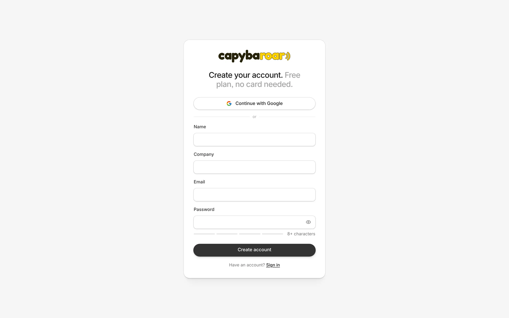

import { Aside, CardGrid, LinkCard, LinkButton, Steps } from '@astrojs/starlight/components';

Capybaroar has three ways to sign in: your email and password, a link and code sent to your email, or Google where it's turned on. This page covers each screen.

<LinkButton href="https://app.capybaroar.com/login" variant="secondary" icon="external">Open in Capybaroar</LinkButton>

## Make an account

<Steps>

1. **Open the sign-up page.** It says **Create your account.** and **Free plan, no card needed.**

1. **Fill in the form:** **Name**, **Company**, **Email** and **Password**.
   - The password needs at least 8 characters. Longer is stronger. A password known from a data leak is refused with the number of leaks it showed up in.
   - Use an address you'll keep. Throwaway inboxes can't sign up.
   - If the email looks like a typo, like `gmial.com`, the form asks **Did you mean** the right one.

1. **Tick I agree to the Terms, Privacy Policy and Data Processing Agreement.**

1. **Press Create account.** A short bot check may run first.

1. **Confirm your email.** Open the email from Capybaroar and press its link. The sign-in page then says **Your email is confirmed. Sign in to continue.**

</Steps>

A new workspace starts a 14-day Pro trial. See [Create your account](/get-started/create-account/).

## Sign in with a password

1. Open the sign-in page. It says **Sign in to your calendar.**
1. Type your **Email** and **Password**. The eye button shows or hides the password, and the form warns **Caps Lock is on**.
1. Press **Sign in**.

A wrong email and a wrong password both say `Wrong email or password`, so nobody can test which addresses have accounts. After 10 tries for one email in 15 minutes, you're asked to wait: `Too many tries. Try again in <n> minutes.`

## Sign in with an email link and code

<Steps>

1. **Press Email me a sign-in link.** The screen says **Sign in with email.** and **We'll send a link and a code.**

1. **Type your email** and press send. Buttons to **Open Gmail** or **Open Outlook** help you find the email. **Use a different email** goes back.

1. **Press the link in the email**, in the same browser. Or type the 6-digit **Code** from the email and press **Sign in**. The code works on any device.

</Steps>

- You can send a new link once a minute. The button counts down: **Send again in `<n>`s**.
- A link works once. An old one says `That link has expired or was already used. Sign in, or send a new one.`
- A link opened in another browser says `That link opened in a different browser. Sign in here, or open it where you asked for it.` Type the code instead.

## Continue with Google

When Google sign-in is on, the sign-in page shows **Continue with Google**. The way you signed in last time is marked **Last used**. After Google, you land in the app.

## Two-factor codes

If you turned on two-factor sign-in, signing in asks for a second step: **Enter the code from your app.** Type the 6-digit **Code** from your authenticator app.

- Lost your phone? Press **Use a backup code** and type one of your 10 backup codes, like `xxxxx-xxxxx`. Each works once.
- Five wrong codes in 10 minutes lock code entry: `Too many wrong codes. Try again in 15 minutes.`

When a workspace requires two-factor sign-in, members without it are sent to set it up before they continue. See [Your account and security](/workspace/your-account/#two-factor-sign-in).

## Forgot your password

<Steps>

1. **Press Forgot password?** on the sign-in page. It says **Reset your password.** and **We'll email you a link.**

1. **Type your email** and press **Send reset link**. The page says **Check your email for a link to set a new password.**

1. **Open the link** and type a **New password**. Press **Save password**.

</Steps>

You can ask for 3 reset emails an hour. Resetting your password signs out your other sessions.

## A new device

When you sign in on a device Capybaroar hasn't seen, you get an email about it. If it wasn't you, press **This wasn't me** in the email to sign out every device, then reset your password.

## Invites

An invite link opens **You're invited** with **Join `<workspace>`**. Sign in, or make an account, with the address the invite was sent to. See [Team and roles](/workspace/team-and-roles/#invites).

## Sign out

Press **Sign out** (the arrow beside your name at the bottom of the sidebar). To sign out other devices too, use **Sign out other devices** in **Settings**, **Your account**.

<Aside type="note">
All sign-in screen messages, and what to do about each one, are in [Errors with your account](/errors/account-and-team/#signing-in).
</Aside>

## Related

<CardGrid>
  <LinkCard title="Create your account" href="/get-started/create-account/" />
  <LinkCard title="Your account and security" href="/workspace/your-account/" />
</CardGrid>
