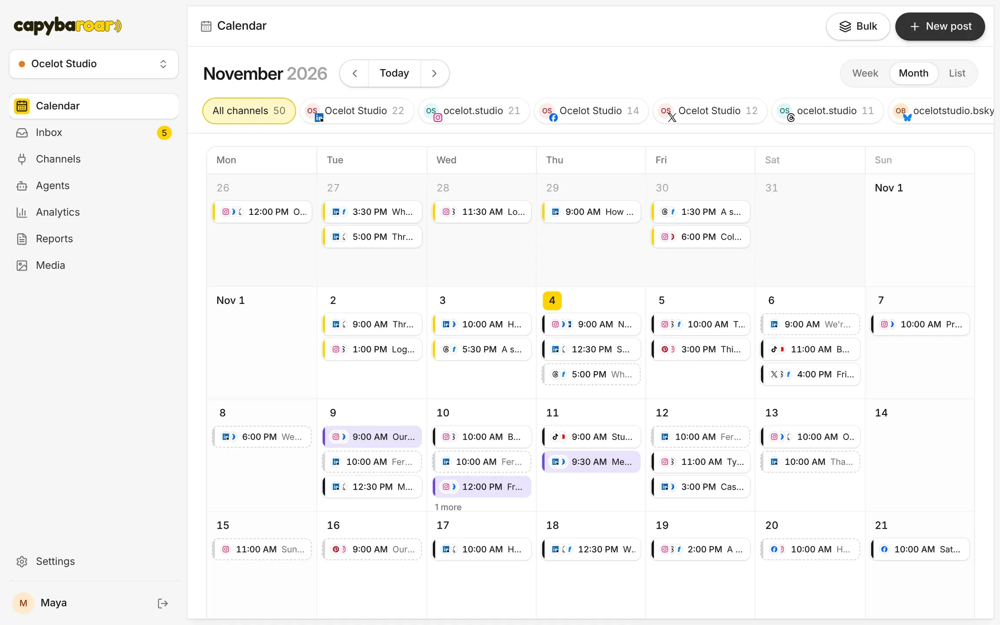
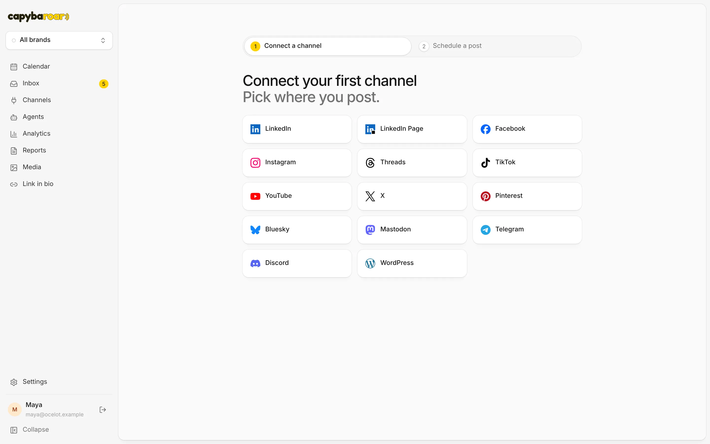

import { Aside, CardGrid, LinkCard, LinkButton } from '@astrojs/starlight/components';

Capybaroar has one sidebar on the left and one page on the right. This page walks through each part so you know where everything lives.

<LinkButton href="https://app.capybaroar.com/calendar" variant="secondary" icon="external">Open in Capybaroar</LinkButton>

## The sidebar

From top to bottom:

| Part | What it is |
| - | - |
| **The logo** | Goes to the calendar |
| **The brand menu** | The brand you're working in, and your workspaces (below) |
| **Calendar** | Every post for every channel. See [The calendar](/publishing/calendar-and-queue/). |
| **Inbox** | Comments, replies, mentions and messages. The number beside it is how many conversations are open. See [Inbox](/results/inbox/). |
| **Channels** | Connected accounts, and the **Feeds** tab. See [The Channels screen](/channels/channels-screen/). |
| **Agents** | Chats with the AI agent, with your 6 newest chats under it and **All chats**. See [The AI agent](/ai/agent/). |
| **Analytics** | Your results. See [Analytics](/results/analytics/). |
| **Reports** | Results to share with clients. See [Reports](/results/reports/). |
| **Media** | Your files. See [The media library](/publishing/media-library/). |
| **Link in bio** | A page for your profiles. See [Link in bio](/results/link-in-bio/). |
| **Settings** | Workspace and account settings. See [General settings](/workspace/settings-general/). |
| **You** | Your picture and name, with **Sign out** |

The open section is lit, with its icon on a small yellow square.

### Fold the sidebar

On a computer, press **Collapse** at the bottom of the sidebar to fold it to icons only and give the page more room. Point at an icon to see its name. The same button, **Expand sidebar**, opens it again. On a phone, the sidebar becomes a bar at the top.

## The brand menu

The menu under the logo says which brand you're in. Everything you see follows it: the calendar, channels, the Inbox, analytics, media, reports and link in bio.

- Pick a brand to switch to it.
- Owners and admins with more than one brand can pick **All brands** to see everything at once.
- With many brands, type in **Search brands**.
- **Manage brands** opens **Settings**, **Brands**.
- If you belong to more than one workspace, they're listed here too. Pick one to switch.

New channels, files and posts go into the brand you're in. See [Brands](/workspace/brands/).

## Page headers

Each page has a white header bar with its icon and title, the count of what's in it where that helps, its tabs beside the title, and its main buttons on the right. For example, **Channels** shows **Channels** and **Feeds** tabs and **Add channel**, and the calendar shows **Campaigns**, **Bulk** and **New post**.

## Dialogs and menus

- Menus open where you click and close with Esc or a click outside.
- Questions, like **Delete this post?**, show in a box with a button for each choice.
- Things that can't be undone, like deleting a workspace, ask you to type a name to confirm.

## First screens

A section with nothing in it yet shows one picture, a short title and one button, like **Add your first file** in Media or **Add your first feed** in Feeds. Press the button to start.

## The welcome screen

Right after you sign up, the welcome screen walks you through two steps: **Connect your first channel** with a button for each network, then scheduling your first post. See [Connect your first channel](/get-started/connect-a-channel/).

## What each role sees

| Role | Sidebar |
| - | - |
| **Owner**, **Admin** | Every section, and every Settings tab |
| **Editor** | Every section. Settings shows only **Your account**. |
| **Client** | **Calendar** and **Settings** (only **Your account**) |

See [Roles and permissions](/reference/roles-and-permissions/).

## Keyboard shortcuts

| Where | Keys | Action |
| - | - | - |
| Post editor | ⌘Enter / Ctrl+Enter | Schedule |
| Post editor | ⌘⇧Enter / Ctrl+Shift+Enter | Post now |
| Post editor | ⌘S / Ctrl+S | Save draft |
| Post editor | ⌘J / Ctrl+J | Rewrite |
| Post editor | Esc | Close |
| Inbox | `j`, `k` | Next and previous conversation |
| Inbox | `r` | Reply |
| Inbox | `e` | Mark done, or open again |
| Agents | Enter, Shift+Enter | Send, new line |

<Aside type="tip">
Every screen has its own address, like `app.capybaroar.com/settings?tab=queue`. Bookmark the ones you use most.
</Aside>

## Related

<CardGrid>
  <LinkCard title="Welcome to Capybaroar" href="/get-started/welcome/" />
  <LinkCard title="The post editor" href="/publishing/post-editor/" />
</CardGrid>
