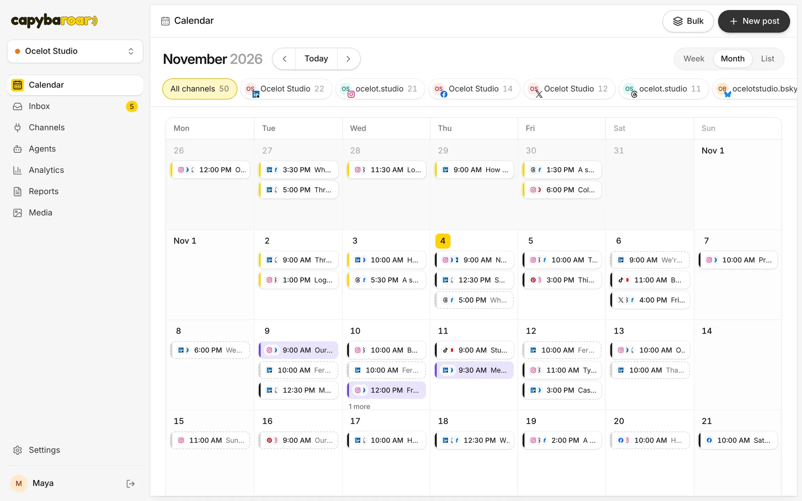
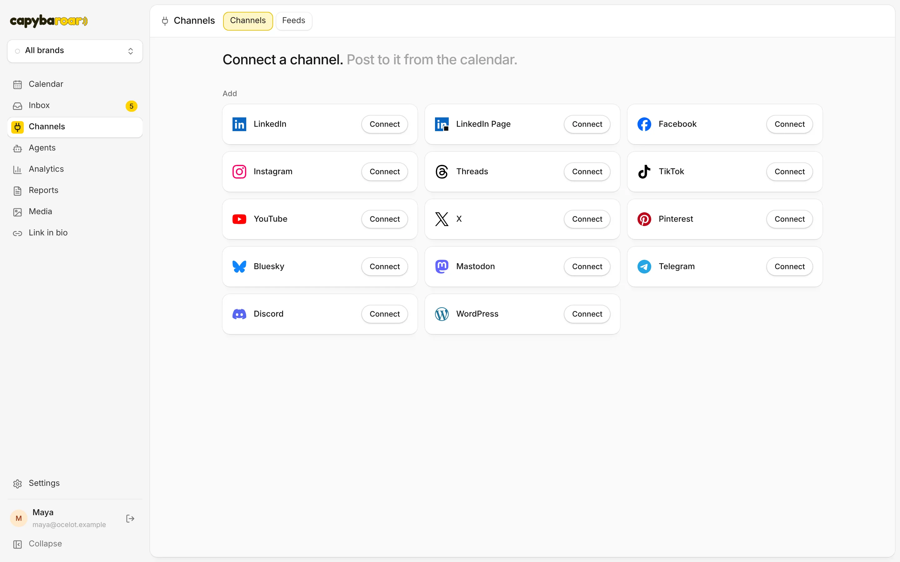

import { CardGrid, LinkCard, LinkButton, Steps } from '@astrojs/starlight/components';

Capybaroar is an agentic social media platform: an AI agent plans and writes your posts, and you schedule them to 14 networks from one calendar.

<LinkButton href="https://app.capybaroar.com/calendar" variant="secondary" icon="external">Open in Capybaroar</LinkButton>

## What you can do

- **Calendar:** plan, write and schedule posts for every channel in one place, with a preview for each network.
- **Agents:** ask for a week of posts in one message. The agent writes them as drafts for you to check.
- **Inbox:** answer comments and mentions from your channels without switching apps.
- **Analytics and Reports:** see reach, engagement and your best times to post, then share a report.
- **Link in bio:** one page for every link you share.
- **MCP and API:** use Capybaroar from Claude, ChatGPT or Cursor, or from your own code.

## The 14 networks

Instagram, Facebook, TikTok, LinkedIn profiles, LinkedIn Pages, YouTube, X, Threads, Pinterest, Bluesky, Mastodon, Discord, Telegram and WordPress. Each one has its own page in these docs with what you can post and how to connect it.

## Plans

The Free plan covers 3 channels and 30 scheduled posts a month for 1 person. Creator, Pro and Agency add more channels, AI credits, teammates, brands and approvals. New accounts get 14 days of Pro free, with no card needed. See [Plans and billing](/workspace/plans-and-billing/) for every limit.

## Where to start

<Steps>

1. [Create your account](/get-started/create-account/)
1. [Connect your first channel](/get-started/connect-a-channel/)
1. [Schedule your first post](/get-started/schedule-your-first-post/)

</Steps>

## Related

<CardGrid>
  <LinkCard title="Create your account" href="/get-started/create-account/" />
  <LinkCard title="Connect your first channel" href="/get-started/connect-a-channel/" />
  <LinkCard title="The AI agent" href="/ai/agent/" />
</CardGrid>
