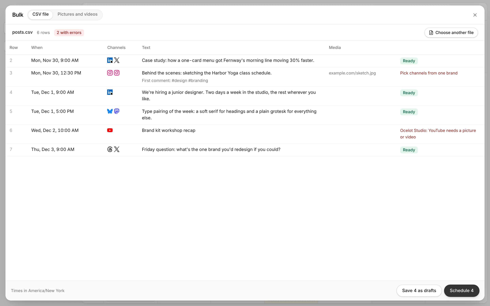

import { CardGrid, LinkCard, LinkButton } from '@astrojs/starlight/components';

Writing one post at a time is fine for a launch. For the rest of the month, Capybaroar has four ways to fill the calendar faster. All of them are on every plan, Free too.

<LinkButton href="https://app.capybaroar.com/calendar" variant="secondary" icon="external">Open in Capybaroar</LinkButton>

| Tool | Best for | Where |
| - | - | - |
| **Bulk upload from a CSV file** | A month of posts planned in a spreadsheet, up to 500 at once | **Calendar**, **Bulk**, **CSV file** |
| **Bulk upload of pictures and videos** | A photo shoot or a set of clips, one post per file, with AI captions | **Calendar**, **Bulk**, **Pictures and videos** |
| **RSS feeds** | A blog or news site, posted as each article comes out | **Channels**, **Feeds** |
| **Evergreen posts** | Your best posts, repeated every few weeks | A published post's **Evergreen** button |

## How they work together

- Bulk upload and RSS feeds can use your [posting queue](/publishing/posting-queue/), so posts land at your usual times without clashing.
- Evergreen copies go into the queue too.
- Everything they make shows on the calendar like any other post, with the same checks: character limits, required settings, media, plan limits and approvals.
- In a brand that needs approval, posts made by an editor wait in review.

On Free, scheduled posts count toward the 30 a month. Drafts don't, so a bulk upload that won't fit can be saved as drafts.

## Pages

<CardGrid>
  <LinkCard title="Bulk upload" href="/publishing/bulk-upload/" description="CSV columns, Ready and Draft only, files spread over the queue" />
  <LinkCard title="RSS feeds" href="/publishing/rss-feeds/" description="Templates, drafts or queue, the Active switch" />
  <LinkCard title="Evergreen posts" href="/publishing/evergreen/" description="Repeat a post every 1 to 26 weeks" />
  <LinkCard title="Plan a week of posts with the agent" href="/ai/plan-a-week/" description="Let the agent write the drafts for you" />
</CardGrid>
