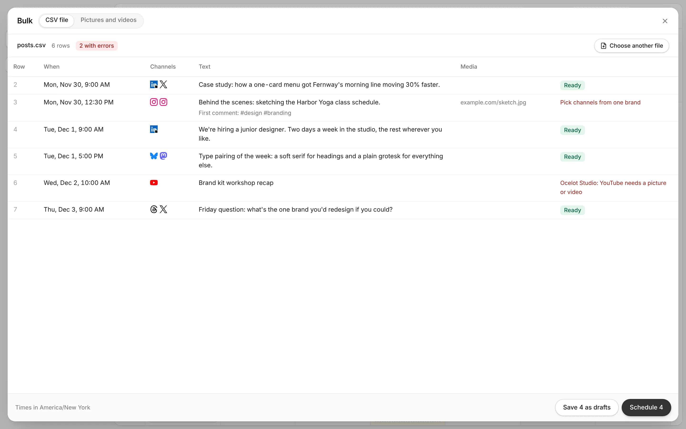
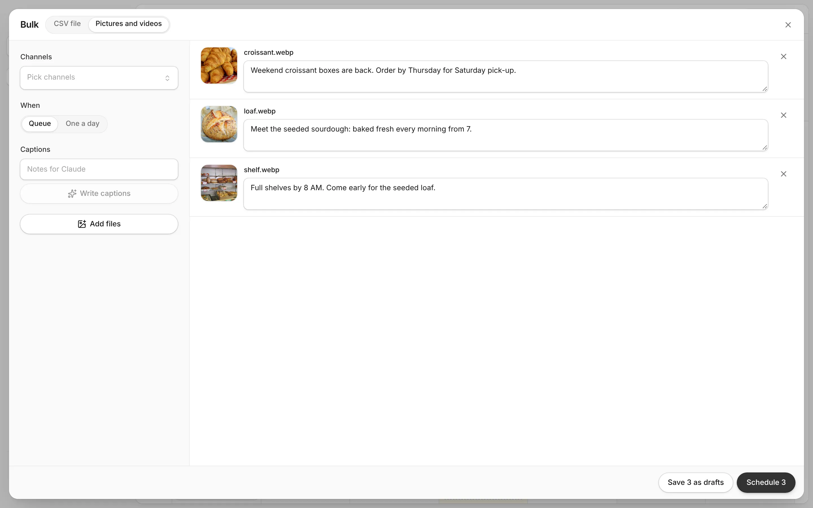

import { Aside, CardGrid, LinkCard, LinkButton, Steps, Tabs, TabItem } from '@astrojs/starlight/components';

**Bulk** on the calendar makes many posts at once, from a CSV file or from a stack of pictures and videos. It's on every plan, Free too.

<LinkButton href="https://app.capybaroar.com/calendar" variant="secondary" icon="external">Open in Capybaroar</LinkButton>

Open **Calendar** and press **Bulk**. Under **Import from**, pick **CSV file** or **Pictures and videos**. Owners, admins and editors can use it.

<video class="walkthrough" src="/videos/bulk-csv.mp4" autoplay muted loop playsinline preload="metadata" width="1280" height="800" aria-label="Opening Bulk, choosing a CSV file and seeing every row marked Ready" title="Opening Bulk, choosing a CSV file and seeing every row marked Ready"></video>

## From a CSV file



<Steps>

1. **Get the template.** Press **Template** to download a CSV file with the right columns and an example row.

1. **Fill in your posts** in any spreadsheet, one row for each post. Save it as CSV.

1. **Choose the file.** Drop it on the sheet, or press **Choose file**. Capybaroar reads every row and shows each one with its time, channels and text, before anything is saved.

1. **Check the rows.** Each row shows **Ready**, **Draft only**, or the problem to fix in red.

1. **Save.** **Schedule `<n>`** schedules the **Ready** rows. **Save `<n>` as drafts** saves every good row as a draft. While it saves, the sheet says **Saving `<n>` of `<total>`**.

</Steps>

### The columns

| Column | Needed | What to put in it |
| - | - | - |
| `date` | Yes | Year-month-day, like `2026-12-01` or `2026/12/01` |
| `time` | Yes | Like `09:30`, `14:30` or `2:30 PM`, in the workspace's time zone. You can also put date and time together in `date`, like `2026-12-01 09:30`. |
| `channels` | Yes | Channel names, @handles or network names, split by `\|`, `;` or `,`. A network name, like `LinkedIn`, picks every channel on that network. |
| `text` | Yes, or a media URL | The post's text. A line with only `---` starts the next part of a thread. |
| `media url` | No | A public `http://` or `https://` link to one picture, video or PDF. Capybaroar downloads it into your media library. |
| `first comment` | No | Posted as a comment right after, on LinkedIn, Facebook and Instagram |
| `title` | No | The title, for networks that take one: YouTube, Pinterest, WordPress and TikTok photo posts |
| `campaign` | No | A campaign name, up to 60 characters. A new name makes a new campaign. |

Here is the template's example row:

```csv
date,time,channels,text,media url,first comment,campaign
2026-12-01,09:30,LinkedIn | X,"Our winter launch is live, read more at https://example.com",,,Winter launch
```

<Aside type="tip">
Text with commas or line breaks must be inside double quotes, as in the example. Spreadsheet apps do this for you when they save as CSV.
</Aside>

### Ready, Draft only, and problems

| Row shows | What it means |
| - | - |
| **Ready** | It passes every check and can be scheduled |
| **Draft only** | It's fine as a draft, but a network needs something a CSV row doesn't have, like a required setting. Point at the badge to see why. Save it as a draft and finish it in the editor. |
| A red message | The row can't be saved. Fix it in the file and choose the file again. |

Every check is listed in [Errors with bulk upload](/errors/automation/#importing-a-csv-file). The most common ones: a time in the past, a channel name that doesn't match, a row with channels from two brands, and text over a network's limit.

### Limits

- Up to 500 rows and about 900 KB in one file.
- All channels in one row must belong to one brand.
- Networks that need a picture or video, like Instagram, need a media URL.

## From pictures and videos

Each file becomes its own post.



<Steps>

1. **Drop your files** on **Drop pictures and videos**, or press **Choose files**. Up to 100 at a time: JPG, PNG, GIF, WebP, MP4 or MOV. Each one uploads to your media library.

1. **Pick channels** in **Channels**.

1. **Pick when** in **When**:
   - **Queue** gives each file the next free queue time, one after another.
   - **One a day** puts each file on its own day at the **Time** you set (9:00 to start), starting today if that time is still ahead.

1. **Write the captions.** Type a caption under each file. Or press **Write captions** and Claude writes the empty ones. Put an angle in **Notes for Claude** first, like "short, friendly, end with a question".

1. **Save.** **Schedule `<n>`** or **Save `<n>` as drafts**. Remove a file you don't want with its **Remove** button.

</Steps>

Writing captions uses 4 [AI credits](/ai/ai-credits/) for each file and needs a plan with AI. Claude writes in the brand kit's voice.

## The monthly limit on Free

Free can schedule 30 posts a month. Before a bulk upload schedules anything, Capybaroar checks how many are left. If the batch won't fit, it stops with **Can't schedule these posts** and `Your plan allows 30 scheduled posts a month and <n> are left. Upgrade to schedule more, or save these as drafts.` Drafts don't count.

## Related

<CardGrid>
  <LinkCard title="The posting queue" href="/publishing/posting-queue/" />
  <LinkCard title="Bulk upload from CSV (recipe)" href="/recipes/bulk-upload-from-csv/" />
  <LinkCard title="Errors with bulk upload" href="/errors/automation/" />
</CardGrid>
