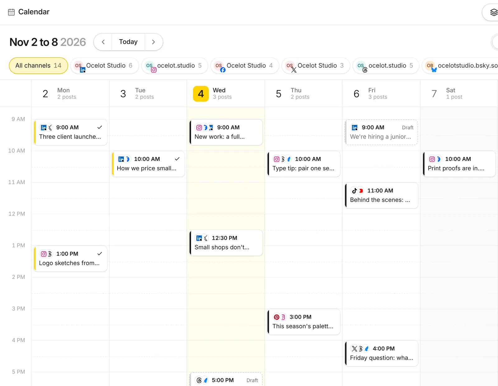

import { Aside, CardGrid, LinkCard, LinkButton, Steps } from '@astrojs/starlight/components';

The calendar holds every post for every channel. Set your queue times once, and new posts slot into the next free one.

<LinkButton href="https://app.capybaroar.com/calendar" variant="secondary" icon="external">Open in Capybaroar</LinkButton>

## Views and filters

Pick **Day**, **Week**, **Month** or **List** at the top right. **Today** jumps back to now, and the arrows move one page at a time.

The row of channels above the calendar filters it. Click a channel to see only its posts, or **All channels** to see everything. When you use campaigns, the **Campaign** menu filters by campaign too.

Each post shows its status:

| Status | What it means |
| - | - |
| **Draft** | Saved, with no time to go out |
| **In review** | Waiting for approval |
| **Scheduled** | Set to go out at its time |
| **Posting** | Going out right now |
| **Published** | Out on every channel |
| **Partly published** | Out on some channels, and turned down on others |
| **Failed** | Didn't go out on any channel. Open it to see why. |

## Move a post

Drag a post to another day or time to move it. Drafts and posts in review keep waiting, and the rest are scheduled at the new time.

## The posting queue

**Add to queue** in the post editor puts a post in your next free queue time. Set those times once:

<Steps>

1. **Open Queue.** Click **Settings**, then **Queue**. Times are in your workspace's time zone.

1. **Start from a preset, or add your own.** Pick **Weekdays at 9**, **Morning and lunch** or **Every day, twice**. **Your best times** uses the hours your posts do best, once 10 posts have results. Add or remove single times under each day.

1. **Press Save.**

</Steps>

## Best times in the editor

Next to the publish time, the editor shows chips with good times to post. Once your posts have results, they are your own best times. Until then, they are popular hours on that network. Click one to use it.

## Channel groups

Post to the same set of channels in one click. In the editor, pick two or more channels and press **Save as group**, then name it. Next time, choose it from the **Group** menu. **Manage groups** lets you delete one. The channels stay connected.

## Campaigns

A campaign ties posts together, like a launch or a sale. Pick one in the **Campaign** menu at the bottom of the editor, or choose **New campaign**. Press **Campaigns** on the calendar to see each campaign's posts, rename it or delete it. Deleting a campaign keeps its posts on the calendar.

## Your media

**Media** in the sidebar holds every picture, video and PDF you upload, ready for any post. Files can be up to 250 MB, and PDFs up to 100 MB. Filter by **Pictures**, **Videos** or **PDFs**, or search by name.

- **Crop** a picture or **Trim** a video to fit each network.
- Add **Alt text** to describe a picture for people who can't see it. Networks that take alt text get it with the post.
- On plans with AI, press **Generate** to make a picture, video or audio file. See [AI credits](/ai/ai-credits/).

## Short links

Press **Shorten links** in the text toolbar to turn the links in a post into short links. Each one counts its clicks.

## Post again, duplicate and delete

Open a post from the calendar to act on it:

- **Post again** makes a new copy of a post that went out. **Duplicate** does the same for one that hasn't.
- **Delete** on a post that went out opens **Delete post**. Pick the channels and press **Delete everywhere** to take it down on each network. Some networks don't let apps delete posts, and Capybaroar says where to delete those yourself. **Remove from Capybaroar only** keeps the posts on the networks.

<Aside type="note">
Some networks let you change a post after it goes out. Open the post, press **Edit**, make your change and press **Save changes**. Each network's page says what it allows under **Change after it goes out**.
</Aside>

## Related

<CardGrid>
  <LinkCard title="Bulk upload and automation" href="/publishing/bulk-and-automation/" />
  <LinkCard title="Schedule your first post" href="/get-started/schedule-your-first-post/" />
  <LinkCard title="Approvals" href="/workspace/approvals/" />
</CardGrid>
