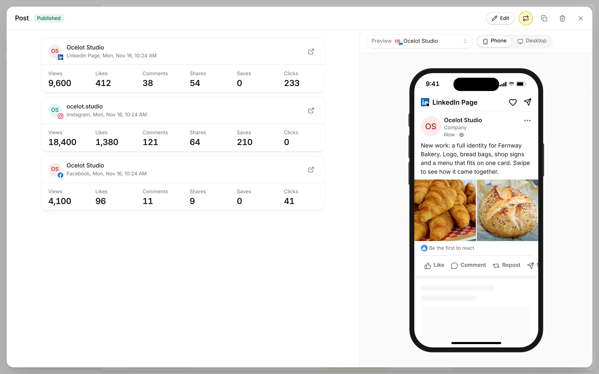

import { Aside, CardGrid, LinkCard, LinkButton, Steps } from '@astrojs/starlight/components';

A post that went out opens as a results view. From there you can change it on networks that allow it, post it again, make it repeat, or take it down everywhere it went.

<LinkButton href="https://app.capybaroar.com/calendar?view=list" variant="secondary" icon="external">Open in Capybaroar</LinkButton>

## The results view

Click a published post on the calendar. The top bar shows **Published**, **Partly published** or **Deleted** and how many channels it went to. Below, each channel has a row:

| Part | What it shows |
| - | - |
| The channel | Its picture, name and network |
| Its state | **Published**, **Failed**, **Waiting**, **Publishing** or **Deleted** |
| Numbers | The first of **Views**, **Reach** or **Impressions**, then **Likes**, **Comments**, **Shares**, **Saves** and **Clicks**, for the ones the network reports |
| **Open on `<network>`** | The post on the network |
| The reason | For a failed channel, why it didn't go out |

The preview on the right shows the post with its real time and numbers. Numbers fill in 1 hour, 1 day, 7 days and 30 days after a post goes out. If the post went through approval, an **Approval** section lists who sent, approved or asked for changes.

## Change a post that went out

Some networks let apps change a post after it's live. Where at least one of the post's channels allows it, the top bar shows **Edit**.

<Steps>

1. **Press Edit.** Each channel that can change shows its **Text** and the settings its network lets you change. Required settings show a `*`.

1. **Make your changes.** Each channel has its own text, so you can fix a typo on one network only.

1. **Press Save changes.** Capybaroar sends the change to each network. A channel that couldn't change shows its reason, and the others keep their change. **Cancel** leaves everything as it was.

</Steps>

| Network | What can change |
| - | - |
| Facebook | The text of a post. Not a video, Reel or Story. |
| LinkedIn, LinkedIn Page | The text |
| YouTube | The description, title, tags, category, visibility, Made for kids and altered content |
| Pinterest | The description, title and link |
| Mastodon | The text and content warning. Not a post with a poll. |
| Telegram | The text, unless it went out as its own message after an album |
| Discord | The text |
| WordPress | The body, title, status, categories, tags and excerpt |
| Instagram, Threads, TikTok, X, Bluesky | Nothing. Edit or delete it on the network. |

Files never change after a post goes out. To change a picture, delete the post and post again.

## Post it again

**Post again** (the copy icon) makes a new draft with the same text, files, settings and campaign. It's placed a day from now on the calendar. Open it, pick a time and schedule it. The first post stays as it was, with its results.

To repeat a post every few weeks by itself, press **Evergreen**. See [Evergreen posts](/publishing/evergreen/).

## Delete a post everywhere

<Steps>

1. **Press Delete** on a post that went out. **Delete post** opens with each channel it went to.

1. **Tick the channels** to delete on. Channels already deleted show **Deleted**. A network that doesn't let apps delete shows **Delete in the app** with an **Open** link, and has no tick box.

1. **Press Delete everywhere.** Each channel shows **Deleted** or **Failed** with the reason. Press **Done** to close.

</Steps>

**Remove from Capybaroar only** deletes the post from the calendar and leaves it on the networks. Its results leave Analytics too.

After a delete everywhere, the post stays in Capybaroar as **Deleted**, so Analytics keeps its numbers. To remove it from the calendar as well, open it again and press **Remove from Capybaroar only**.

| Network | Delete from Capybaroar |
| - | - |
| Facebook, LinkedIn, YouTube, X, Pinterest, Bluesky, Mastodon, Discord, WordPress | Yes |
| Telegram | Yes. In a basic group, only for 48 hours. |
| Threads | When Capybaroar's Meta app has delete access (check) |
| Instagram, TikTok | No. Delete it in the app from the **Open** link. |

<Aside type="caution">
Deleting on the networks can't be undone. Comments, likes and shares on the post are gone with it.
</Aside>

## Delete a post that didn't go out

For a draft, a post in review, or a scheduled or failed post, press **Delete** in the editor and confirm **Delete this post?**. Nothing goes out, and it leaves the calendar.

## Who can do this

Owners, admins and editors, for posts in their brands. Clients can only approve or reject.

## From the API

[`DELETE /posts/{id}?everywhere=true`](/api-reference/delete-a-post/) deletes a post on the networks, with the same results for each channel. The API can't edit a live post.

## Related

<CardGrid>
  <LinkCard title="Errors when writing and scheduling" href="/errors/posting/#edit-and-delete-posts-that-went-out" />
  <LinkCard title="Analytics" href="/results/analytics/" />
  <LinkCard title="Evergreen posts" href="/publishing/evergreen/" />
</CardGrid>
