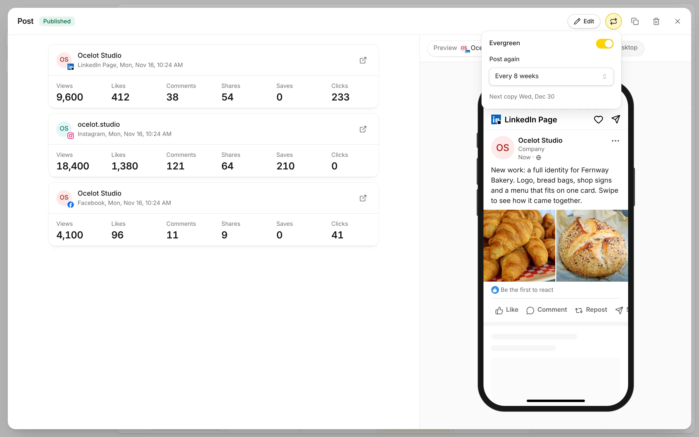

import { Aside, CardGrid, LinkCard, LinkButton, Steps } from '@astrojs/starlight/components';

An evergreen post goes out again by itself every few weeks, so your best posts keep working. Each time, Capybaroar makes a copy and puts it in your queue. Evergreen is on every plan.

<LinkButton href="https://app.capybaroar.com/calendar" variant="secondary" icon="external">Open in Capybaroar</LinkButton>

## Turn it on

<Steps>

1. **Open a published post** from the calendar. Evergreen works on posts that went out, including ones that went out on only some channels.

1. **Press Evergreen** (the repeat icon) in the top bar. A small panel opens.

1. **Pick how often** in **Post again**: **Every week**, or every **2**, **4**, **8**, **12** or **26** weeks.

1. **Press Turn on.** The switch beside **Evergreen** turns on, and the panel shows **Next copy** with its date.

   

</Steps>

Once it's on, the button's name reads like **Evergreen, every 8 weeks**, and the icon stays lit.

## When copies go out

- The first copy is made one period after you turn it on. With **Every 8 weeks**, that's 8 weeks from now.
- Each copy is a new post with the same text, files, settings and campaign, for the same channels.
- It takes the next free time in your [posting queue](/publishing/posting-queue/), so it goes out at one of your usual times.
- The next copy is due one period after that.

If Capybaroar was down when a copy was due, it makes one copy when it's back, and the next one a full period later. You never get a burst of catch-up copies.

## When a copy can't be queued

If the queue has no free time, or Free's 30 posts this month are used, the copy is saved as a draft for you to place. The panel shows why, starting with `Saved as a draft:`. Open the draft on the calendar and pick a time.

Other reasons the panel can show:

| Message | What it means |
| - | - |
| `The post was deleted, so it no longer repeats` | The first post was removed from Capybaroar |
| `The person who turned this on left the workspace` | Turn it off and on again yourself |

## Change or turn it off

- Pick another period in **Post again**. It saves at once, and the next copy moves to match.
- Turn the **Evergreen** switch off. Copies already made stay on the calendar.

## Evergreen or Post again

| | Evergreen | Post again |
| - | - | - |
| How often | Every 1 to 26 weeks, until you turn it off | Once |
| When | The next free queue time | You pick, in the editor |
| Changes | None, it's an exact copy | Change anything before you schedule |

<Aside type="tip">
Pick posts that stay true for months, like a guide, a menu or a how-to. Skip posts with dates, prices or "this week".
</Aside>

## Who can use it

Owners, admins and editors, for their brands. Copies are made as the person who turned it on, so in a brand that needs approval, an editor's copies wait in review.

## Related

<CardGrid>
  <LinkCard title="The posting queue" href="/publishing/posting-queue/" />
  <LinkCard title="Edit and delete posts that went out" href="/publishing/edit-and-delete/" />
</CardGrid>
