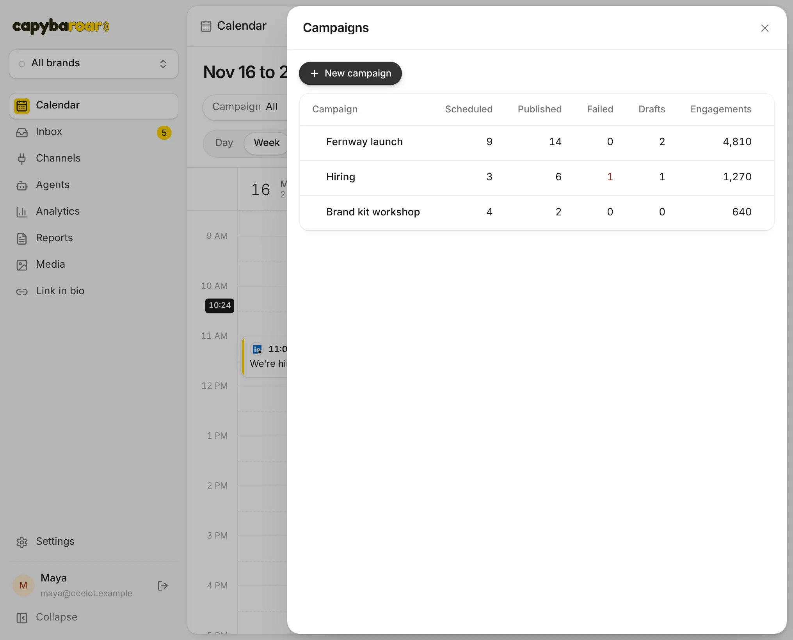

import { Aside, CardGrid, LinkCard, LinkButton, Steps } from '@astrojs/starlight/components';

Channel groups save a set of channels so you can pick them in one click. Campaigns tie posts together, like a launch or a sale, so you can filter the calendar and see their results side by side.

<LinkButton href="https://app.capybaroar.com/calendar" variant="secondary" icon="external">Open in Capybaroar</LinkButton>

## Channel groups

### Save a group

<Steps>

1. **Open the post editor** and tick two or more channels in **Channels**.

1. **Press Save as group.** The box asks **Name this group**, like "All socials". Press **Save**.

</Steps>

A group's name is up to 60 characters. Its channels must be from one brand, because a post goes to one brand.

### Use a group

In the post editor, open the **Group** menu and pick one. Its channels are ticked, and their settings start at each network's defaults. When the channels you ticked match a group, the menu shows that group's name.

**Select all** beside **Channels** ticks every channel of the brand. When they're all ticked, it reads **Clear**.

### Delete a group

Press **Manage groups** (the dots beside **Group**). Each group has a delete button. The box asks **Delete the group `<name>`?** and says **The channels stay connected.** Press **Delete**.

A channel you disconnect leaves every group it was in. A group with no channels left stops showing.

### Groups elsewhere

- The API lists groups with [`GET /channel-groups`](/api-reference/channel-groups/), and the agent can use them by name ("post this to All socials").
- Groups are saved per brand, so an editor sees only their brands' groups.

## Campaigns

### Make a campaign

There are two ways:

- In the post editor, open the **Campaign** menu beside the time and pick **New campaign**. Name it, like "Spring launch", and press **Create**. The post joins it.
- On the calendar, press **Campaigns**, then **New campaign**.

Names are up to 60 characters and must be unique in the workspace. Each new campaign gets the next free color: violet, green, amber, red, turquoise, sky, pink, then yellow.

### Add a post to a campaign

In the post editor, pick the campaign in **Campaign**. Pick **None** to take it out. A post is in one campaign at a time. A campaign made inside a brand only takes that brand's posts.

Bulk upload can set a campaign for each row with a `campaign` column. See [Bulk upload](/publishing/bulk-upload/).

### See a campaign

Press **Campaigns** on the calendar to open the panel.

| Column | What it counts |
| - | - |
| **Campaign** | Its color and name. Click the name to filter the calendar to it. |
| **Scheduled** | Posts waiting to go out |
| **Published** | Posts that went out |
| **Failed** | Posts that didn't go out, in red when there are any |
| **Drafts** | Drafts in it |
| **Engagements** | Likes, comments, shares, saves and clicks on its published posts |

The **Campaign** filter on the calendar shows **All**, one campaign, or **No campaign**, each campaign with its color.

### Rename or delete

In the **Campaigns** panel, press **Rename** to change the name, or **Delete**. The box asks **Delete the campaign `<name>`?** and says **Its posts stay on the calendar.** The posts lose the campaign and keep everything else.

Clients see a campaign's posts on the calendar like any other post.

## Who can use them

Owners, admins and editors can make, use and delete groups and campaigns.

## Related

<CardGrid>
  <LinkCard title="The post editor" href="/publishing/post-editor/" />
  <LinkCard title="The calendar" href="/publishing/calendar-and-queue/" />
  <LinkCard title="GET /campaigns" href="/api-reference/campaigns/" />
</CardGrid>
