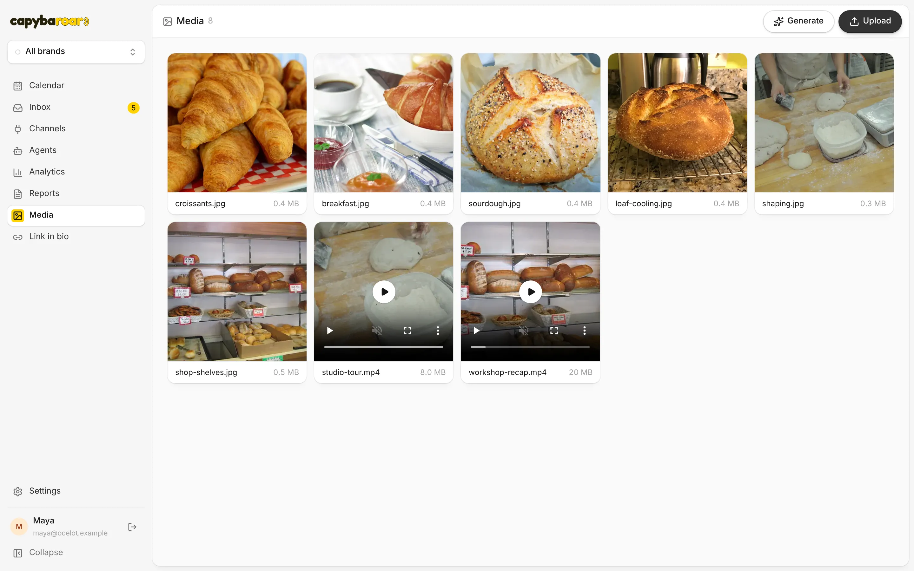

import { Aside, CardGrid, LinkCard, LinkButton, Steps } from '@astrojs/starlight/components';

**Media** holds every file you upload and every file the AI makes, ready to add to any post.

<LinkButton href="https://app.capybaroar.com/media" variant="secondary" icon="external">Open in Capybaroar</LinkButton>

## The first time

With no files yet, Media shows **Add your first file** with an **Upload** button. On a plan with AI it says files Capy makes land here too.

## Add files

- **Upload** at the top right picks files from your device. You can pick several at once.
- **Generate** makes a picture, video, infographic, animation or audio file with AI. It shows on a plan with AI. See [Make pictures, videos and audio](/ai/ai-media/).
- Files you upload in the post editor, in bulk upload and through the API land here too.

| File | Types | Size |
| - | - | - |
| Pictures | JPG, PNG, GIF, WebP | Up to 250 MB |
| Videos | MP4, MOV | Up to 250 MB |
| Documents | PDF, for LinkedIn | Up to 100 MB |
| Photos from phones | HEIC, HEIF, AVIF, turned into JPG as they upload | Up to 250 MB |

Capybaroar checks each file by what it really is. A file renamed to `.jpg` that isn't a picture is refused with `The file isn't the kind its name says.`

## Find files

- **Search** finds files by name.
- The filter picks **All**, **Pictures**, **Videos** or **PDFs**.

Each tile shows the file, its name and its size in MB. Videos and audio play on their tile. Files that are still being made show as a waiting tile, and a failed one shows its reason with a button to dismiss it.

## Delete a file

Point at a tile and press **Delete**. The box asks **Delete `<name>`?**. If posts still to go out use it, it also says `It's in <n> posts still to go out. They'll go out without it.` Posts that already went out keep their copy on the networks.

## Crop, trim and alt text

These happen in the post editor, on each file's tile in the **Media** area:

### Crop a picture

Press **Crop**. Pick a shape: **Original**, **1:1**, **4:5**, **9:16**, **16:9** or **1.91:1**, and drag the picture to place it. Press **Save copy**. The crop is saved as a new file, so the original stays as it was.

### Trim a video

Press **Trim**. Set **Start** and **End** and play it back. Press **Save copy**. Trims work on MP4 and MOV, and must keep at least half a second.

### Add alt text

Press **Add alt** on a picture. The **Alt text** box asks you to describe the picture for people who can't see it. Confirm to save. The tile then reads **Alt text**. Alt text is stored on the file, so every post that uses it gets the same text. Instagram, LinkedIn, X, Bluesky, Mastodon, Pinterest, Discord and WordPress get it with the post.

## Brands and files

Files belong to the brand they were uploaded for, or to the whole workspace. Owners and admins see every file. Editors see their brands' files and the ones they uploaded. A brand-limited API key sees its brand's files only.

<Aside type="tip">
Uploading straight from a link? The API's [`POST /media`](/api-reference/media/) downloads a public file into the library.
</Aside>

## Related

<CardGrid>
  <LinkCard title="The post editor" href="/publishing/post-editor/" />
  <LinkCard title="Errors with media and AI files" href="/errors/media/" />
</CardGrid>
