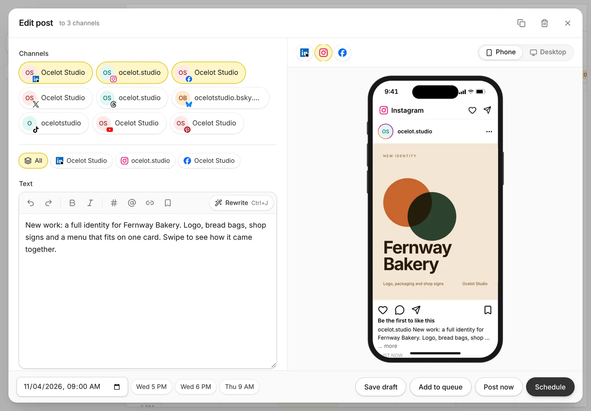
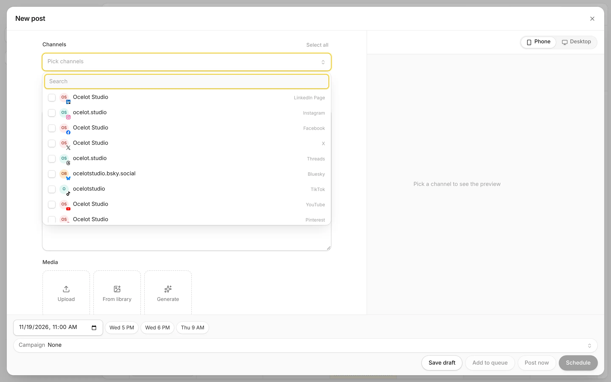
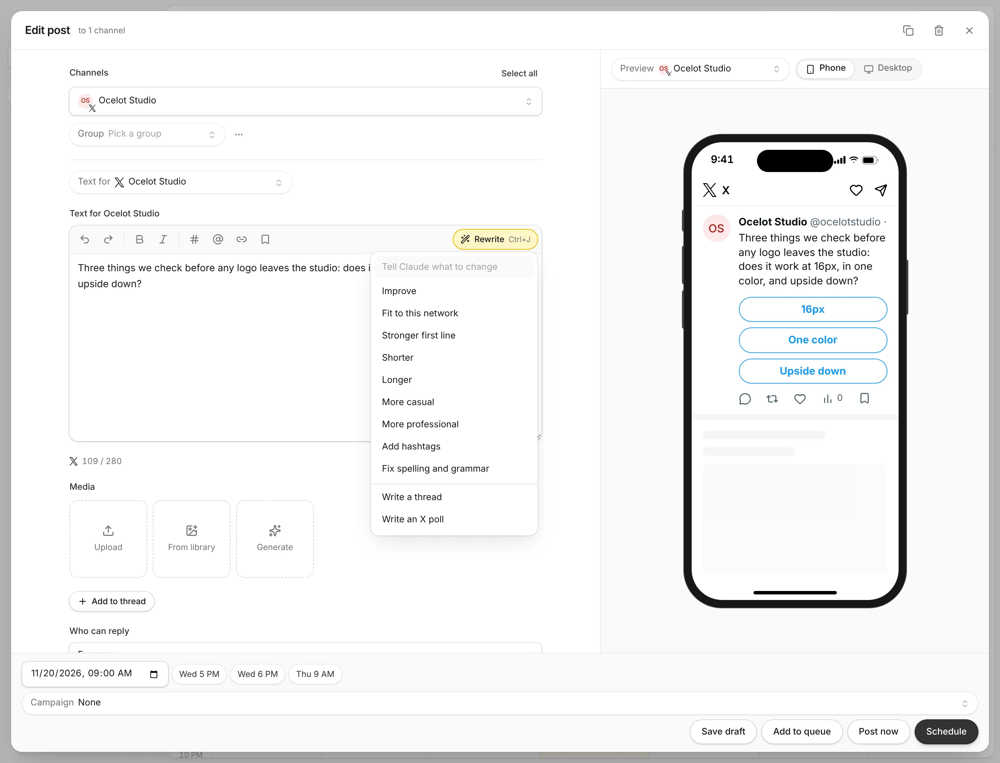
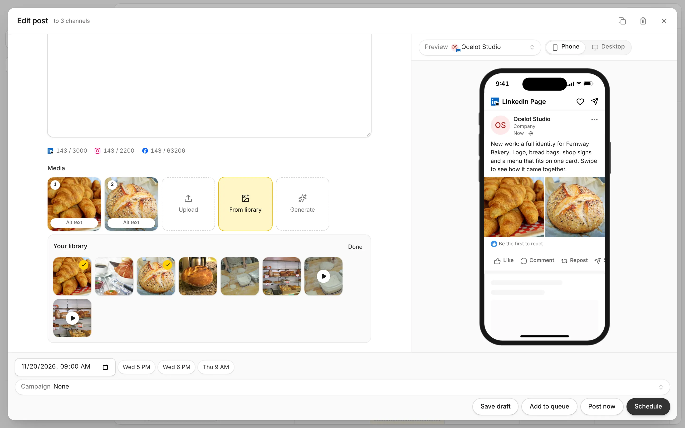
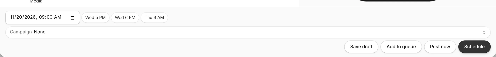

import { Aside, CardGrid, LinkCard, LinkButton, Steps } from '@astrojs/starlight/components';

The post editor is where you write a post once, change it for each channel, see it on a phone or a computer, and pick when it goes out. It opens full screen over the calendar.

<LinkButton href="https://app.capybaroar.com/calendar?new=1" variant="secondary" icon="external">Open in Capybaroar</LinkButton>

## Open the editor

- Press **New post** on the calendar.
- Click an empty time on the calendar. The post starts at that time.
- Click a post on the calendar to open it.
- Press **New post** on the welcome screen, or open `app.capybaroar.com/calendar?new=1`.

Owners, admins and editors can write posts. Clients see posts read-only, with **Approve** and **Reject** on posts waiting for them.

## The top bar

| Part | What it does |
| - | - |
| **New post**, **Edit post** or **Post** | The title. **Post** means it can't be changed here, because it went out or you can only read it. |
| **In review** | Shown when the post waits for approval |
| **Published**, **Partly published** or **Deleted** | The state of a post that went out, and how many channels it went to |
| **Reject** and **Approve** | On a post in review, for owners, admins and clients |
| **Edit** | On a post that went out, when a network lets you change it. See [Edit and delete posts that went out](/publishing/edit-and-delete/). |
| **Evergreen** | On a post that went out: post it again every few weeks. See [Evergreen posts](/publishing/evergreen/). |
| **Duplicate** or **Post again** | Makes a copy as a new draft, a day after the original's time (or a day from now if that has passed). **Post again** shows on a post that went out. |
| **Delete** | Deletes the post. On a post that went out, it opens **Delete post** to delete it on the networks too. |
| **Close (Esc)** | Closes the editor |

## Pick channels

<Steps>

1. **Open Channels.** Press the **Channels** menu and tick the channels you want. Each one shows its network, or **Reconnect** if it's signed out.

   

1. **Or use a group.** Pick a saved set from the **Group** menu. **Select all** ticks every channel of the brand, and **Clear** unticks them.

1. **Save a group.** With two or more channels ticked, press **Save as group** and name it, like "All socials". The **Manage groups** button lists your groups with a delete for each.

</Steps>

A post goes to one brand's channels. Once you tick one channel, another brand's channels show **Another brand's channel** and can't be added. See [Channel groups and campaigns](/publishing/groups-and-campaigns/).

## Write the text

Type in **Text**. The box says **What do you want to share?** until you start. Under it, one counter for each network shows how many characters are left, using the longest text among that network's channels.

### Text for each channel

With more than one channel, the **Text for** menu picks whose text you see:

- **All channels** is the shared text every channel gets.
- Pick a channel to give it its own text. Its name then shows **Own text** in the menu. Clear its text to go back to the shared one.

The channel's own tab also holds its network settings, like a YouTube title or an Instagram format. Each [network's page](/channels/) lists them, with their defaults.

### The text toolbar

| Button | Shortcut | What it does |
| - | - | - |
| **Undo**, **Redo** | ⌘Z, ⌘⇧Z (Ctrl+Z, Ctrl+Y) | Steps back and forward |
| **Bold**, **Italic** | ⌘B, ⌘I | Wraps the selected text in bold or italic letters, which most networks show |
| **Hashtag** | | Types `#` at the cursor |
| **Mention** | | Types `@` at the cursor |
| **Shorten links** | | Turns links into short links that count their clicks. Select one link to shorten only that one. |
| **Snippets** | | Saved pieces of text, like your hashtags or a sign-off. Pick one to insert it. Select text and choose **Save as snippet** to add one. Up to 3,000 characters each. |
| **Rewrite** | ⌘J | Asks Claude to rewrite the text. Needs a plan with AI. |

### Rewrite

**Rewrite** opens a menu. Type in **Tell Claude what to change** and press Enter, or pick one:

- **Improve**, **Fit to this network**, **Stronger first line**, **Shorter**, **Longer**, **More casual**, **More professional**, **Add hashtags**, **Fix spelling and grammar**

Below those, formats that fit your channels:

| Format | Shows when the post has |
| - | - |
| **Write a thread** | A channel on X, Threads, Bluesky or Mastodon |
| **Write an X poll** | An X channel |
| **Make a LinkedIn carousel** | A LinkedIn channel or Page |
| **Make a TikTok slideshow** | A TikTok channel |

A rewrite costs 4 credits, and a format 10. Rewrites follow the brand kit's voice and words to avoid. See [Rewrite with AI](/ai/rewrite-with-ai/).

## Add media

The **Media** area has three buttons:

- **Upload** picks files from your device. You can also drop files anywhere on the editor: it shows **Drop pictures or videos to add them**.
- **From library** opens your media library to pick files you uploaded before.
- **Generate** makes a picture, video or other AI file and adds it when it's ready. See [Make pictures, videos and audio](/ai/ai-media/).

Each file's tile has buttons when you point at it:

- **Crop** for a picture, or **Trim** for a video.
- **Remove** takes it off this post. It stays in the library.
- **Add alt** (or **Alt text** once set) describes a picture for people who can't see it.

Drag tiles to change their order. Numbers on the tiles show the order the networks get. The editor takes JPG, PNG, GIF, WebP, MP4, MOV and PDF, and turns HEIC, HEIF and AVIF photos into JPG as they upload.

## Write a thread

On X, Threads, Bluesky and Mastodon, press **Add to thread** under the media to add a part. Each part has its own text, files and **Upload** button, and goes out as a reply to the part before. A thread has up to 25 posts. Remove a part with **Remove from thread**. Channels on other networks post only the first part.

## Preview

The right side shows the post as people will see it.

- The **Preview** menu picks which channel to show.
- **Phone** and **Desktop** switch the size.

The preview uses each channel's own text, settings and files, and plays videos. With no channel picked, it says **Pick a channel to see the preview**.

## Pick the time and campaign

- **Publish time** is the date and time it goes out, in your browser's time.
- **Best time chips** beside it pick a good hour with one click. Once 10 posts have results, they're your own best times. Until then, they're popular hours on the network you're previewing.
- **Campaign** puts the post in a campaign, **None**, or **New campaign** to make one.

## The four buttons

| Button | Shortcut | What happens |
| - | - | - |
| **Save draft** | ⌘S | Saves it on the calendar at its time. Nothing goes out. |
| **Add to queue** | | Gives it the next free time in your queue and schedules it |
| **Post now** | ⌘⇧Enter | Sends it right away |
| **Schedule** | ⌘Enter | Sends it at the publish time |

In a brand that needs approval, an editor's **Schedule**, **Add to queue** or **Post now** sends the post to review. It shows **In review** on the calendar until an owner, admin or client approves it, and they get an email.

Between the campaign and the buttons, the editor shows the first problem to fix, in amber, like `Bluesky: over 300 characters`. The buttons that send stay off until it's fixed. See [Errors when writing and scheduling](/errors/posting/).

## Autosave

Every change is kept on this device as you type. If you close without saving, Capybaroar asks **Close without saving?** and says your changes stay on this device. Open the post again and a yellow bar says **Unsaved changes from** a date and time, with **Discard** and **Restore**.

<Aside type="note">
Autosave lives in your browser only. Changes on one computer don't show on another until you save.
</Aside>

## Comments and approval history

A post that was sent for approval shows its comments under the editor: who sent it, and **Approved** or **Changes asked** with the reviewer's comment.

## Keyboard shortcuts

| Keys | Action |
| - | - |
| Esc | Close |
| ⌘Enter / Ctrl+Enter | Schedule |
| ⌘⇧Enter / Ctrl+Shift+Enter | Post now |
| ⌘S / Ctrl+S | Save draft |
| ⌘B, ⌘I | Bold, italic |
| ⌘J / Ctrl+J | Open Rewrite |

## Related

<CardGrid>
  <LinkCard title="Schedule your first post" href="/get-started/schedule-your-first-post/" />
  <LinkCard title="The calendar" href="/publishing/calendar-and-queue/" />
  <LinkCard title="Errors when writing and scheduling" href="/errors/posting/" />
</CardGrid>
