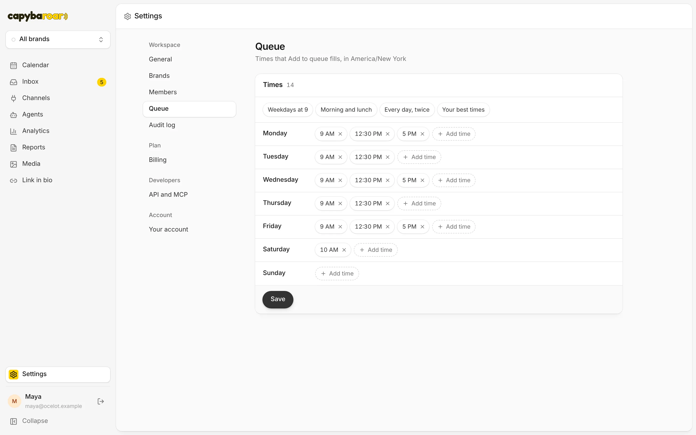

import { Aside, CardGrid, LinkCard, LinkButton, Steps } from '@astrojs/starlight/components';

The queue is a set of weekly times, like Monday to Friday at 9:00. **Add to queue** in the post editor gives a post the next of those times that's free, so you don't have to pick a time for every post.

<LinkButton href="https://app.capybaroar.com/settings?tab=queue" variant="secondary" icon="external">Open in Capybaroar</LinkButton>

## Who can change it

Owners and admins, in **Settings**, **Queue**. Everyone who writes posts can use it with **Add to queue**. The queue is shared by the whole workspace, so every brand fills the same times.

## Set your times

<Steps>

1. **Open Queue.** Click **Settings**, then **Queue** under **Workspace**. The line under the title says which time zone the times are in: the workspace's, from **Settings**, **General**.

1. **Start from a preset**, or skip to the next step. Each one replaces your times, and asks **Replace your times?** first when you already have some.

   | Preset | Times |
   | - | - |
   | **Weekdays at 9** | Monday to Friday at 9:00 |
   | **Morning and lunch** | Monday to Friday at 8:30 and 12:30 |
   | **Every day, twice** | Every day at 9:00 and 17:00 |
   | **Your best times** | Up to 7 of the hours your posts do best, from your own results |

1. **Add or remove times.** Each weekday, Monday first, has a row. Press **Add time** on a day, type a time and press the check mark, or Enter. The new box starts an hour after that day's last time, or at 9:00. Press the **×** on a time to remove it.

1. **Press Save.** You see **Saved** beside the button. The count beside **Times** shows how many times you have.

</Steps>

<Aside type="note">
**Your best times** needs 10 posts with results. Before that, it says **Not enough results yet** and asks you to pick another set for now.
</Aside>

## How the next free time is picked

When you press **Add to queue**, Capybaroar:

1. Starts from now, plus one minute.
1. Walks forward day by day, up to 8 weeks.
1. Takes the first queue time that has no scheduled post at that exact minute.

So two posts added one after the other get two different times. A post you scheduled yourself at 9:00 on Monday also takes that time. Drafts don't hold a time.

| You see | Why | What to do |
| - | - | - |
| `Add time slots to your queue in Settings first` | The queue has no times | Add some |
| `No free slot in the next 8 weeks` | Every time in 8 weeks has a post | Add more times |

## Where else the queue is used

- **Bulk upload** of pictures and videos can spread the posts over your queue, one file per free time. See [Bulk upload](/publishing/bulk-upload/).
- **RSS feeds** can add each new article to the queue. See [RSS feeds](/publishing/rss-feeds/).
- **Evergreen** copies go into the queue. See [Evergreen posts](/publishing/evergreen/).
- The API and MCP server use it with `mode: "queue"`, and [`GET /queue`](/api-reference/queue/) reads the next free time.
- The agent uses it when you ask for posts "at my next queue times".

## Best times in the editor

Your queue is separate from the best time chips in the post editor. Those chips show the hours your posts do best once 10 posts have results, and popular hours on the network before that. Click one to use it for that post only.

Popular hours come from every Capybaroar account on a network, once 200 posts there have results, from hours with at least 5 posts.

## Time zones

Queue times are in the workspace's time zone. Change it in **Settings**, **General**, **Time zone**. The queue keeps its clock times: 9:00 stays 9:00 in the new zone. The post editor shows times in your own browser's time zone.

## Related

<CardGrid>
  <LinkCard title="The post editor" href="/publishing/post-editor/" />
  <LinkCard title="Workspace settings" href="/workspace/settings-general/" />
  <LinkCard title="Analytics" href="/results/analytics/" />
</CardGrid>
