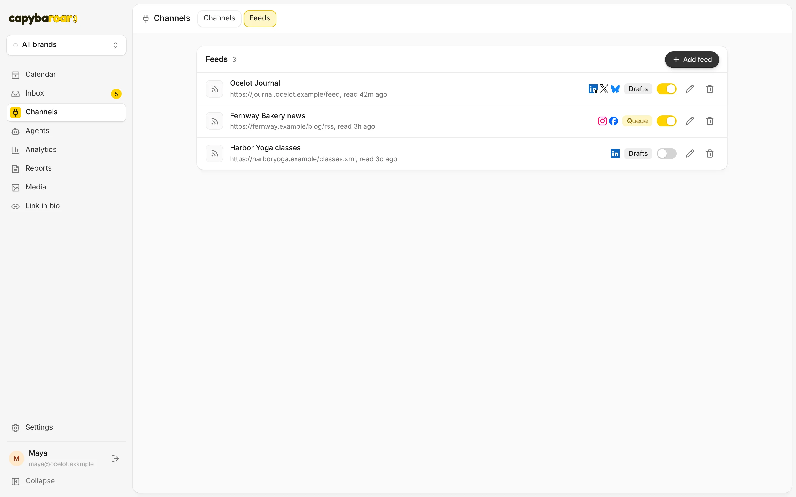
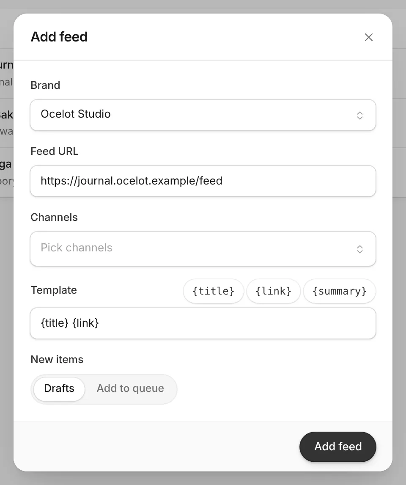

import { Aside, CardGrid, LinkCard, LinkButton, Steps } from '@astrojs/starlight/components';

An RSS feed turns each new article on a blog or news site into a post. Capybaroar reads every feed every 30 minutes. New items become drafts for you to check, or go straight into your queue. Feeds are on every plan.

<LinkButton href="https://app.capybaroar.com/channels/feeds" variant="secondary" icon="external">Open in Capybaroar</LinkButton>

## Add a feed

<Steps>

1. **Open Feeds.** Click **Channels**, then the **Feeds** tab. With no feeds yet, it says **Add your first feed**. Press **Add feed**.

1. **Pick the brand.** With more than one brand, pick which brand the feed posts for in **Brand**.

1. **Paste the Feed URL.** Use the feed's own address, like `https://example.com/feed`. RSS and Atom feeds both work. A web page's address doesn't.

   

1. **Pick channels.** Choose the channels that get a post for each new item. Feeds post text with a link, so only channels that post text are listed. Instagram, TikTok, YouTube and Pinterest need a picture or video and can't take feed items. With no such channel, the box says **Connect a channel that posts text first**.

1. **Write the template.** It starts as `{title} {link}`. Press `{title}`, `{link}` or `{summary}` above the box to add one at the end. Up to 1,000 characters.

1. **Choose New items.** **Drafts** wait on the calendar for you to check. **Add to queue** puts each one in the next free queue time.

1. **Press Add feed.** Capybaroar reads the feed once to check it, and turns its newest item into a post right away.

</Steps>

## The template

| Placeholder | Becomes |
| - | - |
| `{title}` | The article's title |
| `{link}` | A short link to the article, which counts its clicks |
| `{summary}` | The article's summary, from the feed |

For example, `New on the blog: {title} {link}` might give `New on the blog: Our seeded sourdough, step by step https://app.capybaroar.com/l/Ab3dEf9`.

If the filled template is longer than the shortest limit among the feed's channels, Capybaroar shortens the summary first, then the title, so the post fits.

## How new items are posted

- A new feed posts only its newest item. Older items count as already seen, so you don't get a flood of old posts.
- After that, each read turns up to 3 new items into posts, oldest first. A feed that publishes 40 articles at once is spread over the next reads.
- Each item is posted once. Capybaroar remembers the last 300 items it saw on each feed.
- The post goes to the feed's channels, with the template as its text.

## The feed list

Each feed shows:

- Its title, or its address when it has none.
- The address and when it was last read, like `read 12 minutes ago`.
- Its last error in red, if a read failed.
- The faces of its channels, and whether new items become **Drafts** or go to the **Queue**.
- An **Active** switch. Turn it off to stop reading the feed. Turn it back on to start again: items published while it was off are posted on the next read, up to 3 at a time.
- **Edit** to change the channels, the template or New items, then **Save**. The address and brand can't change. To use another address, add a new feed.
- **Remove**. The box asks **Remove `<feed>`?** and says **Posts it already made stay on the calendar.**

## Who can use feeds

Owners, admins and editors, for their brands. Each feed posts as the person who added it. If that person leaves the workspace, the feed stops with `The person who added this feed left the workspace. Add it again.`

<Aside type="tip">
Pick **Drafts** for the first week. Check what the template makes, then switch the feed to **Add to queue** with **Edit** once you're happy.
</Aside>

## Problems

| You see | What to do |
| - | - |
| `That address isn't an RSS or Atom feed` | Find the feed address on the site, often ending in `/feed`, `/rss` or `.xml` |
| `This feed has no items yet` | Add it after the first article is out |
| `Use {title}, {link} or {summary} in the template` | Add at least one placeholder |
| `This feed's channels were removed` | Edit the feed and pick channels again |

All feed messages are in [Errors with feeds](/errors/automation/#rss-feeds).

## Related

<CardGrid>
  <LinkCard title="Set up an RSS feed to auto-post (recipe)" href="/recipes/rss-auto-post/" />
  <LinkCard title="The posting queue" href="/publishing/posting-queue/" />
  <LinkCard title="Short links" href="/publishing/post-editor/#the-text-toolbar" />
</CardGrid>
