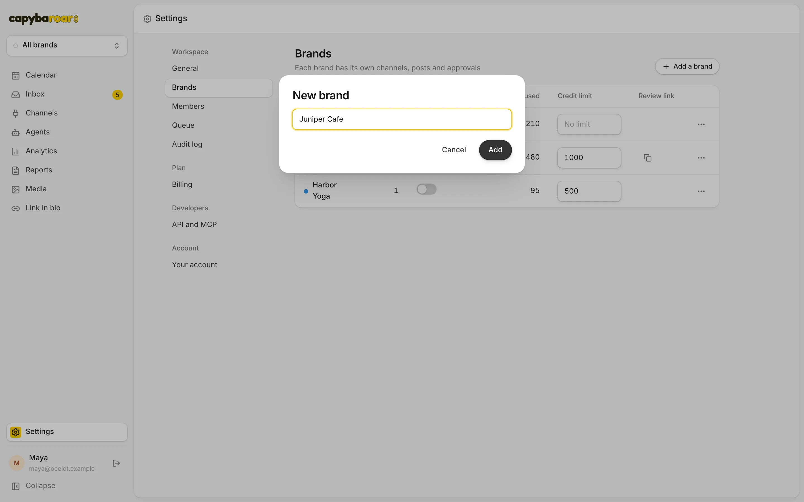
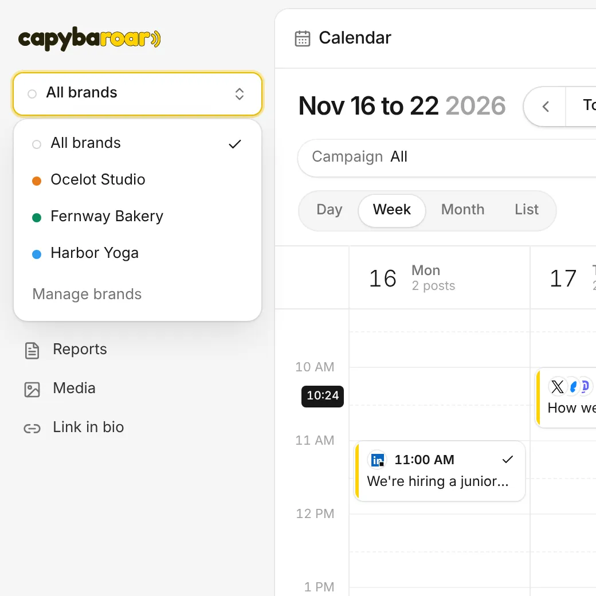
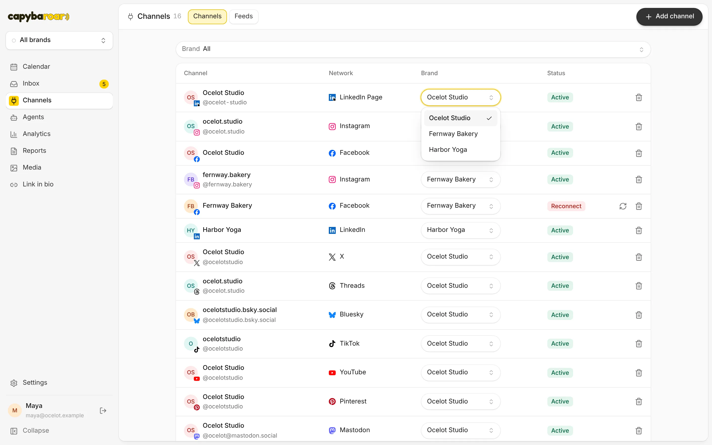
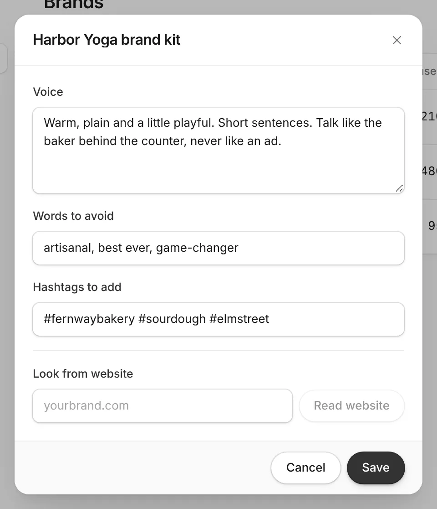
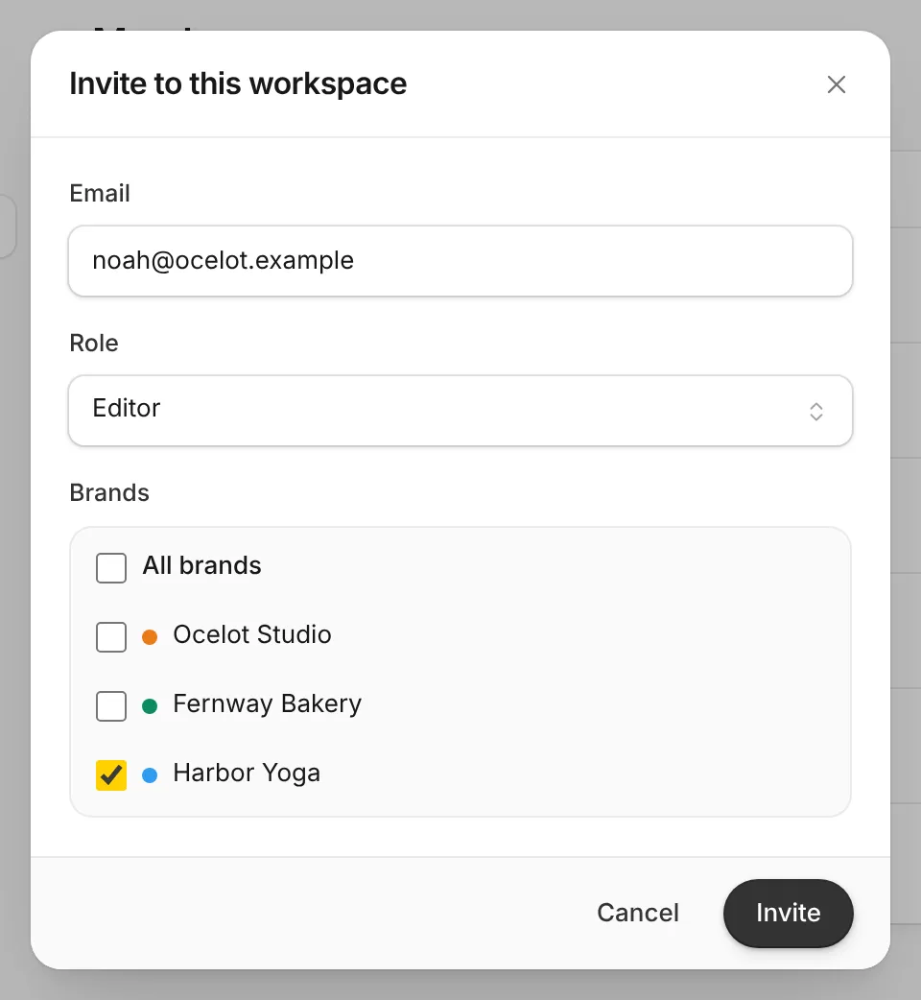
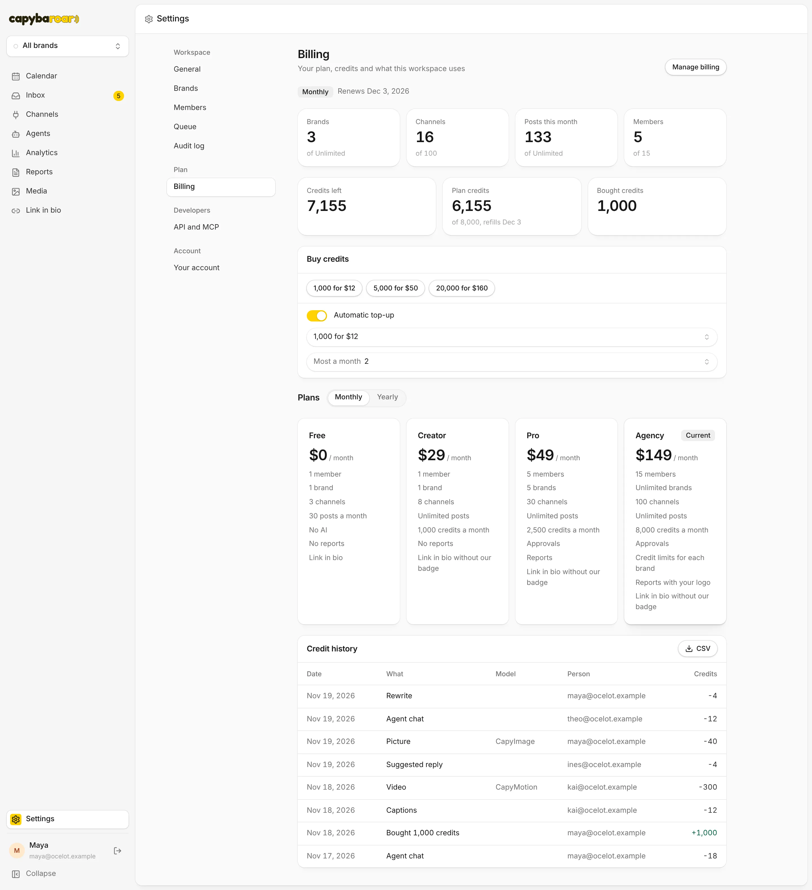

import { Aside, CardGrid, LinkCard, Steps } from '@astrojs/starlight/components';

Run every client from one workspace, with each client's channels, posts, files and results kept apart.

**Goal:** a workspace with one brand per client, and each person seeing only the clients they work on.

**You need:** Pro (5 brands) or Agency (no brand limit, plus credit limits and your logo on reports). Owners and admins set this up.

**Time:** 15 minutes for the first client, 5 for each one after.

<Steps>

1. **Add a brand for each client**

   Open **Settings**, **Brands** and press **Add a brand**. Type the client's name in **New brand** and press **Add**.

   

1. **Switch to the client**

   Open the brand menu at the top of the sidebar and pick the client. Every screen now shows only that brand. Pick **All brands** to see everything.

   

1. **Connect or move the client's channels**

   With the client picked, connect their channels in **Channels**: new channels join the brand you're in. Channels already connected can be moved in their **Brand** column.

   

1. **Fill in the brand kit**

   In **Settings**, **Brands**, open the client's menu and press **Brand kit**. Add the **Voice**, **Words to avoid**, **Hashtags to add**, and their website in **Look from website**, then **Read website**. The agent, Rewrite and CapyInfographic follow it.

   

1. **Give your team their clients**

   In **Settings**, **Members**, invite each person as an **Editor** and tick only their clients. Editors see and post for those brands only. Change their brands later with **Brands** on their row.

   

1. **Set a credit limit per client** (Agency)

   In **Settings**, **Brands**, type a **Credit limit** for each client, in credits a month. **Credits used** shows what each one has used. Buy packs or turn on automatic top-up in **Settings**, **Billing**.

   

</Steps>

## Next steps for each client

- Turn on approvals and invite the client: [Run an approval flow](/recipes/client-approval-flow/).
- Send them results every month: [Send a monthly client report](/recipes/monthly-client-report/).
- Make them a link in bio page: [Link in bio](/results/link-in-bio/).

<Aside type="tip">
Clients you invite with the **Client** role don't take a seat. Seats count owners, admins and editors only.
</Aside>

## Related

<CardGrid>
  <LinkCard title="Brands" href="/workspace/brands/" />
  <LinkCard title="Team and roles" href="/workspace/team-and-roles/" />
</CardGrid>
