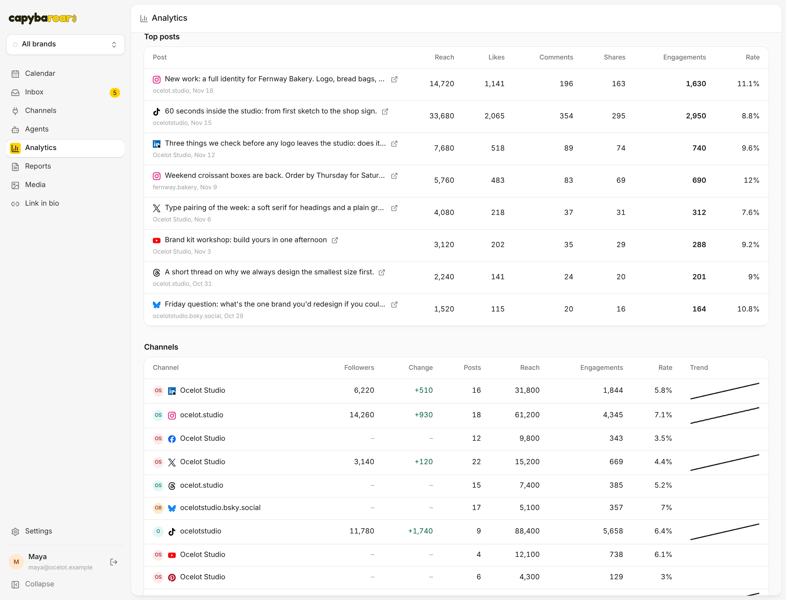
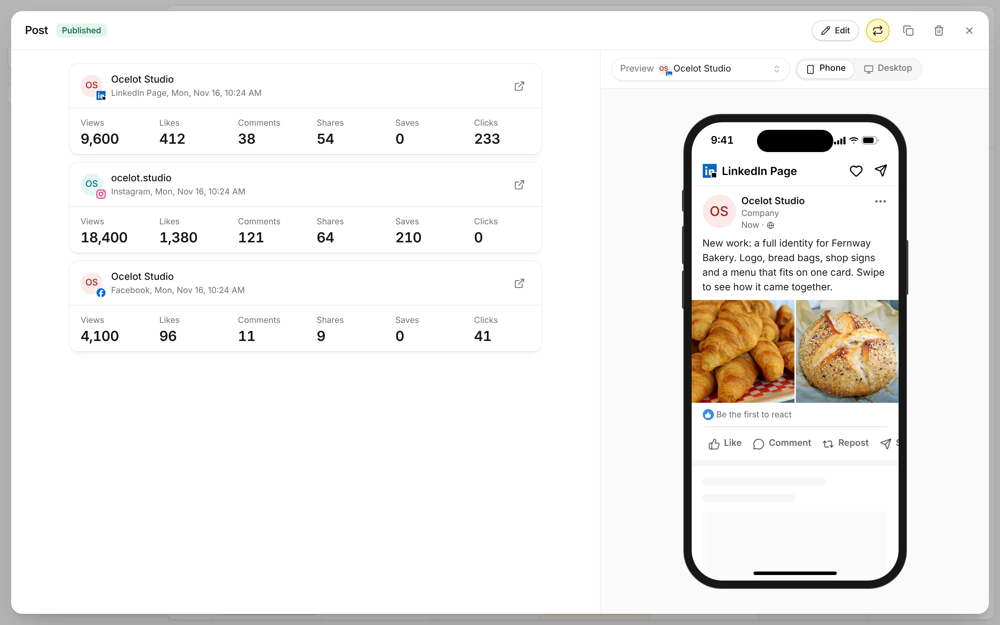
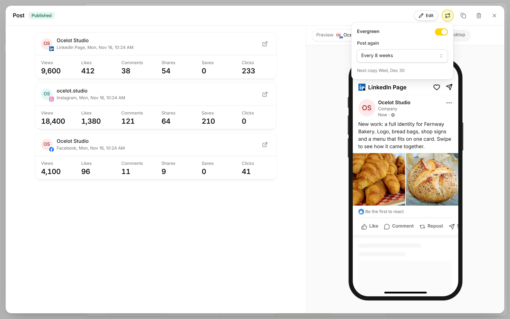
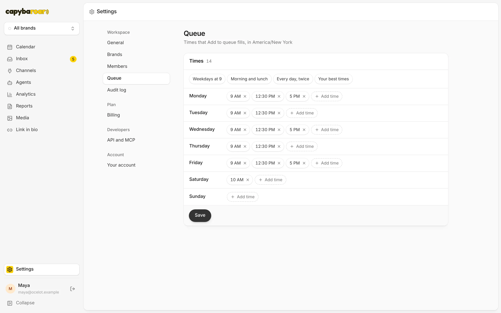

import { Aside, CardGrid, LinkCard, Steps } from '@astrojs/starlight/components';

Your best posts reached only part of your audience the first time. Let them go out again every few weeks, by themselves.

**Goal:** your top evergreen posts repeat on a schedule.

**You need:** posts with results (Analytics fills in over the first month), and queue times. Any plan.

**Time:** 10 minutes.

<Steps>

1. **Find your best posts**

   Open **Analytics**, set **Period** to **90 days**, and scroll to **Top posts**. Pick posts that stay true for months: guides, how-tos, menus, behind the scenes. Skip posts with dates or prices.

   

1. **Open the post**

   Find it on the calendar and click it. The results view shows each channel's numbers, with links to the post.

   

1. **Turn on Evergreen**

   Press **Evergreen** in the top bar, pick how often in **Post again** (every week, or every 2, 4, 8, 12 or 26 weeks) and press **Turn on**. The panel shows the date of the **Next copy**.

   

1. **Make room in your queue**

   Each copy takes the next free queue time. Check you have enough times in **Settings**, **Queue**, or add a preset. If the queue is full, the copy is saved as a draft for you to place.

   

</Steps>

## Tips

- Use longer gaps for small audiences: every 8 or 12 weeks keeps repeats from feeling stale.
- Want to change the words before it goes again? Use **Post again** for a one-off copy you can edit.
- Turn Evergreen off at any time with its switch. Copies already made stay on the calendar.

<Aside type="note">
On Free, each copy counts toward the 30 posts a month. A copy that won't fit is saved as a draft.
</Aside>

## Related

<CardGrid>
  <LinkCard title="Evergreen posts" href="/publishing/evergreen/" />
  <LinkCard title="Analytics" href="/results/analytics/" />
</CardGrid>
