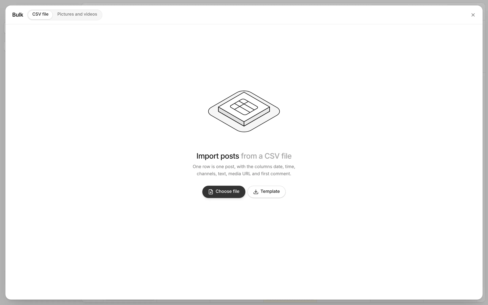
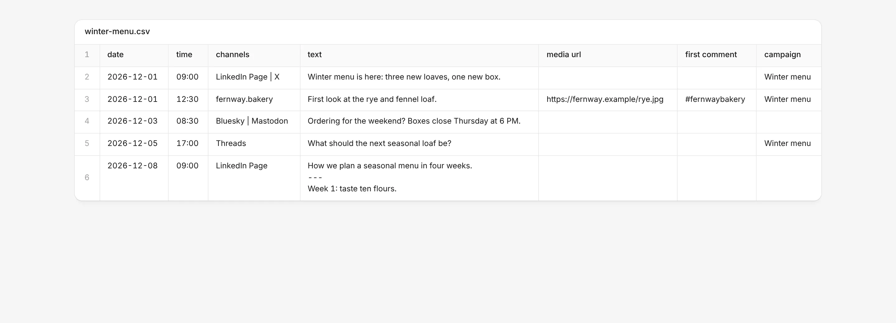
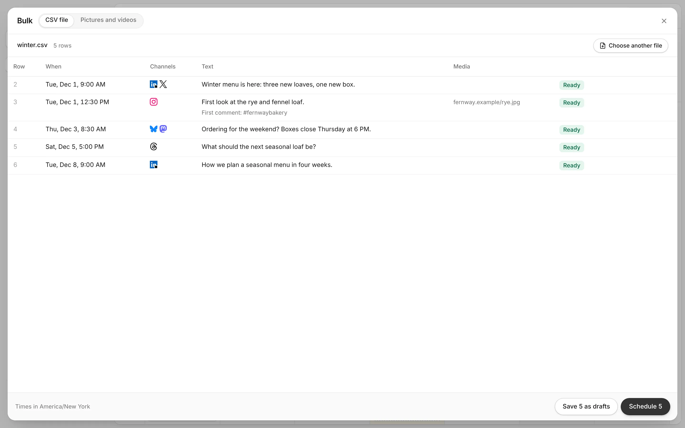
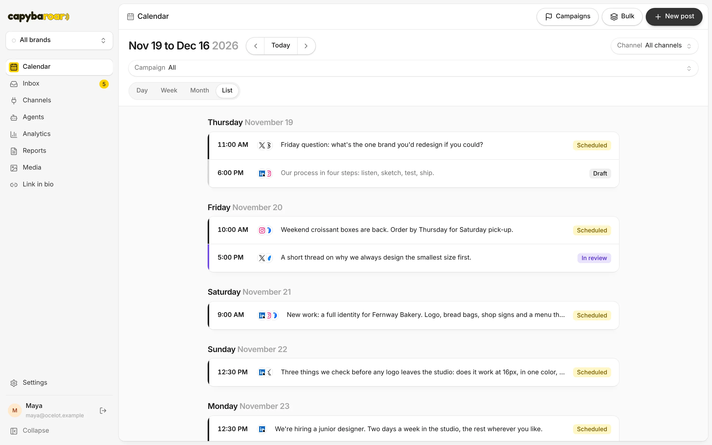

import { Aside, CardGrid, LinkCard, Steps } from '@astrojs/starlight/components';

Plan in the spreadsheet you already use, then bring every post into Capybaroar in one go. Capybaroar checks every row before it saves anything.

**Goal:** a month of posts on the calendar from one file.

**You need:** your channels connected, and a spreadsheet app. Any plan. Free can schedule 30 posts a month, and drafts don't count.

**Time:** 20 minutes, most of it writing.

<Steps>

1. **Get the template**

   Open **Calendar**, press **Bulk** and pick **CSV file**. Press **Template** to download a file with the right columns and an example row.

   

1. **Fill in your posts**

   Open the template in your spreadsheet. One row is one post:
   - `date` like `2026-12-01`, and `time` like `09:00`, in the workspace's time zone.
   - `channels`: names, @handles or network names, split by `|`. `LinkedIn Page` picks every LinkedIn Page channel.
   - `text`. A line with only `---` starts the next part of a thread.
   - `media url`, `first comment` and `campaign` if you want them.

   

   Save it as CSV. Keep it under 500 rows.

1. **Import and check**

   Back in **Bulk**, press **Choose file**. Each row shows its time, channels, text and media, marked **Ready**, **Draft only** or with a problem in red. Fix red rows in the file and press **Choose another file**. Point at **Draft only** to see what a network still needs.

   

1. **Schedule them**

   Press **Schedule `<n>`** to schedule the **Ready** rows, or **Save `<n>` as drafts** to check them on the calendar first. Media links are downloaded into your library as the posts save.

   

</Steps>

## Common row problems

| Message | Fix |
| - | - |
| `Pick a time in the future` | Move the date or time later |
| `No channel called "<name>"` | Use the name as it shows in **Channels** |
| `Pick channels from one brand` | Split the row into one for each brand |
| `<channel>: <network> posts are up to <n> characters` | Shorten the text |
| `<channel>: Instagram needs a picture or video` | Add a `media url` |

Every check is in [Errors with bulk upload](/errors/automation/#importing-a-csv-file).

## Turn a photo shoot into posts

Have pictures and no text? Pick **Pictures and videos** in **Bulk**, drop up to 100 files, pick channels, choose **Queue** or **One a day**, and press **Write captions** for Claude to write each one. See [Bulk upload](/publishing/bulk-upload/#from-pictures-and-videos).

<Aside type="tip">
Add a `campaign` column with the same name on every row, like "Winter menu". Capybaroar makes the campaign for you, and its results show together.
</Aside>

## Related

<CardGrid>
  <LinkCard title="Bulk upload" href="/publishing/bulk-upload/" />
  <LinkCard title="The posting queue" href="/publishing/posting-queue/" />
</CardGrid>
