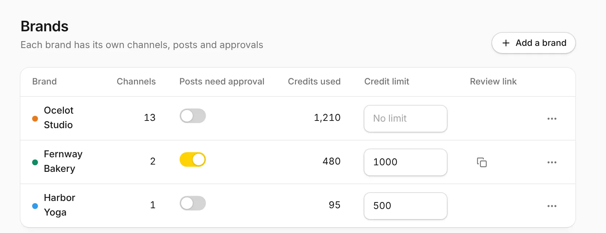
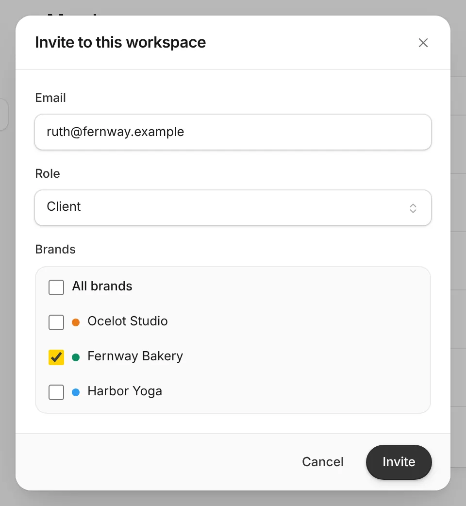
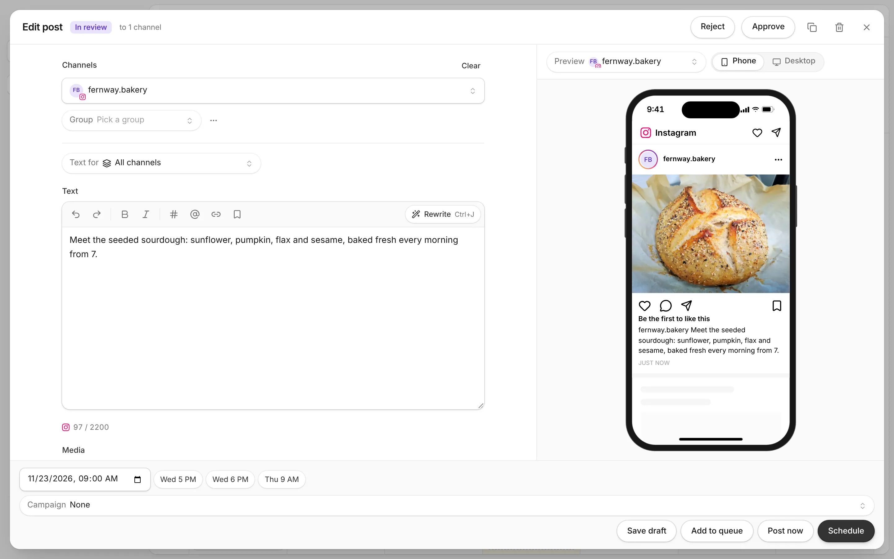
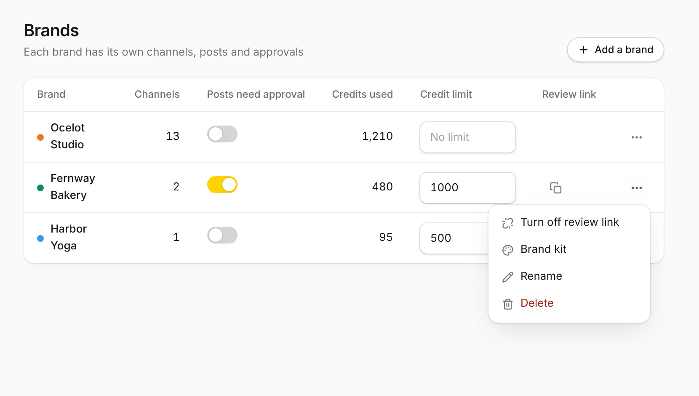
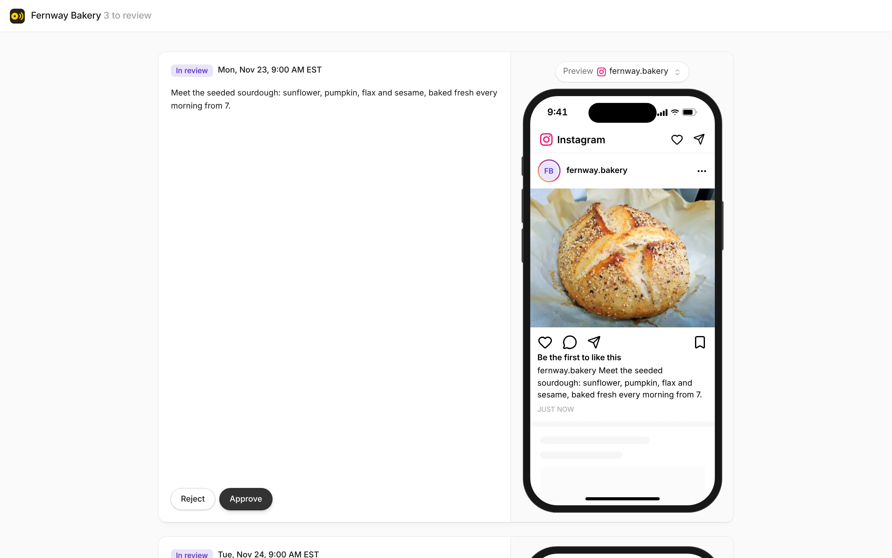
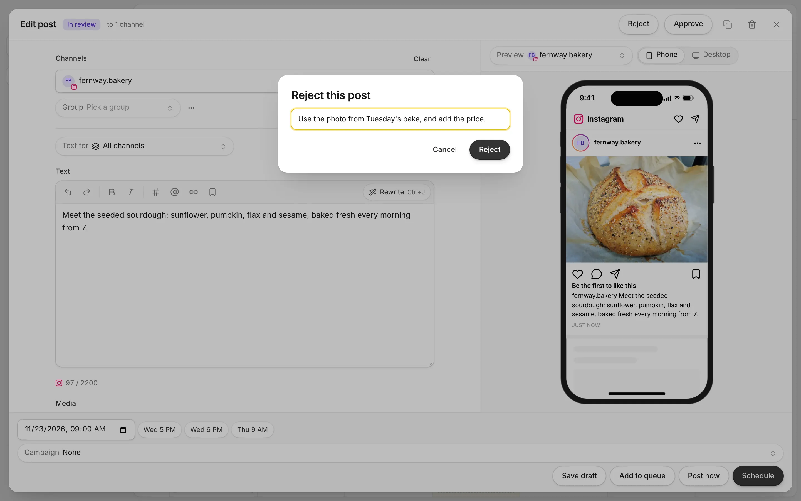

import { Aside, CardGrid, LinkCard, Steps } from '@astrojs/starlight/components';

Your team writes, your client says yes or no, and only approved posts go out. This recipe sets that up for one client brand.

**Goal:** every post an editor writes for the client waits for the client's approval.

**You need:** Pro or Agency (or the trial), the client as a brand with its channels, and an editor writing the posts. Owners and admins set this up.

**Time:** 10 minutes to set up.

<Steps>

1. **Turn on approvals for the brand**

   Open **Settings**, **Brands** and switch on **Posts need approval** for the client's brand. From now on, an editor's post for that brand goes to **In review** when they schedule, queue or post it.

   

1. **Invite the client**

   Open **Settings**, **Members** and press **Invite**. Type the client's email, pick the **Client** role, tick their brand and press **Invite**. Clients don't take a paid seat. They see only the calendar for their brand, and get an email each time a post waits for them.

   

1. **Write and send for approval**

   Your editor writes the post as usual and presses **Schedule**. The post shows **In review** in violet on the calendar. The client, owners and admins get an email.

   

1. **Or share a review link**

   If the client doesn't want an account, open the brand's menu in **Settings**, **Brands**, press **Make a review link**, then **Copy review link** and send it.

   

1. **The client approves**

   The client opens the post, or the review page, checks the preview for each channel and presses **Approve**. The post is scheduled for its time, or goes out at once if its time has passed. Decisions from the link show as **Review link** on the post.

   

1. **Or asks for changes**

   **Reject** asks **What should change?**. The post goes back to a draft with the comment, and the author gets an email. The editor fixes it and schedules it again, which sends it back to review.

   

</Steps>

## Tips

- Posts by owners and admins skip review. To review everything, have your team write as editors.
- Plan ahead: a post approved after its time goes out right away. Give clients a few days.
- Turn on the `post.in_review`, `post.approved` and `post.rejected` [webhooks](/api-reference/webhook-events/) to tell your project tool.

<Aside type="caution">
Anyone with the review link can approve or reject the brand's posts. Turn it off in the brand's menu if it's shared too widely, then make a new one.
</Aside>

## Related

<CardGrid>
  <LinkCard title="Approvals" href="/workspace/approvals/" />
  <LinkCard title="Brands" href="/workspace/brands/" />
  <LinkCard title="Roles and permissions" href="/reference/roles-and-permissions/" />
</CardGrid>
