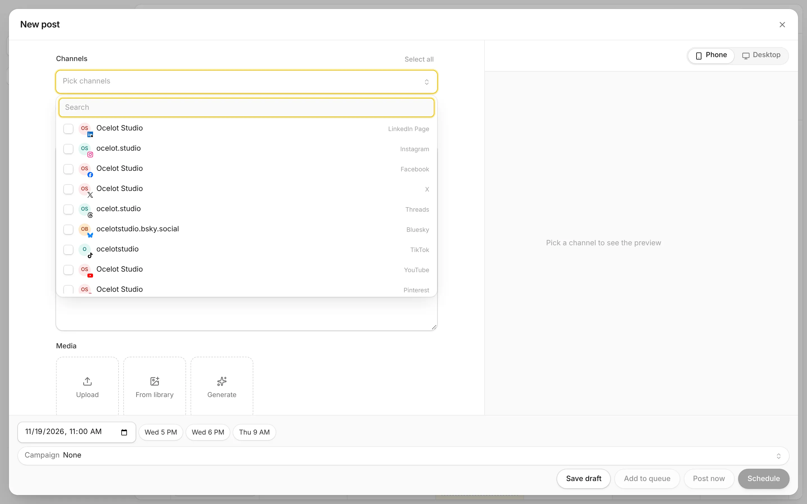
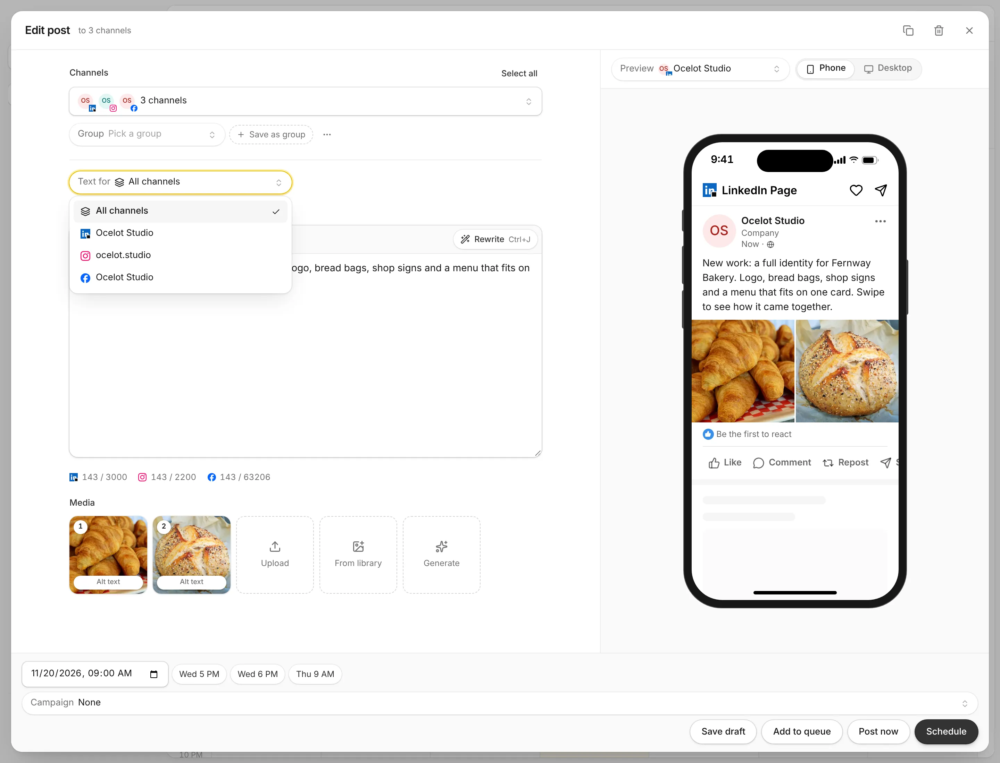
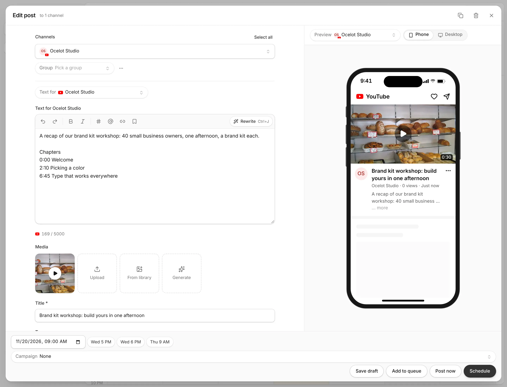
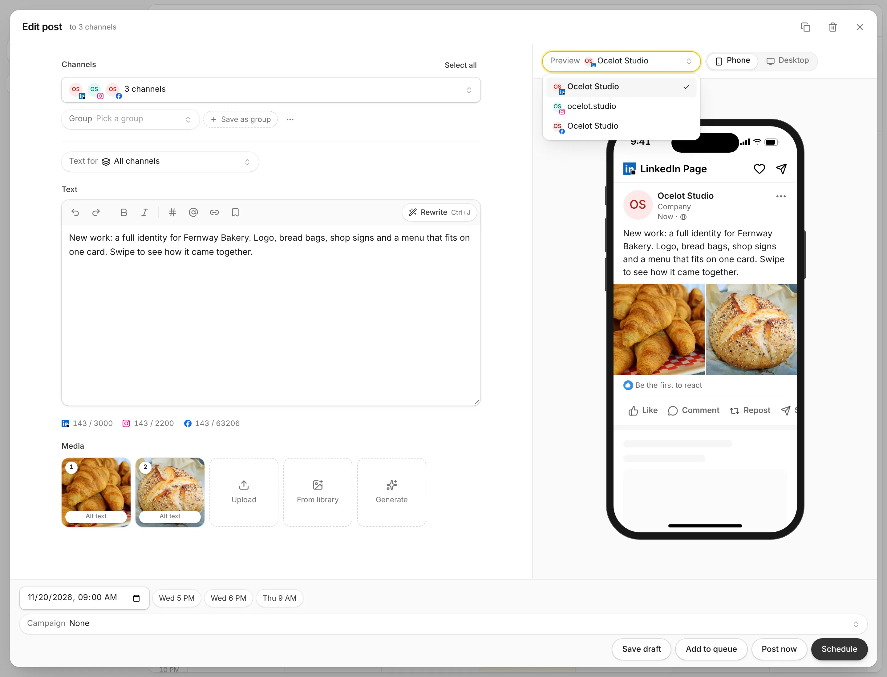
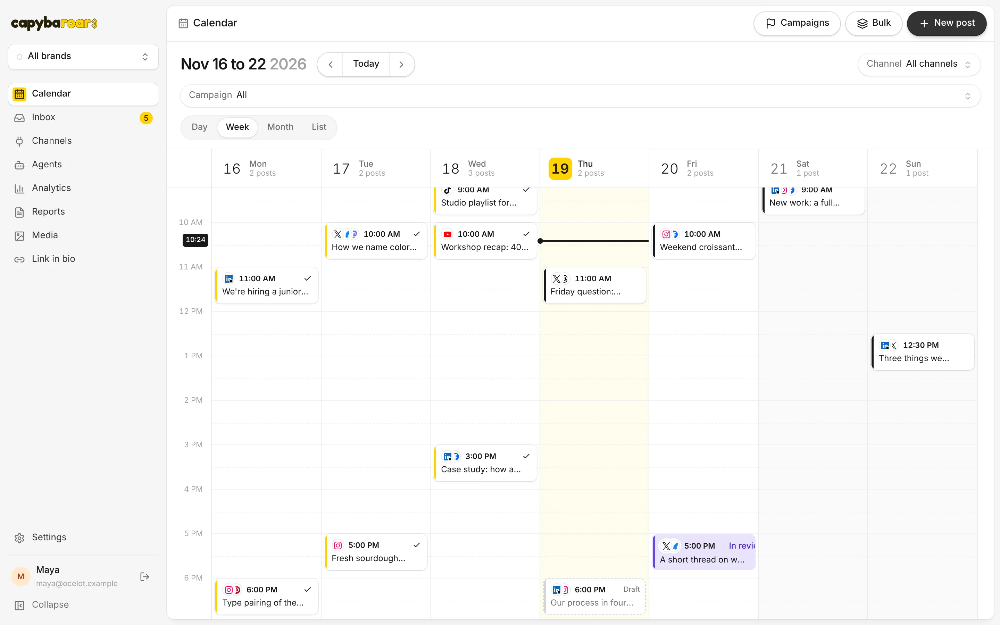

import { Aside, CardGrid, LinkCard, Steps } from '@astrojs/starlight/components';

One post, every channel, each one right for its network. The post editor checks every network's rules before it lets you schedule, so nothing fails at launch time.

**Goal:** one launch post on all of a brand's channels at the same moment.

**You need:** the brand's channels connected, and the launch picture or video. Any plan.

**Time:** 15 minutes.

<Steps>

1. **Pick every channel**

   Pick the brand in the sidebar, press **New post** on the calendar, open **Channels** and press **Select all**. Or pick a saved group in **Group**. A post goes to one brand's channels.

   

1. **Write once, then shorten where needed**

   Write the full announcement in **Text** and add your files. The counters under the text show each network's room. Where one is over, open **Text for**, pick that channel and give it a shorter version. X allows 280 characters, Bluesky 300, Threads and Mastodon 500.

   

1. **Fill each network's settings**

   Each channel's tab in **Text for** holds its network's settings. Fill in the required ones, shown in amber at the bottom until they're set: a YouTube **Title**, a Pinterest **Board**, TikTok's **Who can watch**. Add a **First comment** with the link on LinkedIn, Facebook and Instagram.

   

1. **Check every preview**

   Open the **Preview** menu and look at each channel on **Phone** and **Desktop**. Check that pictures crop well. Press **Crop** on a picture to make a copy in another shape for a network.

   

1. **Schedule it**

   Set the launch time and press **Schedule**. Each channel goes out on its own, and Capybaroar retries by itself if a network has a hiccup. The post shows on the calendar with every channel's logo.

   

</Steps>

## Network rules to keep in mind

| Network | Watch out for |
| - | - |
| Instagram, TikTok, YouTube, Pinterest | They need a picture or video. YouTube needs exactly one video. |
| X | 280 characters, up to 4 pictures, or one video |
| LinkedIn | One video, or up to 20 pictures, or one PDF |
| WordPress | A title. One picture becomes the featured image. |

[Compare every network](/channels/) has the full list.

## Tips

- Turn the launch into a thread on X, Threads, Bluesky and Mastodon with **Add to thread**. Other networks post the first part only.
- Put it in a campaign so its results show together.
- Watch it go out with the [`post.published` webhook](/api-reference/webhook-events/#postpublished), or open the post for each channel's link.

<Aside type="tip">
Save the channel set as a group with **Save as group**, like "Launch", for the next one.
</Aside>

## Related

<CardGrid>
  <LinkCard title="The post editor" href="/publishing/post-editor/" />
  <LinkCard title="Each network's rules" href="/errors/networks/" />
</CardGrid>
