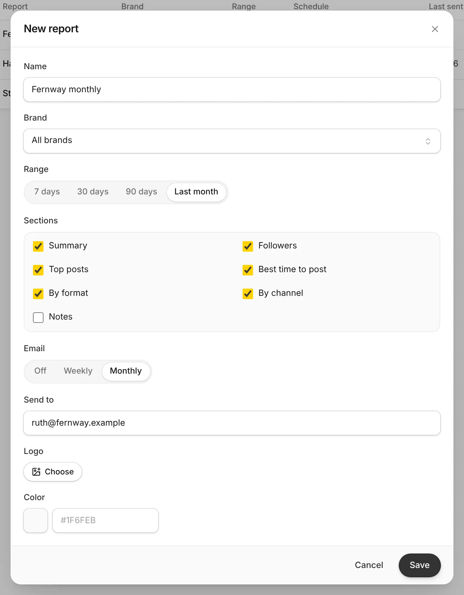
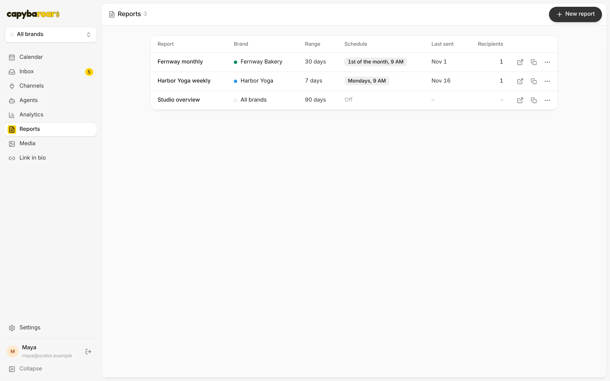
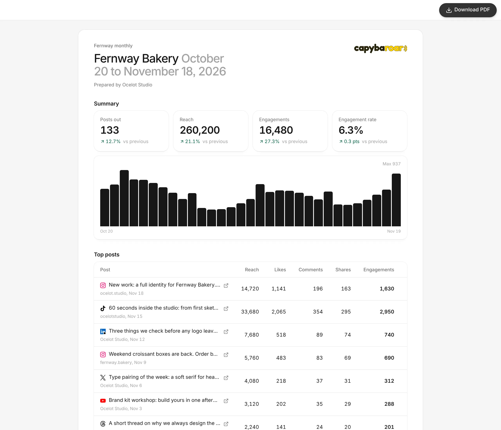

import { Aside, CardGrid, LinkCard, Steps } from '@astrojs/starlight/components';

Set it once, and every client gets last month's results by email on the 1st, at 9 AM in your workspace's time zone.

**Goal:** an automatic monthly results email for each client.

**You need:** Pro or Agency (or the trial), and the client as a brand. Agency adds your logo and color.

**Time:** 5 minutes per client.

<Steps>

1. **Make the report**

   Open **Reports** and press **New report**. Fill in:
   - **Name**, like "Fernway monthly".
   - **Brand**: the client.
   - **Range**: **Last month**.
   - **Sections**: keep the six that start ticked. Tick **Notes** to add a few lines of your own.
   - **Email**: **Monthly**, and the client's address in **Send to**.
   - On Agency, your **Logo** and **Color**.

   Press **Save**.

   

1. **Check the list**

   The report shows in the table with **1st of the month, 9 AM** under **Schedule** and its recipients. **Copy link** gives you the live link. Press **Send now** in its menu to send the first one today.

   

1. **See what the client gets**

   Press **Open**. The report shows the brand, the period, the summary with changes against the month before, followers, top posts, best times and formats, and your notes. **Download PDF** saves a print-ready copy. The link always shows today's numbers.

   

</Steps>

## Tips

- Write the **Notes** before the 1st each month: what worked, and what's next. Clients read the notes first.
- Make a weekly report too, with **Range** set to **7 days** and **Email** to **Weekly**. It goes out on Mondays at 9 AM.
- Send to up to 20 addresses per report.

<Aside type="note">
Report emails need email to be set up on Capybaroar's side. If it isn't, saving still works, and **Send now** says `Email isn't set up on this server`. Share the link meanwhile.
</Aside>

## Related

<CardGrid>
  <LinkCard title="Reports" href="/results/reports/" />
  <LinkCard title="Analytics" href="/results/analytics/" />
</CardGrid>
