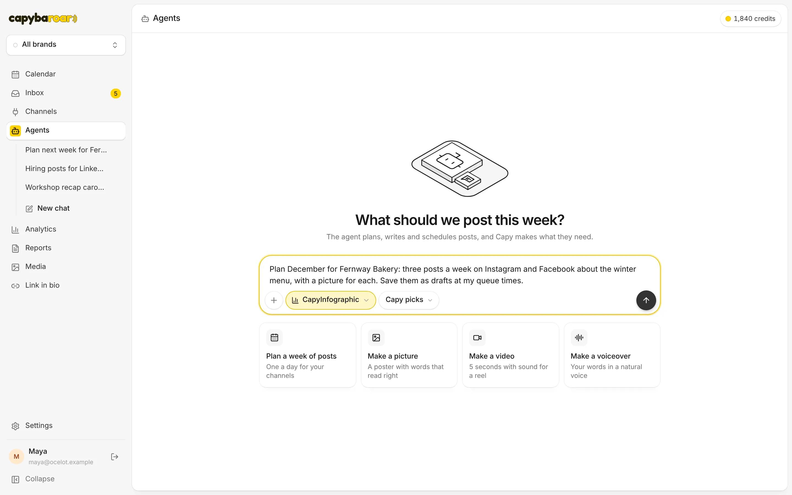
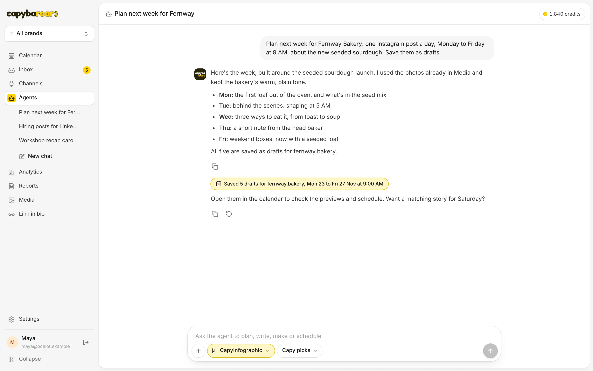
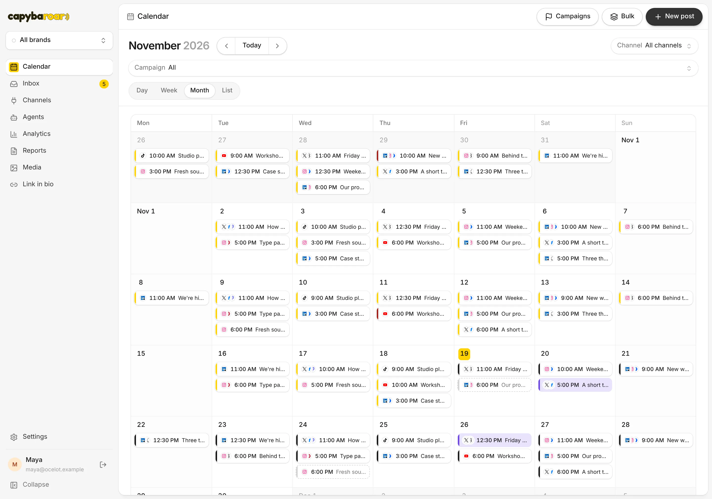
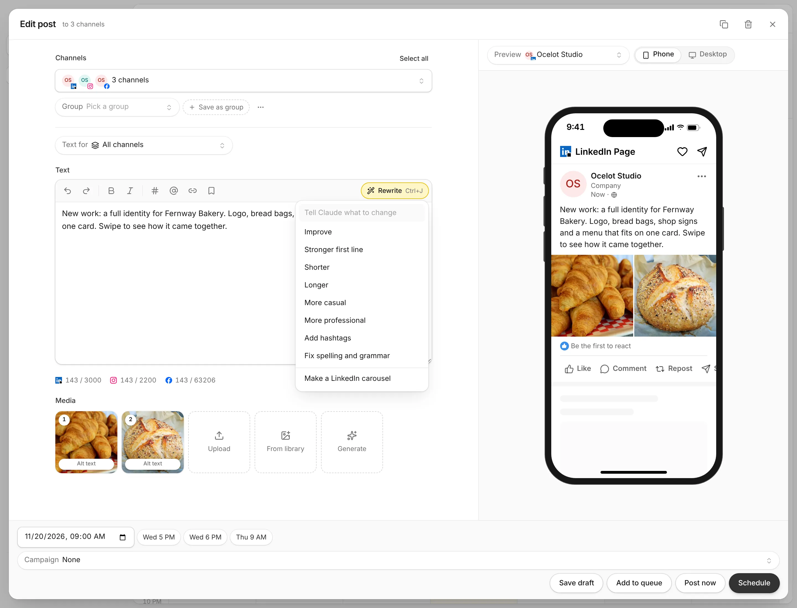
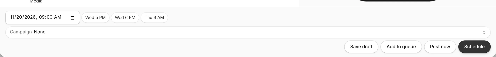

import { Aside, CardGrid, LinkCard, Steps } from '@astrojs/starlight/components';

Let the agent write a month of posts for one brand, with a picture for each, then check and schedule them yourself. Nothing goes out until you say so.

**Goal:** a month of reviewed, scheduled posts for one brand.

**You need:** a paid plan (the agent uses AI credits), the brand's channels connected, and queue times in **Settings**, **Queue**. A filled-in [brand kit](/workspace/brands/#the-brand-kit) makes the writing sound like the brand.

**Time:** about 30 minutes. **Cost:** what the agent uses for its messages, plus each picture: 14 credits for an infographic, from 6 for a photo. Check the credits shown at the top of the agent first.

<Steps>

1. **Ask for the month**

   Pick the brand in the sidebar's brand menu, open **Agents** and press **New chat**. Say what you want, in one message: the brand, the channels, how often, the topic, and that you want drafts at your queue times. Leave **Make** on **CapyInfographic** for graphics with words, or switch it to **Auto**.

   

   A good message: "Plan December for Fernway Bakery: three posts a week on Instagram and Facebook about the winter menu, with a picture for each. Save them as drafts at my queue times."

1. **Read what the agent did**

   The agent lists your channels, finds your next queue times, writes the posts and makes the pictures. Each change shows as a short line, like **Saved 12 posts** or **Will attach when done** for a picture still being made. It ends with a summary of what's on the calendar.

   

   Ask for changes in the same chat: "Make the Friday posts shorter" or "Move the launch post to December 1."

1. **Check the month on the calendar**

   Open **Calendar** and pick **Month**. The drafts show gray, each with its channels. Use **Channel** to look at one network at a time.

   

1. **Polish each draft**

   Click a draft to open it. Check the preview for each channel with the **Preview** menu. Fix wording by hand, or press **Rewrite** (⌘J) for **Shorter**, **Stronger first line** or **Fit to this network**. Use **Text for** to give one channel its own text.

   

1. **Schedule it**

   The time is already set to a queue time. Press **Schedule** (⌘Enter). Repeat for each draft. In a brand that needs approval, an editor's posts go to review instead.

   

</Steps>

## Tips

- Put the posts in a campaign, like "Winter menu", so you can see their results together. Ask the agent to "put them in a new campaign called Winter menu".
- Videos take a few minutes. The agent attaches each one to its draft when it's ready.
- On Free, the agent isn't available. You can still plan with [bulk upload](/recipes/bulk-upload-from-csv/).

<Aside type="note">
The agent never schedules or posts unless you clearly ask it to, and it asks before anything that can't be undone.
</Aside>

## Related

<CardGrid>
  <LinkCard title="The AI agent" href="/ai/agent/" />
  <LinkCard title="Plan a week of posts" href="/ai/plan-a-week/" />
  <LinkCard title="AI credits" href="/ai/ai-credits/" />
</CardGrid>
