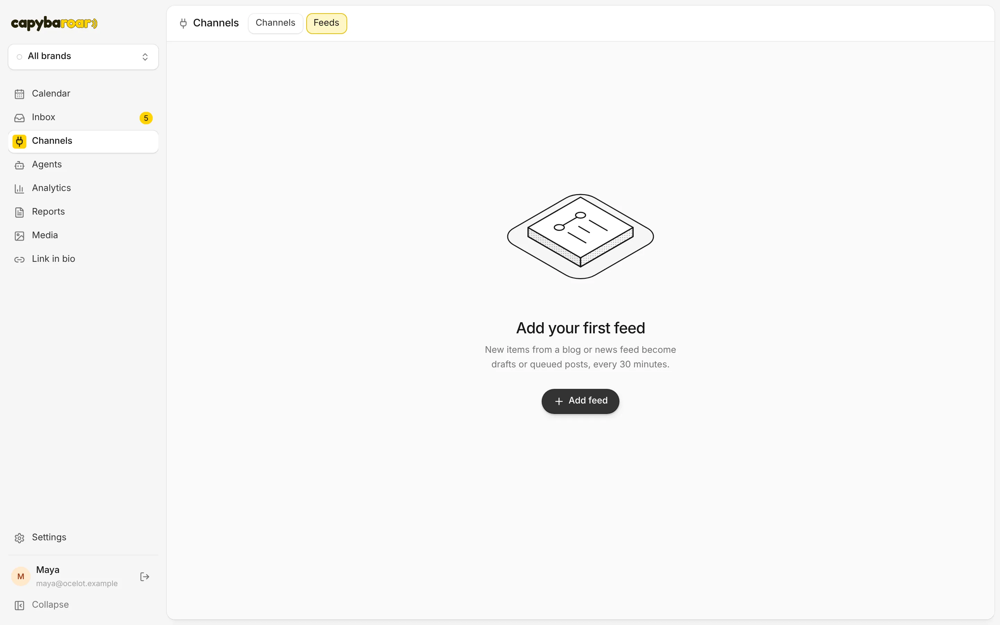
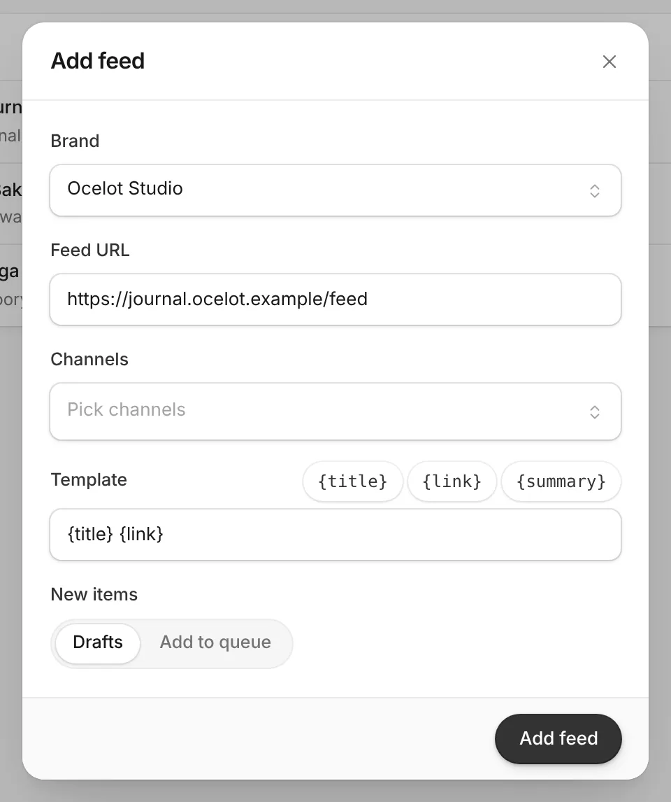
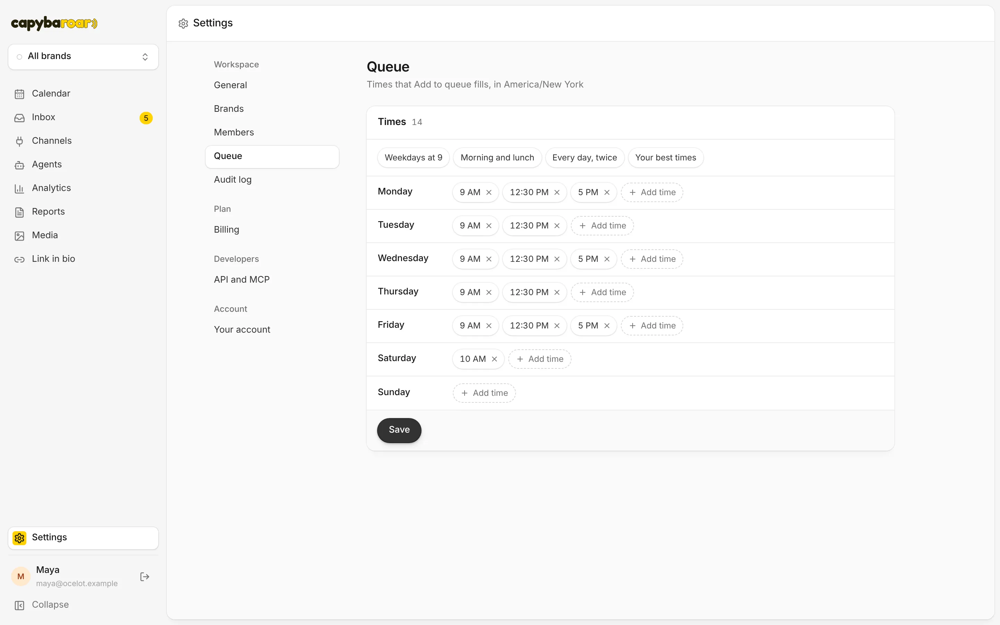
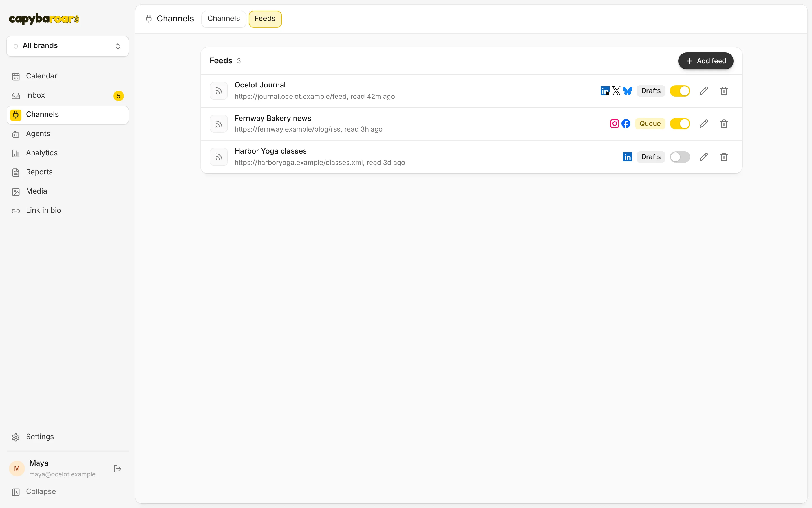

import { Aside, CardGrid, LinkCard, Steps } from '@astrojs/starlight/components';

Write on your blog, and let Capybaroar share each new article on your channels. It reads the feed every 30 minutes.

**Goal:** new blog articles become posts with no extra work.

**You need:** your blog's RSS or Atom feed address, and channels that post text: LinkedIn, Facebook, X, Threads, Bluesky, Mastodon, Discord, Telegram or WordPress. Any plan.

**Time:** 5 minutes.

<Steps>

1. **Open Feeds**

   Click **Channels**, then the **Feeds** tab. The first time, it says **Add your first feed**. Press **Add feed**.

   

1. **Add the feed**

   Pick the **Brand**, paste the **Feed URL**, and pick the **Channels**. Write the **Template** with `{title}`, `{link}` and `{summary}`, like `New on the journal: {title} {link}`. Pick **Drafts** under **New items** for the first week. Press **Add feed**.

   

   Capybaroar reads the feed once and turns its newest article into a post right away, so you can see what the template makes.

1. **Set your queue times**

   If you'll switch to **Add to queue** later, check your times in **Settings**, **Queue**. Queued feed posts take the next free time.

   

1. **Check, then let it run**

   Open the first drafts on the calendar and check the text and link. When you're happy, press **Edit** on the feed, switch **New items** to **Add to queue**, and press **Save**. The feed list shows when each feed was last read and any error.

   

</Steps>

## How it behaves

- Each read posts up to 3 new articles, oldest first.
- Links become short links that count clicks.
- Long titles and summaries are cut to fit the shortest channel's limit.
- Turn the **Active** switch off to pause it. Articles from the pause post on the next read, up to 3 at a time.

<Aside type="note">
Instagram, TikTok, YouTube and Pinterest need a picture or video, so they can't take feed posts.
</Aside>

## Related

<CardGrid>
  <LinkCard title="RSS feeds" href="/publishing/rss-feeds/" />
  <LinkCard title="Errors with feeds" href="/errors/automation/#rss-feeds" />
</CardGrid>
