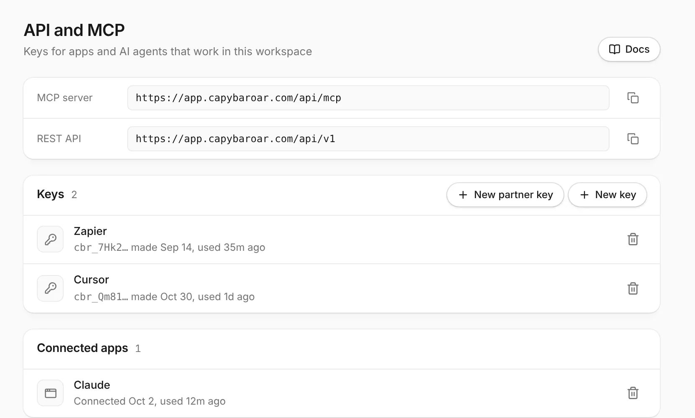
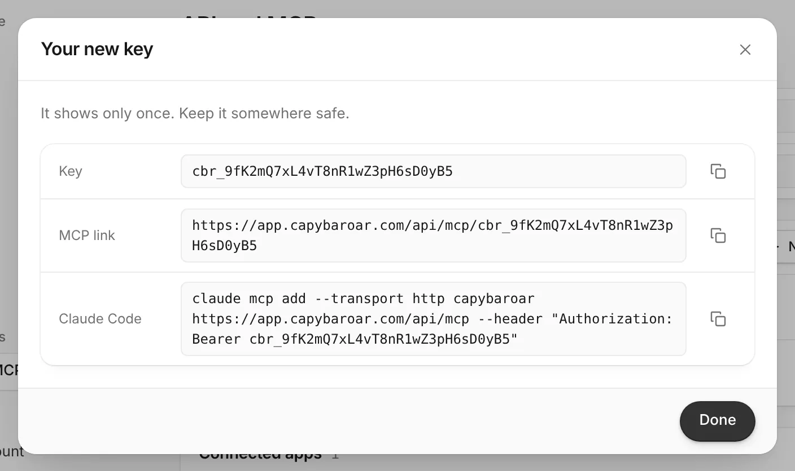
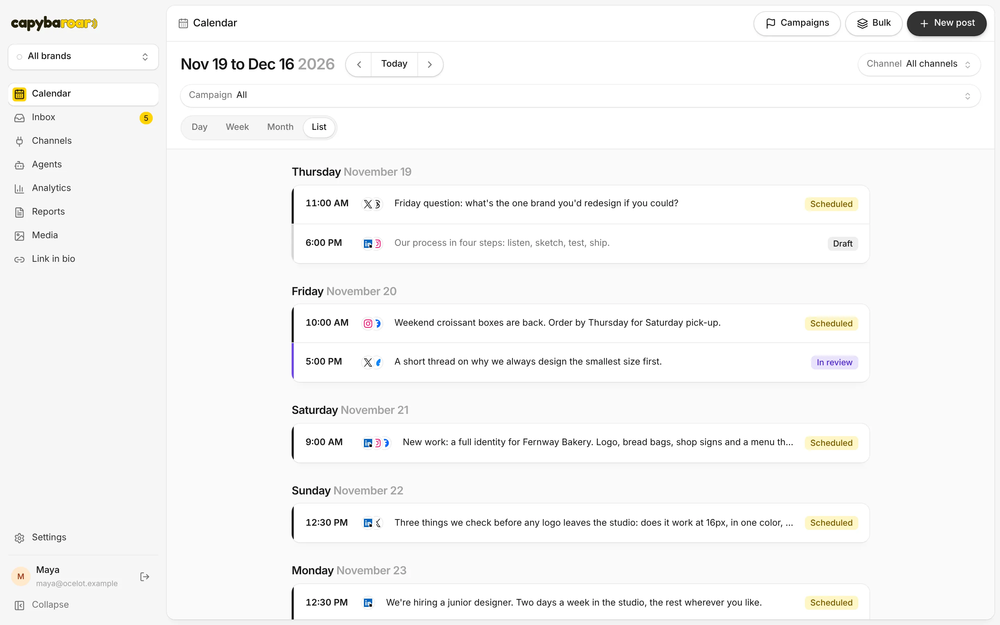
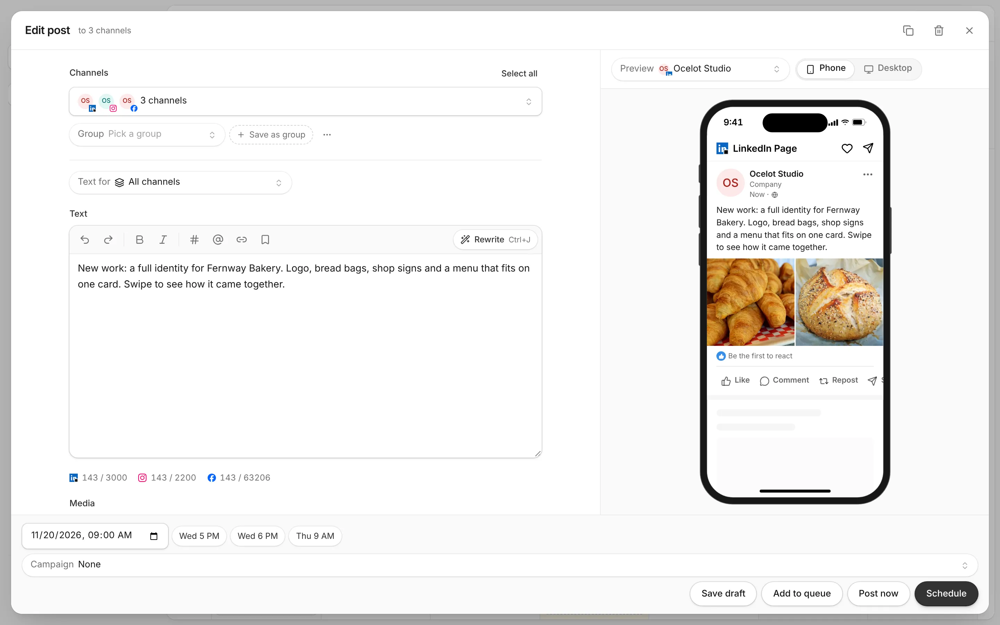

import { Aside, CardGrid, LinkCard, Steps } from '@astrojs/starlight/components';

Work with Claude the way you already do, and let it put the posts straight into your Capybaroar calendar. Claude uses Capybaroar's MCP server, with the same checks as the app.

**Goal:** posts written in Claude, saved as drafts in Capybaroar, and scheduled after you check them.

**You need:** a Capybaroar account on any plan, Free too, and Claude (claude.ai, the desktop app or Claude Code). Owners and admins make keys.

**Time:** 5 minutes to connect.

<Steps>

1. **Find the MCP server address**

   In Capybaroar, open **Settings**, **API and MCP**. Copy the **MCP server** address: `https://app.capybaroar.com/api/mcp`.

   

1. **Connect Claude**

   - **Claude (claude.ai or the app):** open **Settings**, **Connectors**, press **Add custom connector**, name it Capybaroar and paste the address. Press **Connect**, sign in to Capybaroar, pick the workspace and press **Allow**. No key needed.
   - **Claude Code:** press **New key** in Capybaroar, name it "Claude", press **Make key** and copy the **Claude Code** command from **Your new key**. Run it in your terminal.

   

   Claude now shows under **Connected apps** (or your key under **Keys**).

1. **Ask Claude for posts**

   Start a new chat and say what you want, for example: "Use Capybaroar. Look at my channels and last month's results, then write five LinkedIn posts about our winter menu. Save them as drafts at my next queue times." Claude calls `list_channels`, `get_analytics`, `next_queue_slot` and `create_posts`, and tells you what it saved.

   

1. **Check and schedule in Capybaroar**

   Open each draft from the calendar, check the preview and press **Schedule**. Or tell Claude "schedule them", and it changes them with `update_post`.

   

</Steps>

## Good prompts

- "Use Capybaroar. List everything scheduled for next week, and flag any day with nothing on it."
- "Turn this article into a 4-post thread for Bluesky and X, saved as a draft: [paste]."
- "Which of my posts did best in the last 30 days, and what time should I post next week?"

## What Claude can and can't do

- It saves drafts unless you clearly ask to schedule. Capybaroar's server tells it so.
- It asks before deleting a post or posting right away.
- It works as you, with your role and brands, and your plan's limits apply.
- The Claude directory connector doesn't make AI pictures or videos. Connect with a key's **MCP link** from Claude Code or another app to use them.

<Aside type="caution">
A key, and an MCP link with a key in it, can post as you. Keep them private, and delete a key in **Settings**, **API and MCP** if it leaks.
</Aside>

## Related

<CardGrid>
  <LinkCard title="Use Capybaroar from Claude, ChatGPT or Cursor" href="/ai/mcp/" />
  <LinkCard title="MCP tools" href="/api-reference/mcp-tools/" />
</CardGrid>
