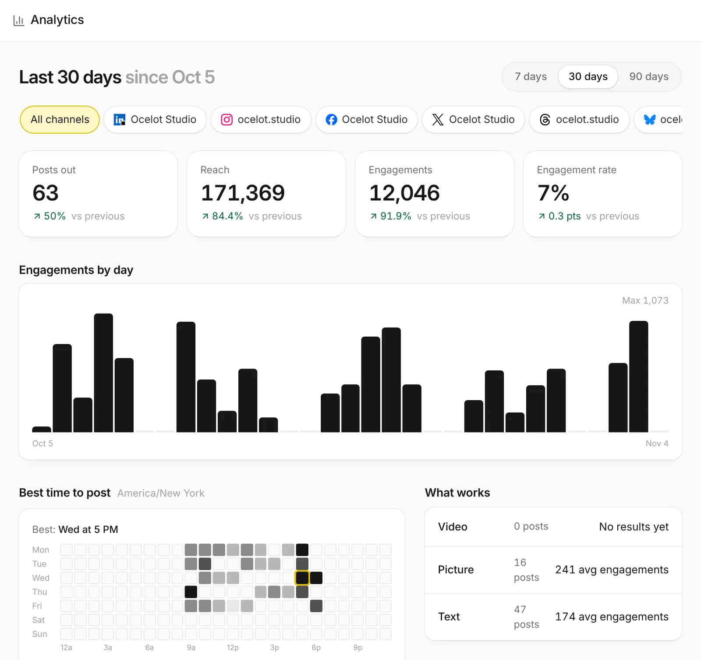

import { CardGrid, LinkCard, LinkButton } from '@astrojs/starlight/components';

Capybaroar collects each post's numbers from its networks and shows them in three places.

<LinkButton href="https://app.capybaroar.com/analytics" variant="secondary" icon="external">Open in Capybaroar</LinkButton>

| Where | For | What it shows |
| - | - | - |
| **Analytics** | Your team | Posts, reach, engagements and rate for 7, 30 or 90 days, against the period before; engagements by day; best times; formats; top posts; channels and followers |
| **A post that went out** | Checking one post | Each channel's numbers, with links to the post |
| **Reports** (Pro and Agency) | Clients and bosses | A brand's results as a live link, a PDF and weekly or monthly emails, with your logo on Agency |

Numbers are read 1 hour, 1 day, 7 days and 30 days after a post goes out, and follower counts once a day. TikTok, Discord, Telegram and WordPress don't send post numbers back yet.

<CardGrid>
  <LinkCard title="Analytics" href="/results/analytics/" description="Every card, chart and table on the Analytics screen" />
  <LinkCard title="Reports" href="/results/reports/" description="Sections, share links, PDFs, emails and white-label" />
  <LinkCard title="Edit and delete posts that went out" href="/publishing/edit-and-delete/" description="One post's numbers on each channel" />
  <LinkCard title="GET /analytics" href="/api-reference/analytics/" description="The same numbers from the API" />
</CardGrid>
