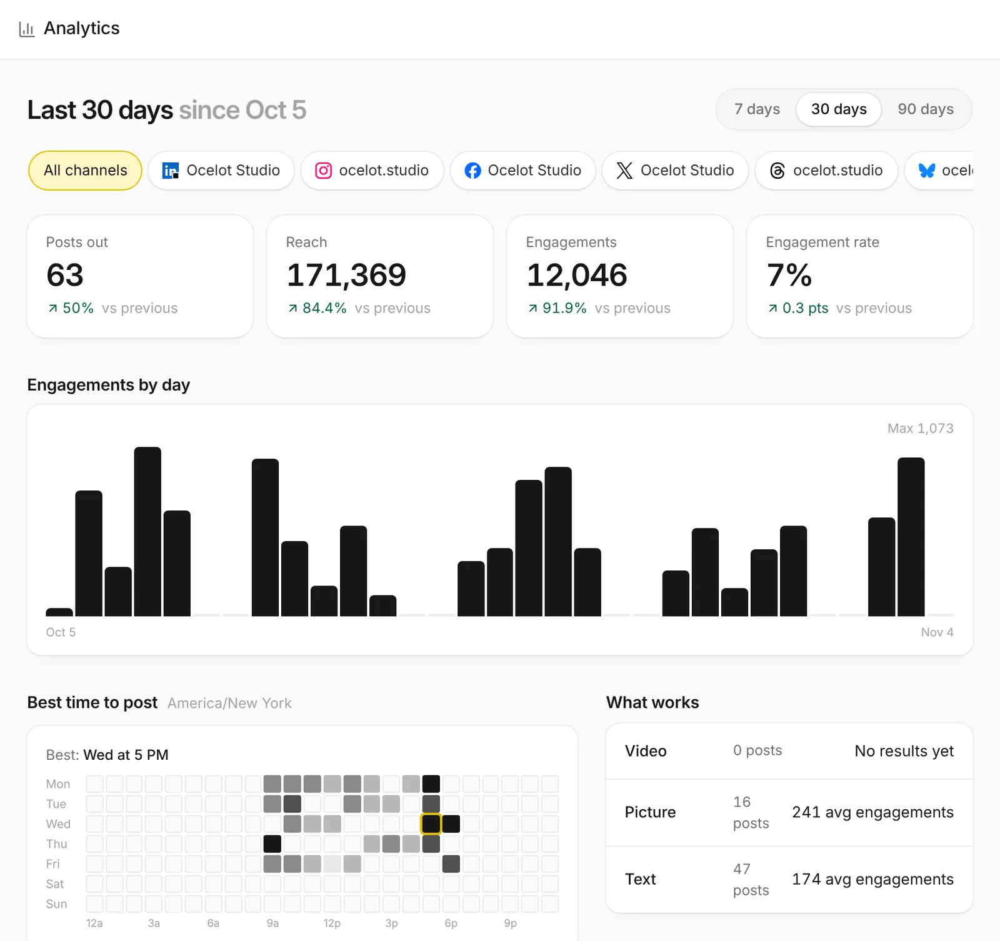

import { Aside, CardGrid, LinkCard, LinkButton } from '@astrojs/starlight/components';

**Analytics** shows how your posts did across every channel: how many went out, how many people they reached, how they engaged, and when your audience is most active. It's on every plan.

<LinkButton href="https://app.capybaroar.com/analytics" variant="secondary" icon="external">Open in Capybaroar</LinkButton>

## Who can see it

Owners, admins and editors. Editors see their brands' channels only. The brand menu in the sidebar limits it to one brand, or **All brands**.

With no channels yet, Analytics says **See how your posts do** with **Connect a channel**.

## Pick the period and channel

- The title says **Last 30 days**, with the day the period started.
- **Period** picks **7 days**, **30 days** or **90 days**.
- **Channel** picks **All channels** or one channel.

Every part below follows these two choices, and each compares with the same length of time just before.

## The numbers at the top

| Card | What it counts |
| - | - |
| **Posts out** | Posts that went out in the period. A post to three channels counts three times. |
| **Reach** | People reached, added up. Where a network gives no reach, its views or impressions count instead. |
| **Engagements** | Likes, comments, shares, saves and clicks added up |
| **Engagement rate** | Engagements divided by reach, for the posts that have reach |

Under each number, the change from the period before shows as a percent. Cards say **None yet** until results come in.

## Engagements by day

One bar for each day in the period, with how many posts went out that day. Point at a bar to see its numbers.

## Best time to post

A grid of the week by hour, in the workspace's time zone, shaded by how well posts at that hour did. It fills in as your posts get results. Once 10 posts have results, the editor's best time chips and the **Your best times** queue preset use these hours.

## What works

Average engagements for **video**, **picture** and **text** posts, so you can see which kind your audience likes.

## Top posts

The posts with the most engagements:

| Column | What it shows |
| - | - |
| **Post** | Its channel, text and when it went out, with **Open post** to see it on the network. A post deleted on the network shows **Deleted**. |
| **Reach**, **Likes**, **Comments**, **Shares** | As the network reports them |
| **Engagements** | All of them added up |
| **Rate** | Engagements divided by reach |

## Channels

| Column | What it shows |
| - | - |
| **Channel** | The account |
| **Followers** | Its follower count now |
| **Change** | Followers gained or lost in the period |
| **Posts**, **Reach**, **Engagements**, **Rate** | For this channel |
| **Trend** | A small line of followers over the period |

## When numbers show up

Capybaroar asks each network for a post's numbers 1 hour, 1 day, 7 days and 30 days after it goes out. Follower counts are saved once a day. So a post from this morning may show only some numbers, and a month-old post shows its final count.

| Network | Post numbers |
| - | - |
| Instagram | Reach, views, likes, comments, shares, saves |
| Facebook | Reach, views (video), reactions, comments, shares, clicks |
| Threads | Views, likes, replies, shares |
| LinkedIn | Likes, comments. Pages also get impressions, reach, clicks, shares. |
| YouTube | Views, likes, comments |
| X | Impressions, likes, replies, shares, bookmarks, clicks |
| Pinterest | Impressions, saves, clicks, video views |
| Bluesky | Likes, replies, shares |
| Mastodon | Favourites, replies, boosts |
| TikTok, Discord, Telegram, WordPress | None yet |

## One post's numbers

Open a post that went out from the calendar to see its numbers on each channel. See [Edit and delete posts that went out](/publishing/edit-and-delete/).

<Aside type="tip">
Short links count clicks too. Use **Shorten links** in the post editor, and clicks show up even on networks that don't report them.
</Aside>

## Get the numbers elsewhere

- Share them with a client as a [report](/results/reports/), with a link, a PDF and emails.
- Read them from code with [`GET /analytics`](/api-reference/analytics/), or ask your AI app through MCP.

## Related

<CardGrid>
  <LinkCard title="Reports" href="/results/reports/" />
  <LinkCard title="The posting queue" href="/publishing/posting-queue/" />
  <LinkCard title="Compare every network" href="/channels/" />
</CardGrid>
