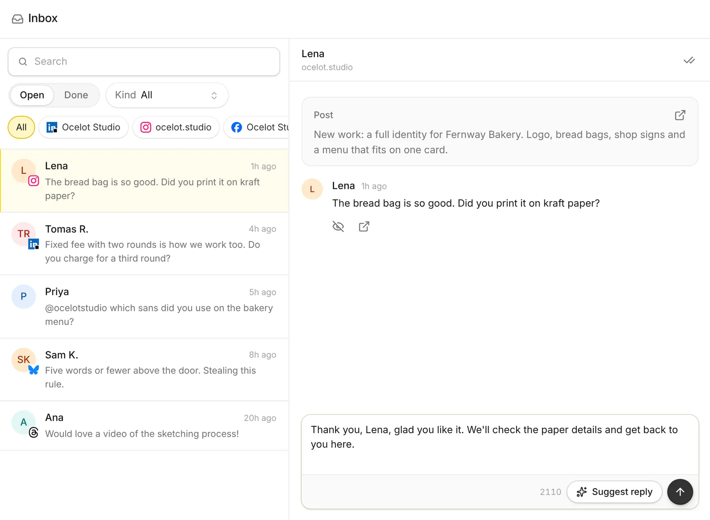
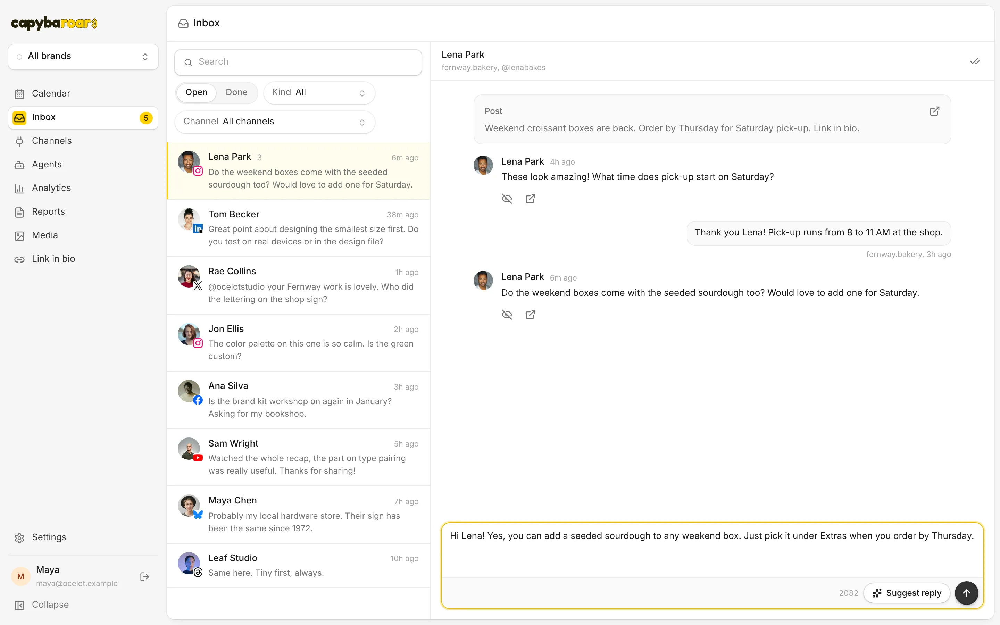
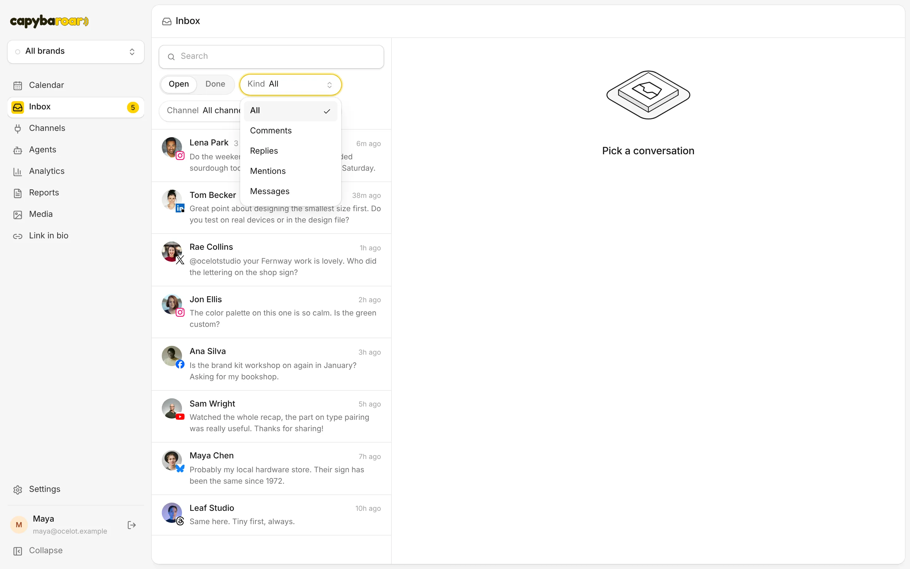

import { Aside, CardGrid, LinkCard, LinkButton, Steps } from '@astrojs/starlight/components';

The Inbox brings the comments and mentions from your channels into one list. Answer them without switching apps, and mark each one done when you're finished.

<LinkButton href="https://app.capybaroar.com/inbox" variant="secondary" icon="external">Open in Capybaroar</LinkButton>

## Answer a comment

<Steps>

1. **Open Inbox.** Click **Inbox** in the sidebar. The number next to it is how many conversations are open.

1. **Pick a conversation.** The list shows the newest first. Click one to see the whole thread and the post it's on.

1. **Write your answer.** Type in the box at the bottom, or press **Suggest reply** to get a draft from AI. Edit it, then press **Send**.

   

1. **Mark it done.** Press **Mark done** at the top of the thread. It leaves the **Open** list and the next one opens.

</Steps>

## Filter the list

- **Open** and **Done** switch between conversations that need you and the ones you finished. **Open again** brings one back.
- **Kind** shows only **Comments**, **Replies**, **Mentions** or **Messages**.
- **Channel** shows one channel's conversations, when you have more than one.
- **Search** finds a conversation by its words.

If a channel needs to be reconnected, the Inbox says so above the list. Click the line to open Channels.

## What you can do on each network

| Network | In the Inbox |
| - | - |
| [Instagram](/channels/instagram/) | Answer and hide |
| [Facebook](/channels/facebook/) | Answer, like and hide |
| [LinkedIn Pages](/channels/linkedin/) | Answer and like |
| [YouTube](/channels/youtube/) | Answer and hide. YouTube doesn't let a hidden comment be shown again. |
| [X](/channels/x/) | Answer, like and hide |
| [Threads](/channels/threads/) | Answer and hide |
| [Bluesky](/channels/bluesky/) | Answer and like |
| [Mastodon](/channels/mastodon/) | Answer and like |

TikTok, Pinterest, Discord, Telegram, WordPress and LinkedIn profiles aren't in the Inbox.

## Keyboard shortcuts

| Key | What it does |
| - | - |
| `j` and `k` | Move down and up the list |
| `r` | Jump to the reply box |
| `e` | Mark done, or open again |

<Aside type="note">
Suggested replies use 4 [AI credits](/ai/ai-credits/) each and need a plan with AI. Answering by hand is free on every plan.
</Aside>

## Related

<CardGrid>
  <LinkCard title="Rewrite and fit posts with AI" href="/ai/rewrite-with-ai/" />
  <LinkCard title="Analytics and reports" href="/results/analytics-and-reports/" />
</CardGrid>
